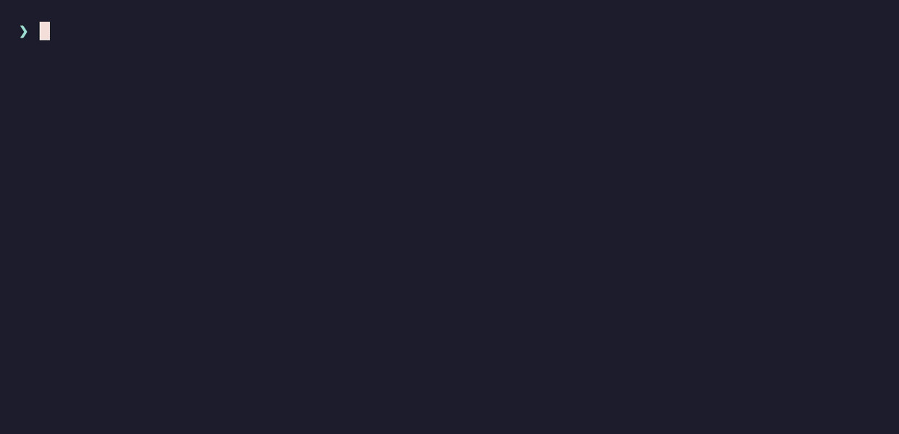
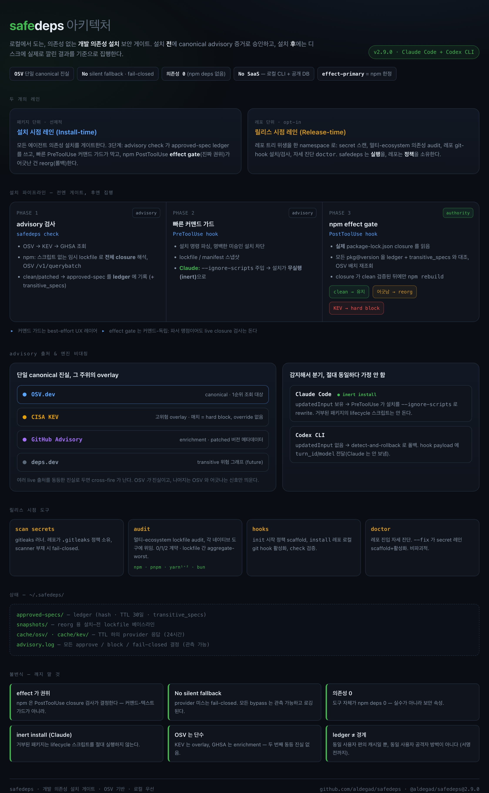

# safedeps

> **AI 코딩 에이전트가 취약하거나 승인되지 않은 의존성을 설치하지 못하게 하고, 새어 들어온 항목은 되돌리게 합니다.**
>
> `safedeps`는 Claude Code 또는 Codex CLI 에이전트가 실행하는 모든 의존성 설치를 게이팅합니다. OSV / CISA KEV / GitHub Advisory를 기준으로 패키지를 사전 승인하고, 실제 lockfile에 반영된 폐쇄성을 다시 검증하며, 일치하지 않는 항목은 자동으로 롤백합니다. 로컬 전용이며 런타임 의존성은 없습니다. *(한국어 README → [README.ko.md](./README.ko.md))*

- **사전 승인** — 각 `pkg@version`와 npm의 전체 전이적 폐쇄성을 OSV(표준), CISA KEV, GitHub Advisory에 대해 설치 전 승인 여부를 확인합니다.
- **실제 효과 적용 강제** — 설치 후 실제 `package-lock.json` 폐쇄성을 다시 검증하여, 래핑되거나 난독화된 명령이 게이트를 통과하지 못하게 합니다.
- **롤백** — 승인되지 않았거나 새로 취약해진 항목은 마지막으로 확정된 안전 스냅샷으로 되돌립니다. 확정 스냅샷이 아직 없는 프로젝트는 명령 전 상태로 되돌리고, 메시지가 어느 쪽인지 말합니다. Claude Code에서는 safedeps 가 npm 설치마다 `--ignore-scripts` 를 붙여, 거부된 패키지의 라이프사이클 스크립트가 설치 중에 돌지 않게 합니다. 이것은 설계이지 약속이 아닙니다. npm 이 그 플래그를 지키는지는 명령에 보이지 않는 셸 상태가 정하므로, safedeps 는 플래그를 붙였다는 것만 보고합니다.

> **실제로 잡은 사례.** pre-commit 감사가 Dependabot이 놓친 취약한 전이적 `hono` 어드바이저리를 잡았습니다 — 커밋 시점에 어드바이저리 DB를 다시 조회해서. 패키지를 설치한 *뒤에* 공개된 CVE("그땐 안전해 보였는데 지금 발견됨")가 몇 주 뒤가 아니라 바로 다음 커밋에 드러납니다.

## Quickstart

```bash
# 1. CLI 설치 — npm 패키지는 스코프가 적용되므로 @aldegad/ 접두사를 사용합니다.
npm install -g @aldegad/safedeps

# 2. Claude Code / Codex에 훅 연결 (멱등성 보장)
cd "$(npm root -g)/@aldegad/safedeps" && node scripts/install/install-safedeps-hooks.mjs

# 3. 완료 — 이제 에이전트가 실행하는 모든 의존성 설치가 게이팅됩니다.
```

> `safedeps`는 CLI 명령어이며, npm 패키지는 **`@aldegad/safedeps`**입니다. npm의 스코프 없는 `safedeps`는 다른 패키지입니다. 정식 소스 트리를 사용하려면 [Installation](#installation)을 참고하세요.

> 훅은 Rust 로 쓴 프로그램 하나, `safedeps-core` 입니다. npm 패키지는 macOS(Apple silicon 과 Intel)와 Linux x64 용으로 빌드한 것을 담고 있고, 설치기가 아무것도 등록하기 전에 그것을 한 번 실행해 봅니다. 체크아웃에서는 cargo 로 직접 빌드합니다. 바이너리가 어디서 오는지, 없거나 소스와 어긋났을 때 무엇이 보이는지는 [Where the hook binary comes from](#where-the-hook-binary-comes-from) 에, v2.19.0 에서 달라진 점은 [What Changed in v2.19.0](#what-changed-in-v2190) 에 있습니다.



## Distribution Model

Safedeps에는 두 가지 배포 채널이 있습니다.

1. **에이전트 스킬 + 훅 (표준)** — 저장소 자체가 스킬 폴더입니다. `SKILL.md`, 훅 엔트리와 그 Rust 코어, provider/ledger 라이브러리, 설치 헬퍼가 하나의 디렉터리에 함께 있습니다. 체크아웃은 코어의 소스를 담고 바이너리를 직접 빌드하며, npm 패키지는 빌드된 바이너리를 담습니다.
2. **npm 패키지 (CLI 편의성)** — `@aldegad/safedeps`가 `safedeps` 명령어를 설치합니다. npm 설치만으로는 Claude Code나 Codex가 스킬을 자동으로 발견하지 않으므로, 사용자는 여전히 훅/스킬 설치자를 실행하거나 스킬 폴더를 수동 등록해야 합니다.

GitHub 릴리스는 정식 스킬/훅 소스 트리를 기준 아티팩트로 사용하려는 경우에 사용합니다. 버전 관리된 전역 CLI가 필요한 경우에는 npm을 사용하세요.

용어 정리: safedeps는 Claude/Codex 훅과 로컬 CLI로 지원되는 에이전트 보안 스킬입니다. 나중에 플러그인 매니페스트로 래핑되지 않는 한 Codex 플러그인 번들은 아닙니다.

## Two Lanes

`safedeps`는 두 가지 보안 레인을 가집니다(전체 설계는 [`ARCHITECTURE.md`](./ARCHITECTURE.md) §1 참조):

- **설치 시점**(이 README의 초점) — advisory 확인 + 승인 사양 ledger + 빠른 PreToolUse 가드 + PostToolUse 효과 강제 + 설치 후 reorg. 설치 명령과 실제 lockfile 영향 범위 기준으로 패키지 단위로 동작.
- **릴리스 시점** — `safedeps gates run`, `safedeps scan secrets [--repo|--worktree|--staged]`, `safedeps audit [npm|pnpm|yarn|bun]`, `safedeps hooks install|check`. 원격 푸시/릴리스 전 repo 트리 시크릿 스캔, 의존성 감사, repo 로컬 git 훅 설치/검사, 그리고 옵트인 원격 리포지토리 posture 검사. 저장소 정책(`gitleaks` 설정, privacy paths)은 대상 repo가 소유하며 safedeps는 로컬 실행을 담당합니다. *(이전 `security-release-gates`를 흡수했습니다.)*

릴리스 시점의 시크릿 유출 영역은 **repo별 opt-in**입니다. `safedeps doctor`가 그 진입점입니다. repo의 `.gitleaks` 정책, `.githooks/pre-commit`, 활성 `core.hooksPath`, 스캐너 가용성(및 전역 설치 시점 게이트 상태)을 진단한 뒤, `safedeps doctor --fix`가 기본 정책을 스캐폴딩(`safedeps hooks init`)하고 활성화(`safedeps hooks install`)합니다. `--fix`를 선택하면 repo 로컬의 pre-commit 설정이 자동으로 적용되며 원격 CI 리소스를 소비하지 않습니다. 스캐폴딩은 비파괴적입니다 — 기존 repo 소유 `.gitleaks.toml`은 덮어쓰지 않습니다 — 그리고 pre-commit 훅은 시크릿 스캔(`safedeps scan secrets --staged`)과, 지원 lockfile이 있는 repo에서 매 커밋마다 의존성 감사(`safedeps audit`, npm/pnpm/yarn/bun 자동 감지)를 실행합니다. 실제 발견은 차단(fail-closed)되며, advisory DB 접근 불가 시에는 경고만 남기고 커밋은 통과시켜(오프라인 폴백) 가시성을 확보합니다. 원격 집행은 두 갈래로 나뉩니다. `main`에 대한 직접 push를 막는 브랜치 규칙은 비용이 들지 않는 no-runner posture로 권장하고, GitHub Actions 워크플로우와 필수 상태 검사는 실행 비용이 드는 명시적 opt-in로 둡니다. 자세한 내용은 [Secret-Leak Lane (per-repo)](#secret-leak-lane-per-repo) 참조.

## How It Works

[](./ARCHITECTURE.md)

`safedeps`는 각 설치를 기준으로 두 단계로 동작합니다.

- **이전 단계** — `safedeps check`가 패키지를 OSV(표준), CISA KEV, GitHub Advisory로 확인한 뒤 로컬 ledger에 승인 기록을 남깁니다. npm의 경우 패키지의 전체 의존성 폐쇄성을 해결해 모든 전이적 패키지도 검사합니다.
- **이후 단계** — PostToolUse 훅이 npm 이 쓰는 lockfile 에서 실제로 설치된 내용을 다시 읽고, ledger에 없는 항목이나 advisory DB에서 새로 위험으로 표시된 항목을 롤백(리오그)합니다.

두 훅 이벤트에 등록되는 커맨드는 작은 엔트리 셔틀 `scripts/safedeps-hook-entry.sh` 에 `pre` 또는 `post` 를 붙인 것입니다. 셔틀은 이 머신의 바이너리 `bin/native/<os>-<arch>/safedeps-core` 를 찾아 실행합니다. 그 바이너리가 훅입니다. 의존성이 없는 Rust 프로그램 하나이고, 이전 버전이 등록하던 Bash 스크립트 둘을 대신합니다. 훅은 심링크를 거쳐 레포 체크아웃을 라이브로 실행하므로, 체크아웃이 일시적으로 깨진 상태(빌드가 덜 된 바이너리, 없는 바이너리, 크래시)에서는 종료코드에 따라 모든 Bash 호출이 오류 한 줄로 막히거나 게이트가 조용히 꺼지곤 했습니다. 셔틀은 그 각각을 설명이 붙은 fail-closed 거부로 바꿉니다. 무엇이 깨졌는지, 어떻게 복구하는지를 말합니다. 머신이 프로세스를 띄우지 못한 순간의 호출도 게이트 없이 통과시키지 않고 거부합니다. Bash 로 되돌아가는 경로는 없고, 환경 변수로 바이너리를 고르거나 끌 수도 없습니다. 상세: [ARCHITECTURE — Phase 0](./ARCHITECTURE.ko.md).

**시간이 다하는 것도 답이지 공백이 아닙니다.** 에이전트 런타임은 훅마다 고정 예산을 주고 그게 지나면 훅을 죽이는데, 그다음 tool call 은 그대로 진행됩니다 — 즉 오래 걸리는 게이트는 그냥 사라집니다. 커맨드를 읽는 비용은 커맨드가 길수록 커지므로, 패딩을 붙이는 것만으로 그 선을 넘길 수 있었습니다. 이제 설치 전 guard 는 더 작은 자기 예산을 갖고, 시간 안에 판정을 못 끝내면 차단하고 그 사실을 말합니다. 메시지가 `UNDECIDED, not unsafe` 로 시작해서 아무도 타임아웃을 적발로 읽지 않게 합니다. 판정은 guard 자신의 프로세스에서 돌므로, 답 없이 끝난 판정(크래시나 시그널)도 같은 방식으로 차단하고 메시지가 어떻게 끝났는지(종료 코드, 시그널, 또는 둘 다 없음)를 말합니다. 끝난 것이 아니라 멈춘 판정 프로세스는 기한까지 기다립니다. 예산과 한참 거리가 먼 짧은 커맨드는 영향이 없습니다.

**읽지 못한 커맨드도 같은 방식으로 다룹니다.** 실패한 읽기는 예전에 아무것도 돌려주지 않았고, 그것이 "설치 아님" 으로 읽혔습니다. 이제 실패한 읽기를 기록하고, 무엇이든 실행을 허용하기 전에 확인합니다. 어느 읽기가 설치를 찾았거나 커맨드의 텍스트가 설치로 읽히면 `UNDECIDED` 로 차단하고, 아니면 실행하되 실패를 stderr 와 `~/.safedeps/advisory.log` 에 남깁니다. 텍스트 판별은 명령을 순서 없는 단어들로 읽고, 설치는 단어로서나 단어 경로의 끝으로서의 패키지 매니저 이름이 그 매니저의 설치 동사 하나 옆에 있는 것입니다. 다른 단어 안에 든 매니저 이름이나, 단어들 가운데 자기 동사가 하나도 없는 매니저나, 다른 매니저의 동사만으로는 부족하지만, 래퍼 뒤에 있거나 따옴표 친 스크립트 안에 있거나 이스케이프로 적혔거나 리다이렉션으로 쪼개진 설치는 여전히 셉니다. 읽기가 실패한 뒤에 적발을 보고할 deny 는 대신 `UNDECIDED` 를 보고합니다. 코어는 커맨드를 셸이 읽는 방식 — 따옴표, 주석, heredoc, 중첩 치환을 한 번에 — 으로 읽으므로, heredoc 이나 아포스트로피가 든 주석이나 여러 줄 문자열이 그 뒤의 설치를 가릴 수 없고, 닫히지 않는 커맨드는 읽지 못한 것으로 다룹니다. 설치 앞의 대입(`FOO="a b" pip install ...`)도 같은 방식으로 읽으므로 그 값이 설치를 가릴 수 없고, `case` 팔이나 중첩 치환 안의 설치도 마찬가지입니다. bash, zsh, dash 가 커맨드를 다르게 읽는 곳에서는 각 셸이 읽는 방식대로 읽고, 셋 중 하나라도 실행할 설치를 모두 판정합니다. `--ignore-scripts` 는 세 셸이 npm 설치의 위치에 동의하는 곳에만 넣고, 아니면 커맨드를 `UNDECIDED` 로 차단합니다.

PreToolUse 명령 훅은 빠른 advisory 안내 장치로서, 명백히 승인되지 않은 설치 및 위험한 명령 형태를 차단해 에이전트에게 즉시 피드백을 제공합니다. 하지만 npm에서는 실제 권한 판단이 설치 후 효과 게이트에 있으며, 실제로 설치된 결과를 기준으로 판단하므로 래핑되거나 난독화된 설치 명령으로 패키지를 우회할 수 없습니다.

**스크립트 안전성(비활성 설치).** Claude Code에서는 PreToolUse 훅이 npm install에 `--ignore-scripts`를 추가합니다. 목표는 **비활성(inert)** 설치입니다. 패키지는 디스크에 기록되고, 라이프사이클 스크립트는 closure 가 검증된 뒤 아래의 rebuild 를 통해서만 돕니다. 이것은 목표이지 약속이 아닙니다. npm 이 플래그를 지키는지는 명령이 도는 셸이 정하므로, safedeps 는 플래그를 더했다는 것만 말합니다. 플래그는 npm 이 참으로 읽는 자리에 붙습니다. npm 은 같은 옵션이 여러 번 오면 마지막 값을 따르므로, 훅은 먼저 그 설치의 마지막 인자 뒤에 플래그를 둡니다. 거기서는 설치에 `--ignore-scripts=false` 나 `--no-ignore-scripts` 가 있어도 스크립트를 다시 켤 수 없습니다. 그다음 플래그를 둔 설치를 npm 이 읽는 방식대로 다시 읽고, 플래그가 참이고 다른 것은 바뀌지 않았을 때만 그 자리를 씁니다. `--cache` 처럼 다음 단어를 값으로 받는 옵션이 마지막 단어이면 플래그가 캐시 디렉터리가 되어 버립니다. 문장이 더 있는 명령에서는 플래그가 그 단어 앞에 갑니다. 한 문장짜리 명령에서는 끝에 둘 플래그의 자리가 없으므로 그 명령은 `UNDECIDED` 입니다(아래). 다시 쓰는 설치는 safedeps 가 설치의 단어를 읽기 전에 하던 재작성도 그대로 담습니다. 한 문장짜리 명령이면 끝에 플래그 하나, 그 밖에는 동사마다 바로 뒤에 하나입니다. 그리고 어느 경우든 동사마다 바로 뒤에 하나를 둡니다. 이것이 바닥입니다. 훅이 더한 플래그 몇 개를 지우면 그 이전의 재작성이 되므로, 훅이 단어를 잘못 읽거나 셸이 단어를 바꿔도 npm 은 적어도 그 재작성이 준 것을 받습니다. 플래그가 들어갈 자리가 늘 있는 것은 아닙니다. 세 가지가 한꺼번에 요구됩니다: 위의 바닥, 쓴 그대로의 명령 인자와 데이터, 그리고 npm 이 옵션으로 읽는 플래그입니다. 셋을 다 줄 수 없는 명령이 있습니다. `npm install left-pad@1.3.0 --cache` 가 그렇습니다. 끝의 플래그가 `--cache` 의 값이 되어 버립니다. `npm install true` 도 그렇습니다. 동사 뒤의 플래그가 `true` 를 자기 값으로 가져갑니다. 셋째는 다른 명령이 읽는 heredoc 본문 안의 설치 단어입니다. 거기에 플래그를 쓰면 그 명령이 출력하는 내용이 바뀝니다. 이런 명령에서 훅은 의무들 사이에서 고르지 않고, 바닥도 버리지 않습니다. 재작성을 보내지 않고 명령을 `UNDECIDED` 로 차단하며, `advisory.log` 가 이유를 이름으로 적습니다. 그 비용과 그런 명령을 쓰는 법은 [What Changed in v2.19.0](#what-changed-in-v2190) 에 있습니다. Codex CLI 에서는 재작성을 보내지 않으므로 거기서는 플래그를 놓을 일이 없습니다. `sh -c`, `bash -c`, `zsh -c`, `dash -c`, `ksh -c`, `eval` 에 넘기는 스크립트는 스크립트로 읽고, 그 안의 설치는 플래그가 들어갈 자리가 있으면 스크립트 안에서 플래그를 받습니다. 여전히 기록만 하는 텍스트는 이미 플래그를 가진 설치 옆에서 출력을 파이프로 넘기는 셸에 먹이는 heredoc(`sh <<E | tee log`) 하나입니다. 명령이 기록되는지는 그 텍스트가 어디로 가는지에 기대지 않습니다. 훅은 읽지 않은 것의 목록이 아니라 읽은 것의 목록을 가집니다. npm 설치 동사는 그 `npm` 이 훅이 읽은 텍스트의 명령 단어일 때만 읽은 것으로 칩니다. 문장의 처음이나 훅이 읽은 스크립트의 처음에 있는 `npm ci` 가 그 예입니다. 훅은 그런 `npm` 을 모두 명령에서 빼고 따옴표와 백슬래시를 지웁니다. 또 명령을 셸 자신의 따옴표 제거로 한 단계씩, 세 단계까지 읽습니다. 넘겨받은 스크립트가 윗단계가 남긴 텍스트를 읽는 것과 같고, `$'...'` 문자열은 그 자리에서 풀어 읽습니다. 그중 어디든 npm 설치 동사가 남아 있으면, 훅이 명령으로 읽지 않은 텍스트가 그것을 담고 있다고 `advisory.log` 에 기록됩니다. 여기서 설치 동사는 설치 검사가 읽는 그 동사입니다. `npm` 과 동사 사이에 옵션이 올 수 있고, 그 값은 비어 있거나 여러 단어일 수 있습니다. `npm` 앞에는 아무것도 없어도 됩니다. `env -S'npm ci'` 처럼 옵션에 명령을 붙여 받는 프로그램이 있기 때문입니다. 셸이 만드는 단어는 명령의 어느 글자도 쓰지 않은 채 `npm` 이나 그 명령이 될 수 있으므로, 셸에 넘기는 here-string 이나 heredoc 본문을 포함해 텍스트가 어디로 가든 같은 방식으로 기록됩니다. 셸이 만드는 명령 단어(`$(echo npm) ci`, `{npm,ci}`), npm 이 자기 명령으로 읽는 단어를 셸이 만들 때(`npm $V x`, `npm "$@"`), 그리고 치환 안의 `npm`(`hash -p "$(command -v npm)" n`)이 그렇습니다. 단어를 셸이 만드는지는 아래에서 설치 자신의 단어에 쓰는 것과 같은 검사로 정합니다. 훅이 다른 설치에 플래그를 넣었으면 아무도 플래그를 읽지 못했다고 기록됩니다. 아무 데도 넣지 못했으면, 이미 플래그를 가진 설치가 옆에 있어도 downgrade 가 기록됩니다. 대가는 소음입니다. 설치 옆에서 데이터일 뿐인 설치 텍스트, 곧 `echo`, 커밋 메시지, 파일에 쓰는 heredoc 안의 텍스트도 기록되고, 설치 옆의 `pnpm i` 와 `$(npm root -g)` 도 기록됩니다. 주석은 기록되지 않습니다. 기록 밖에 남는 것이 셋 있습니다. `printf '\156pm ci' | sh` 나 `base64 -d | sh` 처럼 명령이 실행되는 동안 다른 프로그램이 만드는 텍스트는 명령 안에서 설치를 쓰지 않으므로, 그것은 effect gate 가 확인합니다. alias 가 npm 에 묶은 이름은 `npm` 을 쓰지 않은 문장에서 npm 을 돌립니다. bash 는 스크립트에서 `shopt -s expand_aliases` 뒤에만 alias 를 씁니다. 그리고 설치 검사가 아예 npm 설치로 보지 않는 명령은 여기서 다시 쓰이지도, 기록되지도 않습니다. 셸이 명령을 실행할 때 바꾸는 단어는 무엇이든 될 수 있습니다. 훅은 셸이 펼치는 것을 나열하지 않습니다. 셸이 건드리지 않는 것을 나열합니다. 따옴표 밖의 모든 글자가 영문자, 숫자, `. _ / @ : + , = % -` 중 하나이고 단어가 `~` 나 `=` 로 시작하지 않을 때만, 그 단어를 쓴 그대로로 칩니다. 틸드, 중괄호, `$`, glob, 괄호처럼 그 밖의 글자가 있으면 셸이 실행 때 정할 수 있는 단어입니다. 큰따옴표 안의 `$` 도 셉니다. 거기서도 펼쳐지기 때문입니다. 그런 단어가 있는 설치는 미리 읽을 수 없습니다. 그 설치는 두 플래그를 그대로 두고, npm 이 어느 쪽을 따를지 아무도 읽지 못했다는 사실을 `advisory.log` 에 기록합니다. PostToolUse 훅은 설치가 스크립트를 돌리지 않았다고 말하는 일이 없습니다. 그런 설치에는 safedeps 가 자기가 쓴 명령을 셸이 읽을 방식대로 다 읽지 못했다는 말을 더합니다. `--ignore-scripts=false` 처럼 스크립트를 요청한 설치도 거기에 기록되고, 그 스크립트는 아래의 rebuild 를 통해서만 돕니다. 훅이 설치를 그대로 두는 것은 그 설치 자신의 인자가 이미 플래그를 참으로 두고 이전 재작성도 그대로 두었을 때뿐이고, 인자는 npm 이 인자를 읽는 방식으로 읽습니다. `echo` 나 다른 문장에 있는 같은 글자는 세지 않습니다. 훅은 각 설치의 인자를 셸이 이어 붙이는 방식대로 읽습니다. 그래서 따옴표 안에서 플래그처럼 보이는 줄은 옵션 값의 일부입니다. 동사 앞에 `--` 가 있는 설치는 npm 이 플래그를 옵션으로 읽을 자리가 없으므로 그 명령은 `UNDECIDED` 입니다(`npm -- ci -- x`). 이후 효과 게이트가 폐쇄성을 검증하고 통과 시에만 PostToolUse 훅이 `npm rebuild`를 실행해 검증된 스크립트를 실행합니다. 게이트가 거부한 패키지는 어떤 스크립트도 실행되기 전에 리오그됩니다. rebuild 는 게이트가 읽은 트리만 다룹니다. 게이트가 읽은 디렉터리에서 `--global=false --location=project` 로 돌기 때문에 프로젝트 `.npmrc` 가 rebuild 를 전역 트리로 돌릴 수 없습니다. rebuild 는 트리 전체에 대해 돌기 때문에, 이번 설치가 바꾼 것만이 아니라 트리 전체를 묻습니다. `node_modules` 에 `.package-lock.json` 기록이 없거나, rebuild 가 돌 트리에 다음 중 하나가 있다고 npm 이 답하면 그 패키지를 지목한 경고와 함께 건너뜁니다. 어느 lockfile 에도 기록되지 않은 패키지나 패키지 버전, lockfile 이 공개 registry 에서 왔다고 기록하지 않은 패키지(사설 registry, git URL, tarball), 공개 registry 로 기록됐지만 npm 이 다른 registry 에서 받은 패키지, 선언된 워크스페이스 멤버가 아닌 디렉터리(`file:` 디렉터리 의존성)입니다. 이 질문은 `npm query '*'` 로 npm 에게 묻고, 이 질의는 `npm rebuild` 처럼 `file:` 의존성 안의 `node_modules` 까지 따라갑니다. npm 이 답하지 않아도 rebuild 를 건너뜁니다. `registry.npmjs.org` 기록은 바이트가 어디서 왔는지 말해 주지 않습니다. npm 의 기본값 `replace-registry-host=npmjs` 는 그 URL 을 npm 에 설정된 registry 에서 받고, 기록에는 URL 을 그대로 적습니다. 그래서 npm 이 어느 registry 에서 받는지도 `npm config ls --json` 으로 npm 에게 묻습니다. 명령 전에 설치 자신의 인자와 환경으로 한 번, 명령 뒤에 게이트가 읽은 디렉터리에서 한 번입니다. 두 답이 모두 공개 registry 라고 할 때만 그 기록을 공개 registry 의 것으로 칩니다. (이 기능은 Claude Code의 `updatedInput` capability를 사용합니다. Codex CLI는 이 기능을 노출하지 않으므로, Codex에서는 설치가 일반 실행되고 효과 게이트는 detect-and-rollback 방식입니다. 즉 악성 설치 스크립트가 롤백 전 1회 실행될 수 있습니다.)

이 효과 우선 모델은 현재 npm에만 적용됩니다. `pip`, `cargo`, `go`, `gem`, `maven`, `nuget`은 closure resolver가 추가될 때까지 v2.1 명령 게이트 + reorg 모델을 유지합니다.

```
                         PreToolUse                          PostToolUse
                  (safedeps-core pre)              (safedeps-core post)
                            |                                    |
  install cmd ──> [ Advisory/ledger UX ] ──> [ Execute ] ──> [ npm effect gate ]
                     |            |                           |       |
                  Block obvious Snapshot                  Clean?  Suspicious?
                  misses/risk   lock/manifest files,        |       |
                                package listings          Confirm  REORG
                                                              |       |
                                    |                       v       v
                                    +--- parent_snapshot_id ──> confirmed
                                                                    |
                                                              Rollback to last
                                                              confirmed snapshot
```

### Phase 1: Advisory Check (`safedeps check`)

에이전트가 의존성을 설치하기 전에 다음을 실행해야 합니다.

```bash
safedeps check <ecosystem> <pkg>@<version|range> --json
```

이 명령은 OSV(표준), CISA KEV(고위험 오버레이), GitHub Advisory(강화 정보)를 조회합니다. npm의 경우 먼저 스크립트가 없는 임시 lockfile을 `npm install --package-lock-only --ignore-scripts`로 생성한 뒤 전체 의존성 폐쇄성을 추출하고 OSV `/v1/querybatch`를 쿼리합니다. 정상이거나 안전하게 축소된 spec은 `~/.safedeps/approved-specs/`에 기록되고, npm 항목은 `transitive_specs`도 함께 저장합니다.

**Yarn project-scoped closure.** 대상 디렉터리가 루트 `resolutions`를 가진 Yarn Berry 프로젝트라면, `check`는 새로운 published-package probe 대신 그 프로젝트의 실제 `yarn.lock`을 `yarn info`로 읽어 폐쇄성을 계산합니다. 덕분에 `resolutions`로 취약한 transitive dependency를 patched version으로 고정한 프로젝트는 실제 resolved dependency tree 기준으로 승인받을 수 있습니다 -- published package closure만 봤다면 여전히 취약한 version이 보여 install이 거부됐을 것입니다. 승인 범위는 그 프로젝트 하나로 한정됩니다. ledger key가 project directory, `resolutions`, `yarn.lock` content의 hash를 포함하므로, 다른 프로젝트나 `resolutions`/`yarn.lock`이 바뀐 이후에는 같은 승인을 재사용할 수 없습니다. `resolutions`가 선언돼 있는데도 요청한 package를 프로젝트의 resolved graph에서 검증할 수 없거나 lockfile이 지원되는 Yarn Berry lockfile이 아니면, check는 fail-closed 상태를 유지합니다.

**Yarn candidate materialization (v2.11.0).** 위의 closure는 package가 이미 `yarn.lock`에 있어야 동작하는데, 정작 가장 중요한 경우인 "이제부터 추가하려는 dependency 검사"에는 그 전제가 성립하지 않습니다. 그런 candidate에 대해 `check`는 거부하는 대신 private mirror에서 closure를 만듭니다. safedeps는 프로젝트의 canonical resolution input만 임시 mirror로 복사합니다 -- 루트와 workspace의 `package.json`, `yarn.lock`, `.yarnrc.yml`, 그리고 `.yarn/releases`, `.yarn/plugins`, `.yarn/patches` 파일입니다. 그 외에는 복사하지 않습니다. `node_modules`, cache, unplugged package, install state, VCS 데이터는 제외됩니다. candidate는 mirror의 manifest에만 추가되고, Yarn이 거기서 `yarn install --mode=update-lockfile --no-immutable`로 해석합니다. 이 모드는 link 단계 없이 lock resolution만 갱신하므로 candidate의 lifecycle script는 실행되지 않고, 사용자의 프로젝트 tree에는 아무것도 쓰지 않습니다.

승인에는 그 승인을 만들어낸 근거가 함께 기록됩니다. 정확한 input set의 hash, input 파일 목록, 생성된 lockfile의 hash, candidate locator, 정확한 Yarn 명령, 그리고 `private-project-mirror` isolation 모드입니다. 이 중 하나라도 없으면 ledger가 해당 entry를 거부합니다. safedeps는 Yarn 실행 전후로 프로젝트 input을 다시 hash합니다. 그 사이에 manifest, `resolutions`, config, lockfile이 바뀌었다면 뒤섞인 프로젝트 상태로 승인하지 않고 candidate를 무효화합니다. input 복사, Yarn 실행, 생성된 lockfile에서의 candidate 해석 중 하나라도 실패하면 `project-candidate-materialization-unavailable`로 거부합니다. published-package closure로 되돌아가는 fallback은 없습니다 -- 검증할 수 없는 materialization은 완화가 아니라 거부입니다.

**npm `overrides` 인지 (v2.12.0).** 같은 문제가 일반 npm 에도 있습니다. 취약한 transitive 를 patched version 으로 고정하는 표준 처방이 `overrides` 인데, closure probe 가 빈 manifest 를 써서 published tree 를 해석하는 바람에 이미 고쳐놓은 레포의 설치까지 거부했습니다. 이제 `check` 는 소비 레포의 `overrides` 를 찾아 probe 에 반영하므로, 실제 설치와 같은 방식으로 transitive 를 해석합니다. 탐색은 `SAFEDEPS_NPM_OVERRIDES_JSON` 이 설정돼 있으면 그것을, 아니면 작업 디렉터리에서 위로 올라가며 만나는 첫 번째 비어있지 않은 `overrides` 를 쓰고, 저장소 루트에서 멈춥니다 -- `.git` 이 디렉터리가 아니라 파일인 worktree 루트도 포함합니다. 구체 버전 핀만 인정하고 `"$react"` 같은 `$`-reference 는 버립니다. 독립 probe 에서는 의미가 없기 때문입니다.

`overrides` 를 반영해도 취약점을 숨길 수는 없습니다. probe 는 여전히 각 override 를 구체 버전으로 해석하고 OSV 는 바로 그 버전으로 조회되므로, 여전히 취약한 릴리스를 가리키는 override 는 다른 것과 똑같이 걸립니다. overrides 를 probe manifest 에 반영하지 못하면 safedeps 가 그 사실을 알리고 overrides 없이 진행하는데, 이는 검사를 더 엄격하게 만들 뿐입니다.

closure 가 소비 프로젝트에 의존하게 됐으므로 승인도 거기에 스코프됩니다. published-package 승인이 전역인 건 정확히 그것이 프로젝트 무관이기 때문이고, `overrides` 에서 유도된 승인은 그렇지 않습니다. 그래서 ledger entry 가 project root, override 집합, 그리고 둘의 hash 를 싣고 키가 그 hash 를 포함합니다. transitive 를 patch 한 레포에서 얻은 승인은 patch 하지 않은 레포의 검사를 만족시키지 못합니다. 그 레포의 실제 설치는 취약한 버전을 해석하니까요. override 집합이 바뀌면 키도 바뀝니다. `overrides` 가 없는 레포는 영향이 없고 기존 전역 승인 그대로입니다. post-install gate 는 이제 pre-install hook 과 동일한 방식으로 프로젝트 context 를 읽습니다. 이 게이트는 context 가 없는 승인과 해당 프로젝트 context 의 승인이라는 두 집합을 집계합니다. 다른 프로젝트의 스코프된 승인은 여전히 인정되지 않습니다. context 에는 `overrides` 를 선언한 `package.json` 의 경로가 포함되므로, 한 체크아웃(예: git worktree)에서 얻은 승인은 동일한 레포의 다른 체크아웃에서 인정되지 않습니다.

**peer 의존성 순환에 대한 자체 핀 해석.** npm 11.6.0 이전 버전에서는 패키지 의존성의 optional peer가 대상 패키지를 이름으로 다시 가리키고 레지스트리의 `latest` 릴리스가 다른 버전일 때, 의존성 해석이 `Cannot read properties of null (reading 'edgesOut')` 오류로 끝날 수 있습니다. 2026-10-14 측정 기준, `vitest@4.1.11`에서 npm 10.9.4와 npm 10.9.8은 이 오류로 실패한 반면 npm 11.19.0은 해석을 완료했습니다. 이 probe 해석이 실패하면 safedeps는 probe overrides에서 패키지를 자체 버전으로 고정한 상태로 한 번 더 해석합니다. 핀은 해당 버전이 만족하지 못하는 패키지에 대한 다른 의존성도 바꾸므로, 핀이 적용된 lockfile은 실제 설치가 가져올 nested 버전을 누락시킬 수 있습니다. 따라서 safedeps는 probe manifest에서 핀을 제거하고 해당 lockfile을 대상으로 npm을 다시 실행하여 npm이 lockfile을 변경하지 않고 유지하는지 확인합니다. 검사는 핀을 적용해 다시 해석한다는 사실과 npm이 핀 적용 lockfile을 유지했는지 변경했는지를 stderr로 알립니다. 두 번째 실행이 lockfile을 변경하거나 실패하면, 혹은 핀 적용 실행도 실패하면 검사는 `npm_closure_resolution_failed`를 보고하고 아무것도 승인하지 않습니다. 승인은 probe 핀을 context에 포함하지 않은 채 레포 자체의 overrides에 유지됩니다. 치러야 할 비용은 npm 11.6.0 이전 버전에서 npm이 핀 적용 lockfile을 변경하는 패키지를 여전히 해석할 수 없다는 점이며, npm 11.6.0 이상에서는 핀 없이 첫 실행에서 바로 해석합니다.

### Phase 2: Fast Command Guard + Snapshots (PreToolUse)

Claude Code 또는 Codex CLI가 `npm install`, `pip install`, `cargo add`, `go get`, `gem install` 같은 명령을 실행하려 할 때, 가드 훅이 빠른 advisory/UX 레이어를 제공합니다.

1. `package-lock.json`, `pnpm-lock.yaml`, `yarn.lock`, `package.json`을 `~/.safedeps/snapshots/`로 **스냅샷**합니다.
2. 이전 확정 스냅샷을 가리키는 `parent_snapshot_id`를 포함한 메타데이터를 **기록**해 체인 형성(블록 체인처럼)을 만듭니다.
3. 나중 diff 탐지를 위해 `node_modules`의 패키지 목록과 바이너리 목록에 대한 **설치 전 상태**를 캡처합니다.
4. 명시적 `pkg@version` 설치 명령에 대해 승인된 spec ledger를 **빠르게 확인**합니다.
5. 사전 비행 체크를 수행하고 다음 조건을 감지하면 실행을 **차단**합니다.
   - 타이포스쿼팅 패키지명 (`lod_sh`, `reacct`, `axois` 등)
   - 명령줄의 `--registry` 로 적은 비표준 registry(`registry.npmjs.org`, `registry.yarnpkg.com` 외부). npm 이 `.npmrc` 나 `npm_config_registry` 에서 읽는 registry 는 막지 않습니다. 사내 registry, 미러, 프록시가 그렇게 설정되고, 아직 registry 를 승인할 길이 없기 때문입니다. 설치 자신의 인자와 환경으로 npm 에게 어느 registry 에서 받는지 묻고, 설치 후 훅은 그런 registry 가 공개 registry URL 로 내준 것을 그대로 두되, safedeps 는 그것을 `npm rebuild` 하지 않습니다. registry 자신의 URL 로 기록된 새 패키지는 비표준 출처라 롤백됩니다(아래 표). safedeps 는 그대로 둔 바이트를 기록하므로 같은 바이트를 받은 이 머신의 다른 프로젝트도 그것을 rebuild 하지 않습니다. 수용 출처 항목은 자체 락 레코드에 공개 registry 외부의 해당 항목 URL 이 적힌 패키지에 대해서만 그 기록을 해제합니다. 사내 registry 나 미러가 공개 registry URL 로 내준 바이트에 대해서는 이 버전에서도 여전히 그 기록을 풀 길이 없습니다(경계 참고).
   - 파이프 기반 원격 실행 패턴 (`curl ... | bash`)
   - 설치 스크립트 안전성 명시적 비활성 (`npm config set ignore-scripts false`)

ledger 게이트나 사전 비행 체크에 실패하면 해당 명령은 실행 전에 **차단**됩니다. 명령 가드는 의도적으로 best-effort이며, 에이전트 루프를 개선하고 직접적인 누락을 잡는 데 초점을 둡니다. npm의 권한 판단은 설치 후 효과 게이트가 담당합니다.

**명령 가드가 읽는 것.** 매니저가 문서화한 방식이나 셸이 허용하는 방식으로 쓴 설치입니다. 별칭(`npm i`, `pnpm i`, `bun a`)과 npm 파서가 받아들이는 모든 명령어 철자(`npm upd`, `npm installTest`), 동사 앞의 옵션(`pip --quiet install`), 버전이 붙은 인터프리터(`pip3.11`, `python3.11 -m pip`), 패키지를 받아 실행하는 실행기(`npx`, `npm exec`, `pnpm dlx`, `yarn dlx`, `bunx`, `uvx`, `pipx run`, `go run <모듈>@<버전>`), 매니저별 `create`(`npm create vite` 와 `npm init vite` 는 `create-vite` 를 실행하므로 검사하고 기록하는 패키지도 `create-vite` 입니다. `pnpm create`, `yarn create`, `bun create` 도 같습니다), 묶음·제어문(`( ... )`, `if ...; then ...`), 예약어·`!`·zsh 의 `{` 에 리다이렉션이나 대입을 앞세워 붙인 명령(`then>/dev/null pip install`, zsh `{X=1 pip install ...; }`), zsh 의 `&!`(`true&!pip install`), 어느 자리에 있든 리다이렉션(`pip 2>/dev/null install`, `{fd}>/dev/null npm install`, `< <(true) pip install`), 셸이 명령 앞이나 리다이렉션 대상 안에 허용하는 단어(배열 대입 `a=(x) pip install`, zsh 의 `noglob pip install`, glob 한정자 `>/dev/null(N) pip install`), 따옴표로 감싼 spec, 줄 이음을 모두 읽습니다. 설치의 마지막 단어가 바로 뒤의 연산자나 닫는 백쿼트에 붙어 있어도(`npm ci; echo x`, `(go get)`) 셸이 거기서 단어를 끝내므로 설치로 읽습니다. 백슬래시와 따옴표도 셸과 같은 규칙으로 읽습니다. 어느 단어가 명령이고, 어느 것이 옵션 값이고, 어느 것이 패키지인지는 매니저마다의 옵션 표로 읽습니다. 그래서 `npm --prefix x install evil@1.0.0`, `pnpm --dir x add`, `cargo --config x install`, `pip install --log x` 도 실제 그대로의 설치로 읽고, npm 은 npm 11 과 npm 10 이 각자 옵션을 읽는 방식 둘 다로 읽습니다. v2.18.0 전까지는 이 표기 대부분이 판정도 기록도 없이 가드를 통과했습니다.

**명령 가드가 못 보는 것과, 그 비용이 생태계마다 다르다는 것.** 셸에게 넘기는 텍스트는 가드가 열거한 형태에서만 인식합니다 — `sh -c`, `eval`, 명령 치환과 프로세스 치환, 셸로 들어가는 파이프. `sh -c`·`eval` script 는 셸이 넘기는 단어 그대로(이스케이프된 따옴표까지) 읽으므로, 그 안의 설치는 실제 패키지로 판정됩니다. 셸로 들어가는 파이프에는 가드가 읽는 설치 옆에서도 단독일 때와 같은 질문을 묻고, 그 질문은 보이는 설치 자신의 단어도 셉니다. 그래서 설치 옆의 그런 파이프는 소비자가 검사가 이름으로 아는 것일 때 거부됩니다. 이름으로 부른 셸(`sh`, `bash`, `zsh` 와 목록의 나머지)이고, 복합 명령 안에 있어도 그렇습니다. 검사가 이름으로 모르는 소비자는 단독이든 설치 옆이든 기록 없이 통과합니다. 셸 함수, `source` 나 `. /dev/stdin`, `eval`, `coproc`, 줄을 읽어 실행하는 루프가 그렇습니다. 이후 릴리스가 목록을 닫힌 규칙으로 바꿉니다. `npm install x && cat setup.sh | sh` 처럼 설치와 상관없는 셸 파이프를 설치와 한 명령에 섞으면 거부되니, 둘은 따로 실행하세요. 명령 치환, 백쿼트, 큰따옴표 `sh -c`, `eval` 안의 파이프는 그 안쪽 텍스트에만 질문을 물으므로, `$_` 로 설치의 단어를 다시 만드는 파이프는 v2.17.2 때처럼 기록 없이 통과합니다. 이후 릴리스가 맡습니다. 그 목록 바깥의 형태는 통과합니다: herestring, 셸의 표준 입력으로 먹이는 heredoc(본문에 설치가 든 `bash <<E`), `xargs` 가 조립한 명령줄, 파일로 쓴 뒤 실행하는 스크립트. 설치를 인자 그대로 실행하는 래퍼(`sudo`, `timeout`, `nohup`, `nice`)도 통과합니다. 셸이 따옴표를 벗겨 만드는 명령어 단어나 러너의 패키지도 가드는 알아보지 못합니다. `'pip' install x==1`, 그리고 패키지 뒤에 옵션만 오는 `npx "evil@1.0.0"` 이 그렇습니다. 매니저와 동사 사이에서 셸이 실행 때 값을 정하는 단어도 넘어 보지 못합니다. `pip $x install x==1` 에서 `x` 가 비면 셸은 `pip install x==1` 을 실행합니다. v2.17.2 도 이것들을 놓쳤고, 셸처럼 읽는 것은 계획돼 있습니다. 자기 문법으로 실행되는 문자열 둘도 아직 그 문법으로 읽지 않습니다. env(1) 이 자기 규칙(옵션, `--`, `\_`, `#`)으로 나누는 `env -S` 문자열과, zsh glob 한정자 안의 코드(`ls *(e:'pip install x':)`)입니다. `env -S` 문자열은 셸 스크립트로 읽으므로 대부분의 설치는 찾지만 전부는 아닙니다. npm 에서는 이것이 미탐이 아니라 **지연 탐지**입니다. 효과 게이트가 살아 있는 lockfile 을 읽어서 명령을 어떻게 썼든 결과를 잡기 때문입니다 — 단 게이트가 30초 훅 예산 안에서 끝날 때까지만이고, 그 범위는 주어진 것이 아니라 측정된 값입니다(아래 참고). `pip`, `cargo`, `go`, `gem`, `maven`, `nuget` 에는 가드 뒤에 closure resolver 가 없으므로 같은 형태가 **완전 미탐**입니다 — `~/.safedeps/advisory.log` 에 `UNVERIFIED` 로 기록되고 그걸로 끝입니다. "가드가 이 형태를 파싱하지 않는다" 를 npm 기준으로 읽지 마세요. 경계는 `scripts/test/consumer-forms.sh` 에 측정되어 고정돼 있고, 왜 경계를 넓히는 게 답이 아닌지는 `ARCHITECTURE.md` 가 설명합니다.

**"지연 탐지" 가 실제로 어디까지 닿나.** 효과 게이트는 30초로 등록돼 있고 런타임은 거기서 게이트를 죽입니다. 그래서 npm 의 지연 탐지는 게이트가 끝나는 동안에만 실재합니다. 게이트 비용은 프로젝트 lockfile closure 크기를 탑니다. 예전에는 승인 스펙 원장 크기까지 같이 탔습니다 — 게이트가 closure 패키지마다 원장에 따로 물었고 그 질문 하나하나가 원장 디렉터리 전체를 읽었습니다 — 그래서 738개짜리 원장에서는 closure **4개**에서 이미 30초를 넘었습니다. v2.16.0 은 원장을 closure 당 한 번만 읽고, 같은 머신에서 어드바이저리 캐시가 비어 있을 때 Bash 게이트는 그 뒤 closure **390개** 근처에서 30초를 넘었습니다. 이 숫자는 Bash 훅의 것입니다. 실제 어드바이저리 네트워크로, 다른 머신에서 다른 날 잰 것이고, 이 문단이 약속이 아니라 잰 범위를 말하는 이유입니다. Rust post 훅의 측정은 이렇습니다. macOS 15.6.1 의 Apple M1 에서 2026-10-07 에, 합성 closure 가 처음으로 30초를 넘은 크기는 128,000 패키지(네 조건에서 33.55~72.92초)였고, 64,000 패키지는 12.77~29.60초였습니다. 각 크기는 한 번씩 쟀고, ledger 는 비었거나 모든 패키지를 승인했고, 어드바이저리 캐시는 채워 두었거나 127.0.0.1 의 로컬 fixture 가 응답하는 빈 캐시였습니다. 실제 OSV 와 CISA 네트워크, 롤백, rebuild, 실제 `node_modules`, 엔트리 셔틀은 재지 않았습니다. 64,000 과 128,000 사이는 재지 않았으므로 이 표본은 정확한 패키지 수 한계를 주지 않습니다. 교차 지점 아래에서는 백스톱이 실재하고, 그 위 — 아주 큰 lockfile — 에서는 게이트가 죽고 설치는 판정되지 않습니다. 교차 지점은 머신·네트워크·캐시에 따라 움직입니다. `scripts/measure/effect-gate-cost.sh` 는 그 측정을 합성 closure 로 재현합니다(`--help` 참고). 사용자의 lockfile 을 읽지는 않습니다.

**롤백이 도중에 끊기면 safedeps 가 그렇게 말합니다.** 게이트가 closure 를 거부하면 프로젝트를 되돌립니다 — lock 과 manifest 파일을 복원한 뒤 명령 전에 있던 `node_modules` 는 유지하고 명령이 추가한 항목을 지우거나, 명령이 만든 `node_modules` 는 통째로 지웁니다. v2.16.0 이전에는 로그 기록과 보고가 맨 마지막이라, 롤백 도중에 죽은 훅은 아무 기록도 남기지 않았습니다. 어떤 경우에는 프로젝트가 이미 되돌아간 채였고, 그건 설치가 이유 없이 스스로 취소된 것처럼 보입니다. 이제 게이트는 무엇을 하려는지 행동 전에 적고, 롤백이 스스로를 보고한 뒤에 그 메모를 지웁니다. 자기 실행보다 오래 살아남은 메모가 곧 끝나지 않은 롤백입니다. 다음 명령이 그것을 한 번 보고하고, `~/.safedeps/rollback-incidents/` 에 기록하고, `~/.safedeps/reorg.log` 에 `REORG INTERRUPTED` 를 덧붙이고, 어느 단계까지 갔는지, 롤백을 돌리던 프로세스를 검사한 결과, 프로젝트의 의존성 파일 가운데 스냅샷과 다른 것을 말합니다. 메모를 쓴 프로세스가 사라진 것이 아니라 멈춰 있으면, 메시지는 롤백이 아직 끝나지 않았다고 말하고 `reorg.log` 의 줄은 `REORG STOPPED` 입니다. 원인도 복구 명령도 주지 않습니다. [읽는 법](#롤백-뒤에-safedeps-가-하는-말-읽는-법)은 아래에 있습니다. "오래 살아남았다" 는 메모가 남아 있다는 뜻이 아니라 그것을 쓴 프로세스가 사라졌다는 뜻입니다. 아직 일하는 롤백은 일부러 메모를 디스크에 두므로, 그동안 상관없는 명령은 조용합니다(v2.16.1).

**버전을 안 적은 설치도 게이트를 안 거치며, 이제 그 사실이 기록됩니다.** 원장 검사는 파싱 가능한 `pkg@version` 피연산자에 대해서만 돕니다. `pip install evil`, `cargo add evil`, `go get example.com/evil`, `gem install evil` 은 패키지를 지목하지만 버전을 안 적으므로 spec 이 안 나오고 원장 게이트가 아예 안 돕니다. 여기엔 래핑도 필요 없습니다 — 버전을 안 적으면 됩니다. 효과 게이트가 결과를 읽는 곳에서는 결과에 대해 계속 강제합니다. 게이트가 읽는 디렉터리에 흔적을 남긴 npm CLI 설치가 그렇습니다. npm 은 이런 설치를 `package-lock.json` 에 기록하고, 저장하지 말라는 설치(`--no-save`, `--no-package-lock`)는 `node_modules/.package-lock.json` 에만 기록하는데, 게이트는 둘 다 읽습니다. 그 밖에서는 그대로 미검증 설치가 됩니다. pip, cargo, go, gem, maven, nuget 이 그렇고, pnpm·yarn·bun, 프로젝트나 사용자 `.npmrc` 가 기록 밖에 두는 npm 설치, 전역 트리에 없는 패키지를 설치하는 `npm link <pkg>`(앞에 경로가 있어도: `npm link ../lib <pkg>`), lockfile 을 건드리지 않고 패키지를 받아 오는 `npx` 같은 실행기도 그렇습니다. 이 경우가 이제 `~/.safedeps/advisory.log` 에 `UNGATED` 로 기록되고, 기록에는 명령과 함께 버전 없이 설치되는 패키지가 하나하나 적힙니다. `sh -c`·`eval` payload 안의 npm 설치는 이 목록에 들지 않습니다. 해당 설치의 고정 스펙은 명령 실행 전에 원장 검사를 거칩니다. 명령이 시작된 디렉터리에서 npm 잠금 파일이 다시 작성되면 `safedeps`는 클로저를 확정하거나 되돌립니다. 그곳에 흔적이 남지 않으면 사후 훅은 이를 `~/.safedeps/advisory.log`에 `UNGATED`로 기록합니다. 해당 설치가 가져온 바이트는 이 기기에서 보류 상태로 기록됩니다. 게이트가 본 곳에 흔적을 남기지 않은 npm 설치도 설치 후 훅이 기록합니다. 전역 설치(npm 이 읽는 그대로: `-g`, `-gf`, `--location=global`, `npm_config_global=true`, `.npmrc` 의 `global`. npm 에게 묻기 때문에 철자 목록이 정하지 않습니다)나, 셸이 실행 시점에 정하는 것으로 옮겨진 설치(`cd "$DIR"`)가 그렇습니다. 아래 "설치는 흔적을 남긴 곳에서만 읽힙니다" 를 보세요. 기록의 단위는 이름이 아니라 적힌 그대로의 패키지입니다. `pnpm add left-pad@1.0.0 && pnpm add left-pad` 는 앞의 설치만 고정하고 뒤의 설치는 고정하지 않으므로 뒤의 것이 기록됩니다. 기록은 게이트와 같은 방식으로 명령을 읽습니다. 그래서 플래그로 버전을 준 설치(`gem install rails -v 7.1.0`)는 고정된 것으로 치고, 게이트가 잘못 읽은 패키지는 사라지지 않고 기록에 드러납니다. 해가 없는 기록 몇 가지는 일부러 남깁니다. `pip install x==1 x` 를 pip 가 고정 버전으로 푸는 경우, 고정해서 설치한 패키지를 다시 설치해 아무것도 바뀌지 않는 경우, 명령 앞부분이 설치할 바이너리를 실행기가 부르는 경우, 기록이 모르는 플래그가 값을 받는 경우입니다. 이 기록은 **차단하지 않습니다** — 버전 없는 설치를 전부 거부하는 것은 평범한 `cargo add x` 흐름을 막는 정책 변경이라 레포 소유자의 결정으로 남기고, 기록은 그 결정을 근거로 답할 수 있게 만드는 역할입니다. 평범한 설치가 로그에 안 남는 것도 의도이며, 기준은 어떤 플래그가 붙었는지가 아니라 패키지를 지목하는지입니다. 어떤 플래그가 값을 받는지는 도구마다 다르므로 — pip 의 `-t`·`-f` 는 값을 받고 go·gem 의 같은 철자는 안 받습니다 — 그 표도 생태계별로 갈라 둡니다. `pip install -r requirements.txt` 와 `npm install` 은 지목하지 않고, 작업 트리에서 빌드하는 `pip install .` 도 마찬가지입니다. 프로젝트에 이미 있는 바이너리를 실행하는 `npx tsc` 같은 실행기는 아무것도 받아 오지 않으므로 역시 남지 않습니다. 소스 플래그는 자기 인자만 소비하므로 `pip install -r requirements.txt evil` 은 여전히 `evil` 을 설치하고 그래서 기록됩니다. 모든 설치마다 찍히는 기록은 신호가 아니라 소음이지만, 플래그만 보이면 침묵하는 기록은 더 나쁩니다 — 없는 커버리지를 있는 것처럼 읽히게 하기 때문입니다.

**아무것도 저장하지 않는 npm 설치도 읽힙니다.** v2.18.0 전까지 효과 게이트는 명령이 시작된 디렉터리의 `package-lock.json` 만 읽었습니다. `npm install x --no-save`, `--package-lock=false`, 같은 설정을 환경변수나 `.npmrc` 로 준 경우, `npm -C sub install x`, `cd sub && npm install x` 는 모두 그 파일을 건드리지 않았고, 그래서 게이트는 전부 깨끗하다고 확인했습니다. Claude Code 에서는 그 확인이 `npm rebuild` 를 부르므로, 무실행 설치가 결국 검증 안 된 패키지의 설치 스크립트를 돌렸습니다. 로컬 레지스트리에 실제 npm 을 돌려 재 보니 npm 은 이 설치들을 전부 기록합니다. 저장하지 않는 설치는 `node_modules/.package-lock.json` 에, 옮겨진 설치는 그 디렉터리의 `package-lock.json` 에 남습니다. 이제 게이트는 숨은 lockfile 을 읽고 `-C` 와 리터럴 `cd` 를 따라가며, 이 형태들은 모두 롤백됩니다. closure 만이 아니라 모든 검사가 그것을 읽습니다. 아래의 설치 스크립트 검사와 출처 검사는 예전에 `package-lock.json` 이나 `package.json` 이 바뀔 때만 돌았습니다. 그래서 승인된 이름과 버전을 단 tarball 이 파일이나 http URL 에서 왔을 때 저장하지 않으면 두 검사를 통과했고, rebuild 가 그 스크립트를 돌렸습니다. 이제 두 검사는 저장 여부와 상관없이 설치가 두 기록 중 어디에든 새로 들인 것을 읽습니다. 따라가는 곳은 npm 이 실제로 설치하는 디렉터리이고, 이름 붙은 디렉터리와 늘 같지는 않습니다. 그 디렉터리는 npm 에게 묻습니다(설치 명령 자신의 인자를 붙인 `npm prefix` 와 `npm root`). npm 은 `package.json` 이나 `node_modules` 가 있는 가장 가까운 디렉터리까지 올라가고, 워크스페이스 멤버라면 그 멤버를 선언한 루트까지 갑니다. 다만 심링크를 거쳐 닿은 멤버에서는 올라가지 않습니다. `src` 에 `package.json` 이 없을 때 `cd src && npm install x` 는 프로젝트의 lockfile 에 기록하고, 워크스페이스의 `packages/a` 안에서 돈 설치도 그렇습니다. 게이트는 그 lockfile 을 읽습니다. npm 의 규칙을 bash 로 옮긴 사본은 심링크 멤버에서 틀렸고, 그래서 이제는 npm 에게 묻습니다. npm 에게 물을 수 없거나 제때 답이 없으면, 또는 명령이 셸이 실행 시점에 정하는 값을 npm 에 넘기면, 이유를 적고 cwd 를 봅니다. 워크스페이스에서는 루트 lockfile 이 각 멤버를 경로로 기록합니다. 게이트는 더 이상 그 경로를 패키지 이름으로 읽지 않고, 롤백은 루트뿐 아니라 멤버의 `package.json` 도 복원합니다. 그래서 `npm install x -w packages/a` 도 디스크에서 되돌려집니다. `.npmrc` 가 설치를 두 기록 밖으로 보내는 경우는 따로이며, 아래 경계에서 다룹니다. `scripts/test/lockless-forms.sh` 가 이것들을 종단으로 돌립니다.

**설치는 흔적을 남긴 곳에서만 읽힙니다.** 명령 텍스트로 디렉터리를 고르는 방식은 세 차례 리뷰에서 매번 틀렸고, 그때마다 결과는 조용한 통과였습니다. `false && cd sub; npm install x` 는 현재 디렉터리에 설치하는데, 게이트는 실행되지 않은 `cd` 를 따라갔습니다. `command cd sub; npm install x` 는 `sub` 에 설치하는데, 게이트는 그 철자를 따라가지 않았습니다. 어느 쪽이든 설치가 건드리지 않은 디렉터리를 읽고 깨끗하다고 했습니다. 철자 목록으로는 이것이 닫히지 않습니다. 명령이 먼저 `npm init` 을 돌리거나 `.npmrc` 를 써서 npm 이 읽는 것 자체를 바꿀 수도 있기 때문입니다. 그래서 이제 텍스트는 볼 곳만 고릅니다. 명령이 돌기 직전에 safedeps 는 그곳의 시각과 npm lockfile 두 개를 적어 두고, 명령 뒤에 둘 중 하나가 다시 쓰였는지 봅니다. npm 은 무언가를 설치하면 이미 있던 것을 다시 설치할 때도 `node_modules/.package-lock.json` 을 다시 씁니다. 둘 다 다시 쓰이지 않았으면 그 설치를 `UNGATED` 로 기록하고, 아무것도 찾지 못한 검사를 그대로 적습니다: `no install trace in <dir>: neither npm lockfile there is newer than the baseline taken before this command or has another inode`. 거기서는 아무것도 rebuild 하지 않으며, Claude Code 에서는 사용자에게 알립니다. 설치가 다른 곳에 떨어졌는지 아무것도 설치하지 않았는지는 말하지 않습니다. safedeps 가 구분할 수 없기 때문입니다. `--dry-run` 이나 실패한 설치도 같은 모양으로 나타나는데, 이것은 통과가 아니라 소음입니다. `npm install a; cd sub; npm install b` 처럼 한 명령의 npm 설치 둘 사이에 무언가가 있어도 기록됩니다. 앞 설치의 흔적이 뒤 설치를 대신 답해 버리기 때문입니다. 실행되지 않을 수 있는 `cd` 는 실행이 증명되는 데까지만 따라가므로, `false && cd sub; npm install x` 는 현재 디렉터리에서 읽혀 롤백되고 `cd sub || exit` 은 여전히 따라갑니다. `scripts/test/effect-trace-grid.sh` 가 모든 형태를 종단으로 돌립니다.

**패키지를 실행하기만 하는 호출은 흔적을 남긴 곳에서만 판정됩니다.** safedeps 는 `npx <name>`(그리고 `npx --no-install <name>`)을 설치로 읽습니다. 패키지를 받아 와서 실행할 수 있기 때문입니다. 받아 온 것은 프로젝트가 아니라 패키지 매니저 자신의 캐시로 갑니다. 설치 후 훅은 그런 호출마다 프로젝트의 closure 전체를 판정했습니다. closure 가 한 번도 승인되지 않은 프로젝트에서는 프로젝트를 롤백했고, 프로젝트의 트리 전체를 출처 모를 레지스트리의 바이트로 기록해 다음 실제 설치의 rebuild 를 막았으며, 호출마다 closure 검사 하나를 통째로 치렀습니다. 이제는 같은 흔적 검사가 먼저 돕니다. 호출 안의 어떤 것도 패키지를 설치하지 않는다고 safedeps 가 보증할 수 있을 때만 판정하지 않습니다. 호출이 품은 스크립트와 치환까지 모든 문이 두 종류 중 하나여야 하고, 그중 적어도 하나는 러너여야 합니다. 러너는 `npx`, `pnpx`, `bunx`, `npm exec`, `npm x`, `pnpm dlx`, `yarn dlx`, `bun x` 입니다. 러너가 실행하는 것은 패키지 매니저도 corepack 도 셸도 아닌 패키지여야 하고, 셸이 확장하는 것 없이 평범한 단어로 적혀 있어야 합니다. `-c` 스크립트를 받은 러너는 세지 않습니다. 다른 한 종류는 닫힌 목록의 셸 내장 명령입니다: `cd`, `pushd`, `popd`, `echo`, `printf`, 할당만 있는 `export`, `true`, `:`, `test`, `[`. 내장 명령은 접두어·리다이렉션·주석 없이 홀로 서야 하고, 그 뒤의 단어도 모두 평범해야 합니다. 그리고 그 호출이 npm lockfile 두 개에 흔적을 남기지 않아야 합니다. 그러면 아무것도 롤백·기록·확정하지 않고, `advisory.log` 에 `UNGATED` 줄이 남습니다. 러너 옆에 그 밖의 문이 하나라도 있으면 호출 전체를 전처럼 판정합니다. safedeps 가 모르는 문은 건너뛰지 않고 판정하기 때문입니다. `npm`, `yarn`, `pnpm`, `bun` 어느 매니저의 설치든, 게이트가 설치로 읽지 못하는 설치(맨 `yarn`, `"yarn" add`, `sudo yarn add`)든 그렇습니다. 다른 프로그램, 서브셸, 그룹, `if` 나 `for` 같은 복합 명령, safedeps 가 읽는 깊이보다 깊이 중첩된 텍스트도 그렇습니다. 그래서 `make && npx tsc`, `npx tsc | head`, `(cd app && npx tsc)` 는 판정합니다. 패키지 매니저를 실행하는 러너(`npx yarn add`)도 판정합니다. 그 판정에는 아래 표의 install script 검사와 네이티브 바이너리 검사가 들어갑니다. npm lockfile 을 다시 쓰는 호출은 설치처럼 판정합니다. 러너가 실행한 코드가 npm lockfile 두 개 밖에 쓴 것은 판정하지 않습니다.

### Phase 3: Post-install Effect Enforcement (`safedeps-core post` -- PostToolUse)

설치 명령이 끝난 뒤 verify 훅이 변경 사항을 분석합니다. npm에서는 이것이 주요 집행 지점입니다. `package-lock.json` 과 npm 의 숨은 `node_modules/.package-lock.json` 에서 실제 폐쇄성을 읽고, 각 패키지를 승인된 direct entry와 해당 `transitive_specs`로 검증한 뒤 OSV 배치 조회를 다시 수행합니다.

1. **npm effect gate** — 잠금 파일의 어떤 패키지든 승인되지 않았거나 KEV 차단, 취약점 존재, 또는 fail-closed 검증 실패 시 reorg 수행.

2. **설치 스크립트 분석** — 설치가 새로 들인 패키지의 `preinstall`, `install`, `postinstall` 스크립트를 봅니다. 새로 들인 패키지란 `node_modules` 에 새로 생긴 것, 그리고 두 npm 기록 중 하나가 명령 전 어느 기록에도 없던 버전·출처·integrity 로 지금 담고 있는 것입니다. 다음 항목을 탐지합니다:
   - 네트워크 접근 (`curl`, `wget`, `fetch`, `http`, `socket`, `dns`)
   - 동적 코드 실행 (`eval`, `exec`, `spawn`, `child_process`, `Function()`)
   - 민감 경로 접근 (`~/.ssh`, `.env`, `.aws`, `credentials`)
   - 난독화된 내용 (`base64`, `atob`, `Buffer.from`, 16진수/유니코드 이스케이프)

3. **Lock file diff analysis** — lock 파일을 명령 전에 떠 둔 사본과 비교합니다. npm 에서는 출처를 npm이 읽는 락파일과 트리 기록(`node_modules/.package-lock.json`)에서 읽고, 명령 전 npm이 읽던 락파일과 트리 기록 어느 쪽에도 없던 출처만 셉니다:
   - 비표준 registry를 가리키는 resolved URL. `https://registry.npmjs.org/` 나 `https://registry.yarnpkg.com/` 으로 시작하는 URL 만 공개 registry 이고, 그것도 npm 이 실제로 거기서 받았다고 답할 때만입니다(`replace-registry-host` 가 `never` 가 아니면 npm 은 그런 URL 을 설정된 registry 에서 받습니다). 설치가 링크한 디렉터리 의존성도 프로젝트가 선언한 워크스페이스가 아니면 비표준 출처입니다
   - resolved URL의 보안 취약 프로토콜 (`http://`, `git://`)
   - 과도한 의존성 증가(의존성 혼란 공격 가능성): `package-lock.json` 에 명령 전 사본에 없던 패키지 이름이 50개를 넘는 경우입니다. 이름은 패키지가 `node_modules` 안에 설치된 이름이거나 그 항목이 주는 `name` 입니다. 워크스페이스 멤버나 링크된 디렉터리의 폴더는 이름이 아닙니다. 폴더와 이름이 달라지면 npm 이 그 자리에 `name` 을 쓰므로, 폴더를 옮겨도 새 이름이 생기지 않습니다. 이미 있던 패키지가 다른 버전·자리·출처로 들어온 것은 새 이름이 아닙니다. 그 버전은 closure 검사가 판정하고, 출처 검사와 설치 스크립트 검사가 읽습니다. 읽을 수 없는 `package-lock.json` 은 0개로 세지 않고 사유가 됩니다

4. **바이너리 검사** -- 스냅샷 대비 새로 추가된 정렬된 `.bin` 이름을 최대 20개까지 검사하며, 일반 대상 및 심볼릭 링크에서 `file` 명령어 문구가 아닌 일관된 이미지 헤더를 직접 읽고 스크립트와 일반 텍스트는 무시합니다. 네이티브 스캐너는 점으로 시작하는 .bin 이름을 제외하며, 이는 사전 설치 스냅샷 및 추적 목록과 일치합니다. ELF(`ET_EXEC`/`ET_DYN`), Mach-O(실행 파일/dylib/번들/dyld, 오브젝트/코어/dSYM 제외; 16KiB 접두어, 최대 818/127개 아키텍처 범위의 Fat32/Fat64 빅엔디언, 숨겨진 ARM64 추가 fat32 슬롯 포함), DLL을 포함한 PE 실행 이미지를 식별합니다. 포맷 불일치(불가능한 fat 개수 및 Java 포함)는 `NotNative`로 분류되며, 이전 거절 사유가 있으면 건너뜁니다. 후보를 실행하지 않고 엄격히 읽기만 수행하며(패키지 실행이나 로더 에뮬레이션 없음), 네이티브 식별은 로드 가능성, 실행 가능성 또는 안전성을 보증하지 않습니다. 일관된 ELF 헤더 검증은 Linux 로더보다 엄격하므로 Linux가 허용하는 잘못된 형식의 ELF 헤더가 NotNative로 분류될 수 있으며, 이는 분류상의 한계일 뿐 Linux 실행 테스트를 주장하는 것은 아닙니다. 감독되는 코어 자식 프로세스에 의해 제한됩니다: `min(검사 시작 + 1초, post 시작 + 25초)`, 파일당 64KiB, 총 20 * 64KiB, 공유 기준선/디렉터리 1MiB 및 16,384개 항목(이 검사 한도는 훅 전체의 종료·롤백 시간 보증이 아니다). 불완전한 검사(I/O, 마감시간, 예산, 유효하지 않은 자식 프로세스 결과)는 rebuild/`CONFIRM`을 방지하는 독립적인 롤백 사유로 fail-closed 처리됩니다.

### Confirm or Reorg

- **모든 검사 통과** — 검증된 설치가 남긴 그대로의 lock·manifest 파일을 새 스냅샷으로 기록하고, 그 스냅샷을 `~/.safedeps/confirmed_<dir hash>`에 **confirmed**로 표시합니다. 이것이 새 안전 기준점이므로, 이후의 롤백은 이 설치를 남깁니다.

  예전에는 검증된 설치 *이전*에 찍은 스냅샷이 기준점이었고, 그래서 기준점이 설치 한 번만큼 뒤처져 있었습니다. 로컬 레지스트리에 실제 npm 으로 측정한 결과, 승인된 `npm install a` 다음에 승인되지 않은 `npm install b` 를 하면 프로젝트가 `package.json`, lockfile, `node_modules` 어디에도 `a` 가 없는 상태로 롤백됐습니다. 이제는 Claude Code 와 Codex 모두에서 `a` 는 남고 `b` 만 빠집니다(`scripts/test/lockless-forms.sh`).

  기준점은 파일이지 `node_modules` 가 아닙니다. 롤백은 명령 전에 있던 `node_modules` 는 유지하고 명령이 추가한 항목을 지우거나 명령이 만든 `node_modules` 는 통째로 지우며, 다음 설치가 둘을 다시 맞춥니다. 그래서 아무것도 저장하지 않은 검증된 설치(`--no-save`)는 기준점에 들어가지 않지만, 이후 롤백에서 그 패키지는 `node_modules` 에 남습니다. 검증된 상태를 기록하지 못하면 기준점은 그대로 두고, 이후 롤백이 이 설치까지 되돌린다는 사실을 알려 줍니다.

  파일은 검사가 읽기 전에 복사되고, 검사가 끝났을 때 프로젝트가 같은 바이트를 담고 있을 때만 그 사본이 기준점이 됩니다. 그 사이 다른 설치가 파일을 바꿨다면 지금 있는 것은 검사받지 않은 것이므로, 기준점은 움직이지 않고 그 이유를 알려 줍니다.
- **검사 실패 발생** — **reorg**가 트리거됩니다:
  1. lock file을 마지막 confirmed 스냅샷에서 복원. 확정 스냅샷이 아직 없는 프로젝트는 명령 직전에 뜬 스냅샷으로 돌아갑니다. 그 상태는 아무도 검증하지 않았고 거부된 것이 남아 있을 수 있으므로, 메시지와 `reorg.log`, `advisory.log` 가 모두 그 스냅샷이 이 명령 전에 뜬 것이고 어떤 확정 스냅샷도 그것을 가리키지 않는다고 말합니다.
  2. 변경된 경우 `package.json` 복원
  3. 악성 아티팩트를 치우려고 명령 전에 있던 `node_modules` 는 유지하고 명령이 추가한 항목만 지우거나 명령이 만든 `node_modules` 는 통째로 지움. 단, 명령이 프로젝트에 무언가를 쓴 것이 보일 때만입니다: 설치 흔적이 있거나, `package.json`·lockfile 이 명령 직전에 뜬 스냅샷과 다르거나, 그때 뜬 목록에 없는 패키지·`.bin` 항목·패키지로 가는 링크가 `node_modules` 에 있거나, npm 의 숨은 lockfile 이 그 뒤에 수정됐을 때입니다. 아무것도 쓰지 않은 명령이면 `node_modules` 를 그대로 두고, 메시지가 아무것도 찾지 못한 검사를 하나씩 적습니다. vite 의 `.vite` 처럼 도구가 `node_modules` 아래에 캐시 디렉터리만 만들면 디렉터리 자신의 시각이 바뀌는데, 그것만으로는 지우지 않습니다. 메시지는 디렉터리 자신이 스냅샷보다 새롭다고 적습니다. 롤백은 패키지 매니저를 부르지 않으므로 설치 스크립트도 돌리지 않고, 재설치 명령도 주지 않습니다. 무엇을 복원하고 지웠는지, 그 뒤 `package.json`·`package-lock.json`·`npm-shrinkwrap.json` 을 검사한 결과를 말합니다. 재설치가 어디에 쓸지는 npm 이 정하고, 그 설치도 다른 설치처럼 게이트를 지납니다. 복원이나 제거가 실패하면 운영체제가 돌려준 오류와 함께 한 줄로 적고, 롤백은 나머지를 계속합니다.

     스냅샷은 항목 목록만 갖고 파일을 보관하지 않으므로, 롤백은 명령이 제자리에서 수정한 내용을 되돌릴 수 없습니다. 명령이 대체하거나 업그레이드하거나 다시 쓴 패키지는 명령의 바이트를 유지하고, 명령이 제거한 패키지는 제거된 채로 남습니다. npm 의 숨은 lockfile(`node_modules/.package-lock.json`)은 명령이 남긴 대로 유지되며, 명령 전 트리에 없었을 때만 추가된 항목으로 간주되어 제거됩니다. 이미 있던 패키지 아래에 명령이 넣은 패키지(`node_modules/<a>/node_modules/<b>`)는 목록에 들어가지도 않고 제거되지도 않습니다. 복원된 lockfile 은 더 이상 `node_modules` 를 설명하지 않으며, 게이트가 다른 설치처럼 검사하는 다음 설치가 둘을 다시 맞춥니다. 트리를 유지하는 대가는 명령이 제자리에서 바꾼 패키지가 다음 설치까지 디스크에 남는다는 점입니다. Claude Code 에서 safedeps 는 `--ignore-scripts` 로 설치를 다시 썼고 롤백된 설치에 대해 리빌드를 실행하지 않습니다. Codex 에서 safedeps 는 이 플래그를 추가할 수 없으며 설치 자체의 스크립트가 롤백 전에 이미 실행되었습니다. 이전의 판단되지 않은 설치가 트리에 넣은 패키지(`UNGATED` 로 기록됨)는 명령의 것이 아니므로 남습니다. 명령 전 `node_modules` 가 없었던 경우(스냅샷에 absent)는 명령이 만든 것이므로 예전처럼 전체를 제거합니다(`removed <path>/node_modules`). 스냅샷에 디렉터리가 아닌 다른 것으로 적혀 있거나 적혀 있지 않은 경우도 예전처럼 제거합니다. 심볼릭 링크인 `node_modules` 는 여전히 제거를 거부하고 이름을 표시하며(`refused removal of ...`), 절대 따라가지 않습니다.

     명령 독립적 백스톱은 `npm run deps:install` 처럼 pre-guard 가 설치로 읽지 못한 명령을 사후 훅에서 검사하며, 마지막 confirmed 스냅샷으로 되돌립니다. 명령 전 스냅샷이 없으므로, 그 기록은 명령 직전 pre-guard 가 쓴 호출의 트레이스 엔트리입니다. `node_modules` 가 디렉터리였고 모든 읽기가 성공했으며 모든 이름이 텍스트로 보관될 수 있을 때, 그 엔트리도 동일한 `node_modules` 항목 목록을 담습니다. 엔트리가 `node_modules` 의 inode 를 기록했고 `node_modules` 가 여전히 그 inode 를 갖고 있다면, 롤백은 트리를 유지하고 엔트리 목록에 없던 항목만 제거합니다. 각 항목마다 `<path>/node_modules lists the entry <path>/node_modules/<entry>, which the trace entry for this call did not list before this command` 줄에 이어 `removed ...` 를 출력하고, 그 뒤 `kept <path>/node_modules: it has the inode the trace entry for this call recorded before this command` 라고 적습니다. 목록이 없는 엔트리는 트리 전체를 유지합니다. 엔트리가 확인되지 않는 경우(호출 입력에 `tool_use_id` 가 없거나, 다른 명령이나 다른 디렉터리의 엔트리이거나, inode 기록이 없거나, 현재 다른 inode 인 경우)는 기존의 `this rollback has no snapshot from before the command` 줄 다음에 예전처럼 `node_modules` 를 제거합니다.

     롤백은 심볼릭 링크를 따라 프로젝트 밖으로 나가지 않습니다. `node_modules`·`package.json`·lockfile 이 다른 디렉터리를 가리키는 링크면 그 단계는 거부되고, 메시지와 `reorg.log`(`REORG REFUSED`)에 그 이름과 링크가 가리키는 곳이 남습니다.
  4. 이벤트를 `~/.safedeps/reorg.log`에 기록. 메시지에 실린 줄과 같은 줄입니다.
  5. Claude Code에 탐지 위협과 롤백 동작을 상세히 담은 시스템 메시지 전달

#### 롤백 뒤에 safedeps 가 하는 말 읽는 법

롤백 메시지, 거부된 단계, 건너뛴 rebuild, 끝나지 않은 롤백의 보고는 닫힌 한 벌의 줄로 쓰입니다. 줄 하나는 safedeps 가 한 일이거나, 그 줄을 쓸 때 돌린 검사의 결과입니다. 어떤 줄도 왜 그렇게 됐는지, npm 이 무엇을 할지, 디렉터리 안에 무엇이 있는지, 다음에 무엇을 하라는지는 말하지 않습니다. 줄 뒤에 있는 규칙은 여기에 적습니다.

| 줄 | 뜻 |
|---|---|
| `Rollback snapshot: <id>, a confirmed snapshot` | 프로젝트의 확정 기록이 이 스냅샷을 가리킵니다. safedeps 가 검증한 설치가 남긴 파일입니다. |
| `Rollback snapshot: <id>, taken before this command; no confirmed snapshot names it` | 프로젝트에 확정 스냅샷이 없었습니다. 파일은 명령 전 상태로 돌아갔습니다. 그 상태는 아무도 검증하지 않았고, 거부된 패키지가 남아 있을 수 있습니다. |
| `restored <path>` / `removed <path>` | 파일이 이제 스냅샷과 같거나, 경로가 없습니다. safedeps 가 행동한 뒤에 확인했습니다. |
| `not restored <path>: copy returned OS error <n>; ...` / `not removed <path>: removal returned OS error <n>; <path> exists` | 그 단계가 실패했습니다. 줄은 운영체제가 돌려준 오류와 그 경로를 검사한 결과를 말합니다. 디렉터리 안에 무엇이 남았는지는 말하지 않습니다. 제거는 지울 수 있는 것을 지운 뒤에 실패합니다. `copy returned without error` 가 붙은 같은 줄은 복사가 오류 없이 끝났다고 보고했는데도 파일이 스냅샷과 다르다는 뜻입니다. |
| `not restored <path>: <path> exists and is not a regular file` | 그 경로가 디렉터리이거나 다른 종류의 파일이라서 safedeps 가 그 위에 복사하지 않았습니다. |
| `refused restore of <path>: ...` / `refused removal of <path>: ...` | 그 경로가 심볼릭 링크이고, 줄이 링크가 가리키는 곳을 말합니다. safedeps 는 링크를 따라가지 않고, 읽은 프로젝트 밖에 쓰지 않습니다. |
| `kept <path>` 와 그 아래 검사 줄 | 명령이 `node_modules` 에 썼다는 것을 어떤 검사도 보이지 못해서 지우지 않았습니다. 아래 줄들이 그 검사입니다. `node_modules` 가 심볼릭 링크면 다음 줄이 그 사실과 링크가 가리키는 곳을 말하고, 검사는 링크가 가리키는 곳을 읽습니다. 패키지 목록은 `node_modules` 아래 세 단계까지의 `package.json` 만 읽으므로, 더 깊이 쓰인 패키지(`node_modules/<a>/node_modules/<b>`)는 목록에 나오지 않습니다. |
| 이유 줄 하나, 그 다음 `removed <path>/node_modules` | 명령이 `node_modules` 에 썼다는 것을 처음 보인 검사이며, 명령 전 스냅샷에 `node_modules` 가 없었거나(absent), 디렉터리로 기록되지 않았거나, 백스톱 롤백에 일치하는 inode 를 가진 트레이스 엔트리가 없어 `node_modules` 전체를 지웠을 때입니다. `node_modules` 자신의 시각은 여기에 들지 않습니다. 그런 경우 kept 줄들이 `<path>/node_modules itself is newer than the pre-command snapshot <id>` 라고 적습니다. |
| `<path>/node_modules lists the entry <path>/node_modules/<entry>, which the pre-command snapshot <id> does not`, 그 다음 `removed <path>/node_modules/<entry>` | 명령 직전 스냅샷 목록에 없던 항목이 `node_modules` 에서 발견되어 제거되었습니다. |
| `kept <path>/node_modules, which was a directory when the pre-command snapshot <id> was taken` | 명령 직전 스냅샷이 찍혔을 때 `node_modules` 가 디렉터리였으므로, 추가된 항목을 지운 뒤 트리를 유지했습니다. |
| `the walk of <path>/node_modules returned OS error <n>` | 롤백이 `node_modules` 의 일부를 읽지 못했습니다. 나열할 수 있었던 추가 항목은 지우고, 읽지 못한 부분에서는 아무것도 지우지 않았습니다. |
| `<path>/node_modules lists the entry <path>/node_modules/<entry>, which the trace entry for this call did not list before this command` | 백스톱 롤백에서 호출의 트레이스 엔트리가 명령 전에 나열하지 않았던 항목이 `node_modules` 에서 발견되어 다음 단계에서 제거됩니다. |
| `kept <path>/node_modules: it has the inode the trace entry for this call recorded before this command` | 백스톱 롤백에서 `node_modules` 가 명령 전 트레이스 엔트리에 기록된 inode 를 그대로 갖고 있어 트리를 유지했습니다. |
| `<path> exists` / `<path> does not exist` / `<path>/package.json has the key workspaces` | 롤백 뒤 프로젝트 루트에 있는 것입니다. safedeps 는 패키지를 재설치하지 않고, 재설치가 어디에 쓸지 판단하지 않습니다. 프로젝트 자신의 `node_modules` 에만 작용하고, 워크스페이스 멤버의 것에는 작용하지 않습니다. |
| `The rollback changed nothing.` | 복원이나 제거를 시도한 단계가 없습니다. 시도했다가 실패한 단계는 바꾼 것이 없다고 하지 않습니다. 제거는 지울 수 있는 것을 지운 뒤에 실패합니다. |
| `no install trace in <dir>: ...` | 그 디렉터리의 npm lockfile 둘 다 명령 동안 바뀌지 않았습니다. 거기에는 이 설치의 흔적이 없습니다. |
| `safedeps added --ignore-scripts to this install` | 이 훅이 쓴 pre-guard 기록이 safedeps 가 설치를 플래그를 달아 고쳐 썼다고 말하고, post 훅이 받은 명령이 바이트 하나 다르지 않게 그 기록에 담긴 명령입니다. 그 기록은 이 호출 자신의 것입니다(아래). safedeps 가 쓴 명령에는 플래그가 실려 있었습니다. 명령이 스스로 `npm rebuild` 를 돌리면 설치 스크립트는 그래도 돕니다. rebuild 건너뜀 줄과 같습니다. |
| `safedeps asked for --ignore-scripts on this install; the command this hook received is not the one safedeps wrote` | 이 훅이 쓴 pre-guard 기록이 safedeps 가 명령을 고쳐 썼다고 말하는데, post 훅은 다른 명령을 받았습니다. 런타임이 safedeps 가 쓴 그대로 돌리지 않은 것입니다. 설치의 스크립트가 돌았다고 보십시오. |
| `safedeps did not add --ignore-scripts to this install` | 이 훅이 쓴 pre-guard 기록이 safedeps 가 명령을 고쳐 쓰지 않았다고 말합니다. Codex 에서는 할 수 없습니다. 기록을 쓰지 못한 pre-guard 는 명령을 고쳐 쓰지 않고, 그 사실을 `advisory.log` 에 남깁니다. 기록 파일이 없으면 줄을 내지 않습니다(아래). |
| `... did not run npm rebuild: <fact>` | safedeps 는 프로젝트 루트의 `package.json`·lockfile·`node_modules` 가 링크가 아니고 이 설치의 흔적이 있는 디렉터리에서만 rebuild 합니다. 이 줄은 safedeps 가 한 일을 말합니다. 설치 스크립트가 돌았는지는 말하지 않습니다. 명령이 스스로 rebuild 했다면 스크립트는 이미 돌았습니다. |
| `... ran npm rebuild: exit <n>` | safedeps 가 돌린 rebuild 가 그 종료 코드로 끝나 실패했습니다. |
| `... npm rebuild terminated by signal <n>` | rebuild 가 그 시그널 때문에 끝났습니다. 종료 코드가 없고, 줄은 코드를 지어내지 않습니다. |
| `... could not start npm rebuild: OS error <n>` / `... could not start npm rebuild: error without an OS code` | rebuild 가 시작되지 못했습니다. 줄은 운영체제가 돌려준 오류를 말하거나, 오류에 코드가 없었다고 말합니다. |
| `... could not read npm rebuild process status: OS error <n>` / `... npm rebuild ended without an exit code or signal` | safedeps 가 rebuild 를 시작했지만 어떻게 끝났는지 알지 못했습니다. 앞의 줄은 기다리기가 실패했다는 뜻이고, 뒤의 줄은 상태에 종료 코드도 시그널도 없었다는 뜻입니다. |

이 세 줄은 명령이 무엇을 다는지가 아니라 safedeps 가 한 일을 말합니다. safedeps 는 명령에서 플래그를 읽지 않습니다. "did not add" 는 설치 스크립트가 돌았는지 말하지 않습니다. 명령이 단어나 환경이나 `.npmrc` 로 스스로 플래그를 걸 수 있습니다. Codex 에서는 safedeps 가 플래그를 넣을 수 없습니다.

세 줄은 모두 post 훅이 이 명령에 대한 pre-guard 의 기록을 찾았을 때만 나옵니다. backstop 의 롤백에는 셋 다 없습니다. backstop 은 post 훅이 그 기록을 찾지 못했거나, 찾은 기록이 가리키는 스냅샷에 meta 파일이 없거나, 찾은 기록이 스냅샷을 가리키지 않거나, 찾은 기록이 JSON 객체 하나가 아닐 때 돌고, 머리말이 어느 쪽인지 말합니다("this hook found no record of this command from before it ran", "this hook found a pre-guard record, and the snapshot it names has no meta file", "this hook found a pre-guard record, and the record names no snapshot", 또는 "this hook found a pre-guard record, and the record is not one JSON object"). `tool_use_id` 를 적지 않은 호출이라면 기록이 post 훅이 계산하지 않은 키 아래에 있을 수 있고, meta 파일이 없는 스냅샷이나 없는 스냅샷에는 고쳐 쓰기의 기록이 없으므로, backstop 은 safedeps 가 한 일을 말하지 않습니다.

줄은 기록이 밝힌 사실로만 냅니다. 기록에는 버전이 있고, 이 사실을 밝히는 것은 v2.18.0 부터 쓰는 버전 2 기록뿐입니다. 버전 2 기록에서 "safedeps 가 명령을 고쳐 쓰지 않았다" 는 값 false 이고, "고쳐 썼다" 는 값 true 와 safedeps 가 쓴 명령입니다. v2.17.2 기록에는 버전이 없고 둘 다 밝히지 않습니다. 그 false 는 고쳐 쓰지 않았다는 뜻이 아니었습니다. 기록 쓰기가 실패해도 고쳐 쓴 명령은 나갔기 때문입니다. 그 true 에는 비교할 명령이 없습니다. 그런 기록, 없는 기록, 두 사실 중 어느 것도 밝히지 않는 기록에는 세 줄 중 어느 것도 내지 않고, `advisory.log` 에 그 기록을 적습니다. post 훅이 읽지 못한 기록(JSON 객체 하나가 아닌 파일 등)에도 줄이 없고, `advisory.log` 에 읽지 못했다고 남깁니다. 예전에는 이 모양마다 기록에 없는 값으로 "did not add" 나 "asked" 를 냈고, 그 줄은 거짓일 수 있었습니다.

**post 훅이 쓰는 기록은 자기 호출의 기록입니다.** pre-guard 는 설치의 기록을 호출의 `tool_use_id` 아래에 둡니다. 한 호출의 두 훅이 모두 받고 다른 호출은 받지 않는 값입니다. post 훅은 그 기록만 읽습니다. 두 세션이 같은 디렉터리에서 같은 명령을 동시에 돌려도 post 훅마다 자기 호출의 기록을 씁니다. pre-guard 가 통과시킨 뒤 거부된 호출과 실행 중에 취소된 호출은 post 훅이 돌지 않고, 그 기록은 24시간 정리를 기다립니다. 뒤의 어느 호출도 그 기록을 읽지 않습니다. v2.18.1 전에는 기록을 명령이 돈 디렉터리와 명령으로 찾았고, 두 경우 모두 post 훅이 다른 호출의 기록을 쓸 수 있었습니다. 그 기록에서 나온 줄은 모두 다른 호출에 관한 것일 수 있었고, 확정 스냅샷이 없는 롤백은 다른 호출의 스냅샷으로 되돌려 두 호출 사이에 고친 내용이 사라졌습니다. `tool_use_id` 를 적지 않은 훅 입력은 지금도 그렇게 맞추고, `advisory.log` 가 그 사실을 적습니다. Claude Code 와 Codex 는 둘 다 그 값을 보냅니다. 실패한 호출도 판정합니다. Claude Code 는 실행된 뒤 실패한 Bash 호출에 `PostToolUse` 가 아니라 `PostToolUseFailure` 를 부르고, 설치기는 post 훅을 둘 다에 등록합니다. 그래서 실패한 설치도 다른 설치처럼 검사하고, 기록을 남기지 않습니다. Codex 는 실패한 Bash 호출에도 `PostToolUse` 를 부릅니다. 설치마다 기록을 두기 전의 pre-guard 가 기기에 하나 남기던 기록(`current_state`, `current_snapshot_id`)은 어느 호출도 가리키지 않으므로 읽지 않습니다. 기록이 스냅샷보다 오래 남을 수도 있습니다. 기록은 24시간 남고, 스냅샷 정리는 그보다 먼저 스냅샷을 지울 수 있습니다. 기록이 가리키는 스냅샷에 meta 파일이 없는 호출은 backstop 으로 가고, `advisory.log` 가 그 기록을 적습니다. 기록이 스냅샷을 가리키지 않는 호출도 그렇습니다. 손상된 기록만 그렇게 됩니다. 기록이 JSON 객체 하나가 아닌 호출도 그렇습니다. v2.18.0 전에는 post 훅이 앞의 두 곳에서 아무 말 없이 멈췄고 설치를 검사하지 않았습니다. 세 번째는 그 명령을 부를 때마다 24시간 동안 훅을 오류로 끝냈습니다. 프로젝트 디렉터리를 적지 않은 기록은 훅 자신의 작업 디렉터리가 아니라 명령이 돈 디렉터리에서 판정합니다. 확정 스냅샷으로의 롤백은 손상된 기록이 무엇을 적었든 늘 판정하는 디렉터리의 확정 스냅샷을 씁니다. 테스트는 같은 명령의 겹치는 두 호출을 엔진마다 하나씩 돌려, 각자 자기 기록으로 말하는지 검사합니다.

끝나지 않은 롤백의 보고도 같은 모양입니다. 그 `Rollback snapshot:` 줄은 보고를 쓰는 시점에 프로젝트의 confirmed 기록이 그 스냅샷을 가리키는지를 롤백 메시지처럼 말합니다. `Owner:` 는 그 프로세스가 일하고 있지 않다는 것을 보인 검사입니다. 돌고 있지 않거나, 좀비이거나, 그 pid 가 나중에 시작한 다른 프로세스의 것이거나, 멈춰 있습니다. 멈춘 프로세스는 죽지 않았습니다. 프로세스를 다시 이어 주면 롤백도 이어지므로, 프로젝트를 고치기 전에 그 프로세스를 어떻게 할지 먼저 정하십시오. `Checked at the time of this report` 아래에는 `node_modules` 가 무엇인지와, 감시 대상 파일 가운데 스냅샷과 다른 것만 적힙니다. 그 파일들을 확인한 뒤에 재설치하십시오.

공개 레지스트리가 아닌 레지스트리에 대한 경고와 safedeps 가 rebuild 하지 않은 트리에 대한 경고는 지금도 문장입니다. rebuild 하기 전에 사용자에게 확인하라고 말하며, 그것은 의도입니다.

### 알려진 위험 수용: `SAFEDEPS_ACCEPT_RISK`

2026-10-14에 대규모 프로젝트의 `npm install` 실행이 safedeps의 설치 후 게이트에 의해 롤백되었습니다. 당시 락파일 클로저에는 승인된 스펙 원장에 등록되지 않은 패키지가 639개 포함되어 있었습니다. 또한 패치 버전이 없거나 현재 메이저 라인에 수정본이 없는 공개 OSV 권고를 가진 패키지가 4개 포함되어 있었습니다. 프로젝트 유지보수자는 코드 분석을 통해 해당 보안 권고가 도달 불가능하다는 점을 확인하고, 그 결정을 저장소에 기록해 두었습니다. safedeps는 해당 결정을 알지 못했습니다. 기존 개발 트리를 재설치하는 작업조차 롤백되었고 `node_modules` 디렉터리가 삭제되었습니다. `SAFEDEPS_ACCEPT_RISK` 오버라이드(override) 기능은 명시적인 경고 및 감사 기록과 함께 사람이 기록한 결정을 통과시킵니다.

오버라이드는 명령어 내 각 npm 설치 구문 앞에 할당문을 배치하는 형식으로 지정합니다:

```sh
SAFEDEPS_ACCEPT_RISK='<who decided and why>' npm ci
```

이 오버라이드는 bash, zsh, dash 해석기 모두에서 다음 조건을 모두 충족할 때만 유효하게 인정됩니다:
- 명령어 내 모든 npm 설치 구문이 선두 할당문에 해당 할당을 포함해야 합니다.
- 모든 할당문은 단 하나의 동일한 값을 가져야 합니다.
- 값은 입력된 그대로 해석되어야 하며, `$`, 백틱, 명령어 치환을 포함할 수 없습니다.
- 값은 비어 있거나 공백 문자만으로 구성될 수 없으며, 제어 문자를 포함할 수 없습니다.
- npm 설치 구문 외에 명령어에 포함될 수 있는 셸 내장 명령은 `cd`, `pushd`, `popd`, `echo`, `printf`, `export`, `true`, `:`, `test`, `[`로 제한됩니다. 각 내장 명령은 독립된 단어로 쓰여야 하며 입력된 그대로 해석되어야 합니다.
- 명령어는 `sh -c`, `eval`, 명령어 치환 등을 통해 다른 셸로 텍스트를 전달할 수 없습니다.
- 모든 npm 설치는 npm이 락파일에 기록하는 위치에 설치되어야 합니다. 전역 설치는 인정되지 않습니다.

명령어 앞부분에서 `export SAFEDEPS_ACCEPT_RISK=...`를 실행하거나 `env SAFEDEPS_ACCEPT_RISK=... npm ci` 형식을 사용하는 것은 인정되지 않습니다. 에이전트 또는 훅이 실행되는 환경 변수에 설정된 값도 인정되지 않습니다. safedeps는 이 오버라이드를 위해 자체 환경 변수를 읽지 않으며 오직 명령어 텍스트만 읽습니다. 설치 명령에 변수명이 포함되었으나 유효 조건을 만족하지 못하면 사전 설치 훅이 설치 시작 전에 실행을 거부합니다. 거부 메시지는 `safedeps: SAFEDEPS_ACCEPT_RISK is in this command and does not count:`로 시작하며 그 뒤에 이유가 이어집니다. safedeps는 오버라이드 없이 설치를 실행하는 방식으로 물러서지 않습니다.

사전 설치 단계에서 오버라이드가 유효할 때 사전 설치 훅은 다음 규칙을 적용합니다:
- Claude Code에서는 원장 검사가 미승인 npm 스펙을 통과시킵니다. `~/.safedeps/advisory.log`는 `pre-guard ACCEPTED RISK` 라인에 해당 패키지를 기록합니다. 설치 명령은 Claude Code의 모든 npm 설치와 마찬가지로 `--ignore-scripts`가 추가되도록 재작성됩니다.
- Codex CLI에서는 명령어 라인에 명시된 스펙에 대해 원장 검사를 면제하지 않습니다. Codex는 설치 스크립트 실행을 보류할 수 없으므로, 검증되지 않은 패키지나 CISA KEV에 등재된 패키지가 검사 전에 스크립트를 실행할 수 있습니다. 거부 메시지에 이 사실이 명시됩니다. 스펙이 명시되지 않은 명령어(`npm ci`, 인자 없는 `npm install`)는 양쪽 엔진 모두에서 원장 검사로 차단되지 않습니다.
- 다른 생태계의 스펙은 결코 통과시키지 않습니다.
- 타이포스쿼팅 이름, 비표준 `--registry`, 원격 콘텐츠 셸 파이핑, `npm config set ignore-scripts false` 등 다른 사전 설치 검사는 기존과 동일하게 설치를 거부합니다.

설치 후 단계에서 npm 효과 게이트는 기존과 동일하게 원장 클로저 검사와 OSV 일괄 검사를 실행합니다. 발견된 모든 문제가 미승인 패키지 또는 취약한 패키지인 경우 설치가 유지됩니다:
1. safedeps는 먼저 `~/.safedeps/accepted-risk.jsonl`에 단일 JSON 라인을 추가합니다. 항목에는 `at`(UTC 시간), `tool_use_id`, `project`, `command`, `reason`, `snapshot`, `problems`, `packages`가 포함됩니다. 각 패키지 항목에는 이름, 버전, 문제 유형이 기록되며, 취약 패키지의 경우 OSV 권고 ID가 함께 기록됩니다.
2. 해당 라인을 기록하지 못하면 설치는 대신 롤백됩니다. 다시 읽을 수 없는 오버라이드는 유지되지 않습니다.
3. `~/.safedeps/reorg.log`에 `ACCEPTED RISK` 블록이 기록되고, `~/.safedeps/advisory.log`에 `post-verify ACCEPTED RISK` 라인이 기록됩니다.
4. safedeps는 `npm rebuild`를 실행하지 않습니다. Claude Code에서는 패키지 설치 스크립트가 보류된 상태로 유지됩니다. `npm rebuild <pkg>` 실행 여부는 사용자와 확인한 후 사람이 결정합니다.
5. 검증을 거치지 않은 상태이므로 검증된 기준점 `confirmed_<dir hash>`는 이동하지 않습니다.

에이전트는 다음 순서대로 메시지 라인을 수신합니다:

| 메시지 라인 | 의미 |
|---|---|
| `safedeps: WARNING: SAFEDEPS_ACCEPT_RISK kept this install. Its checks found problems that would have rolled it back, and no rollback ran.` | 검사에서 롤백 대상 문제가 발견되었으나 오버라이드로 인해 롤백이 실행되지 않고 설치가 유지되었음을 알립니다. |
| `Accepted risk: <reason>` | 명령어 할당문에 기록된 사유 문자열입니다. |
| `Accepted problems:` | 다음 줄에 세미콜론으로 구분되어 나열되는 수용된 문제 목록의 헤더입니다. |
| `safedeps added --ignore-scripts to this install and did not run npm rebuild: SAFEDEPS_ACCEPT_RISK kept this install, which no check verified` | Claude Code에서 설치 스크립트가 보류되었으며 safedeps가 `npm rebuild`를 실행하지 않았음을 알립니다. |
| `safedeps did not add --ignore-scripts to this install` | Codex CLI에서 설치 스크립트가 보류되지 않았음을 알립니다. |
| `Audit record: <path of accepted-risk.jsonl>` | 감사 기록 파일의 경로입니다. |
| `Details log: <path of reorg.log>` | 상세 로그 파일의 경로입니다. |

CISA KEV에 등재된 패키지는 오버라이드 대상에 포함되지 않습니다. 읽을 수 없는 클로저, 읽을 수 없는 KEV 카탈로그, 실행할 수 없는 원장 검사 또는 실행할 수 없는 OSV 일괄 검사도 대상에 포함되지 않습니다. 의심스러운 설치 스크립트, 비표준 또는 안전하지 않은 확인 소스, 락파일의 비정상적인 대규모 추가, 네이티브 바이너리 발견도 대상에 포함되지 않습니다. 공개 레지스트리 외부의 출처는 대신 `SAFEDEPS_ACCEPT_SOURCE`로 수용합니다(아래 참고). 이러한 항목은 오버라이드 유무와 관계없이 항상 설치를 롤백합니다. 오버라이드가 설정되었으나 롤백되는 경우, 롤백 메시지의 문제 라인은 다음 문장으로 끝납니다: `SAFEDEPS_ACCEPT_RISK was set for this install, and it keeps an install only where every problem is an unapproved or vulnerable package`. 오버라이드가 수용할 수 있었던 문제들도 여기에 함께 나열됩니다.

오버라이드는 단 하나의 명령어에만 적용됩니다. 사유는 `tool_use_id`로 식별되는 해당 호출의 보류 레코드에만 존재합니다. 원장 항목이나 승인은 영구 저장되지 않습니다. 오버라이드가 없는 후속 설치는 기존과 동일하게 판단되므로 미승인 클로저는 다시 롤백됩니다. 위험을 수용하는 것은 패키지를 승인하는 것이 아니며, `safedeps check`와 원장은 변경되지 않습니다. 오버라이드는 오직 npm 효과 게이트에만 적용됩니다. pip, cargo, go, gem, maven, nuget, pnpm, yarn, bun에는 오버라이드가 없습니다. 사전 설치 훅이 설치로 읽지 못한 명령어는 레코드 없이 사후 백스톱에 도달하므로 오버라이드가 적용되지 않습니다.

### 공개 레지스트리 외부 출처 수용: `SAFEDEPS_ACCEPT_SOURCE`

프로젝트에 따라 `https://example.test/pkg/-/pkg-1.0.0.tgz`처럼 공개 npm 레지스트리 외부의 HTTPS URL에서 npm 타르볼을 설치해야 하는 경우가 있습니다. safedeps의 설치 후 게이트는 공개 레지스트리 외부에서 확인된 모든 패키지를 비표준 출처로 간주하고 설치를 롤백합니다. `SAFEDEPS_ACCEPT_SOURCE`는 사람이 기록한 결정으로 해당 URL을 한 번 수용하고, 수용된 바이트를 원장 파일에 기록하여 이후 같은 바이트를 설치할 때는 오버라이드 없이 통과할 수 있게 합니다.

오버라이드는 명령어 내 각 npm 설치 구문 앞에 할당문을 배치하는 형식으로 지정하며, 값은 URL, 공백 한 칸, 그리고 누가 어떤 이유로 결정했는지를 적습니다:

```sh
SAFEDEPS_ACCEPT_SOURCE='https://example.test/pkg/-/pkg-1.0.0.tgz <who decided and why>' npm install https://example.test/pkg/-/pkg-1.0.0.tgz
```

락파일에 해당 URL이 명시된 경우 `npm ci`나 인자 없는 `npm install` 앞에서도 동일하게 동작합니다.

이 오버라이드는 위의 `SAFEDEPS_ACCEPT_RISK`와 완전히 동일한 조건에서 유효하게 인정됩니다. 즉, 명령어 내 모든 npm 설치 구문이 선두 할당문에 동일한 단일 값으로 해당 할당을 포함해야 하고, bash, zsh, dash 해석기 모두에서 입력된 그대로 해석되어야 하며, 제어 문자를 포함할 수 없고, 허용된 동일한 셸 내장 명령만 사용할 수 있으며, `sh -c`, `eval`, 명령어 치환을 사용할 수 없고, 모든 npm 설치는 npm이 락파일에 기록하는 위치에 설치되어야 합니다(전역 설치 불가). `export SAFEDEPS_ACCEPT_SOURCE=...`, `env SAFEDEPS_ACCEPT_SOURCE=...`, 그리고 에이전트나 훅의 환경 변수에 설정된 값은 결코 인정되지 않으며, safedeps는 오직 명령어 텍스트만 읽습니다.

설치가 실행되기 전 사전 설치 훅은 다음 규칙을 적용합니다:
- 명령어에 `SAFEDEPS_ACCEPT_SOURCE`가 포함되어 있으나 유효 조건을 만족하지 못하거나, safedeps가 수용할 수 없는 URL이거나, URL 뒤에 사유가 없는 경우 사전 설치 훅은 설치 실행 전에 이를 거부합니다. 거부 메시지는 `safedeps: SAFEDEPS_ACCEPT_SOURCE is in this command and does not count:`로 시작하여 이유가 이어지고 `The install was not run.`으로 끝납니다. safedeps는 오버라이드 없이 설치를 실행하는 방식으로 물러서지 않습니다.
- safedeps가 수용할 수 있는 URL은 `https://`로 시작하고, 사용자 이름이나 비밀번호 부분 없이 비어 있지 않은 호스트를 명시하며, 공백 없는 출력 가능한 ASCII 문자를 사용하고, 공개 레지스트리 URL(대소문자 구분 없이 `https://registry.npmjs.org/` 또는 `https://registry.yarnpkg.com/`)이 아니어야 합니다. `http://`, `git+https://`, `git://`, `file:` 및 공개 레지스트리 URL은 결코 수용되지 않습니다.
- Claude Code에서는 모든 npm 설치와 마찬가지로 `--ignore-scripts`와 함께 설치가 실행되며, `~/.safedeps/advisory.log`에 `pre-guard: SAFEDEPS_ACCEPT_SOURCE is set for this npm install` 라인이 기록됩니다.
- Codex CLI에서는 사전 설치 훅이 설치 실행 전에 오버라이드를 거부합니다: `safedeps: SAFEDEPS_ACCEPT_SOURCE does not count on Codex.` Codex는 설치 스크립트 실행을 보류할 수 없으므로, 어떤 검사도 통과하지 않은 바이트의 스크립트가 검사 전에 실행될 수 있기 때문입니다. 설치가 `--ignore-scripts`와 함께 실행되는 Claude Code에서 먼저 출처를 수용하십시오. 원장에 항목이 기록되면, 이후 Codex에서 `npm ci` 등 락파일 기반으로 설치할 때 같은 바이트가 승인된 패키지로 설치됩니다.

오버라이드를 사용한 설치에서는 `resolved`가 지정된 URL과 바이트 단위로 일치하고 `integrity`를 가진 각 락 레코드가 대상에 포함됩니다. npm이 읽는 락파일(1바이트라도 있으면 `npm-shrinkwrap.json`, 아니면 `package-lock.json`)과 `node_modules/.package-lock.json`의 모든 레코드가 대상에 포함되는 패키지는 미승인 패키지로 집계되지 않고, 현재 OSV가 해당 패키지에 대해 알리는 모든 권고가 수용되며, 해당 출처가 롤백 사유가 되지 않습니다. npm이 읽지 않는 `package-lock.json`은 판정하지 않습니다.

이 오버라이드는 CISA KEV 등재, 읽을 수 없거나 실행할 수 없는 클로저, KEV 카탈로그, 원장 검사 또는 OSV 일괄 검사, 의심스러운 설치 스크립트(휴리스틱), 락파일의 비정상적인 대규모 추가, 네이티브 바이너리 발견, 안전하지 않은 `http://` 또는 `git://` 출처, 공개 레지스트리 외부의 다른 URL, `integrity`가 없는 해당 URL 레코드는 결코 덮지 않습니다.

검사에서 발견된 모든 문제가 오버라이드로 덮이는 경우:
1. safedeps는 설치 유지가 의존하는 마지막 쓰기로 `~/.safedeps/accepted-sources.jsonl`에 항목을 한 라인으로 기록합니다. 그 라인에는 URL 아래의 무결성, 이름, 버전마다 항목이 하나씩 들어 있습니다. 쓰기는 라인의 개행이 파일에 들어간 때 확정됩니다. 라인을 온전히 쓰지 못하면 safedeps는 설치를 롤백하고 어떤 항목도 유효하지 않습니다. 확정 뒤의 단계가 실패해도 설치는 롤백되지 않습니다. 파일의 sync, 이 쓰기가 파일을 만든 경우 그 디렉터리의 sync, 닫기가 각각 실행되며, 실패한 단계는 `Accepted source` 라인과 권고 로그에 적힙니다.
2. 그다음 설치는 정상적인 설치와 마찬가지로 확정됩니다. 대상 패키지는 재빌드 검사에서 승인된 패키지로 취급되므로 검증된 기준점이 이동하고 `npm rebuild`가 실행됩니다. 휴리스틱 검사는 여전히 적용됩니다.
3. 수용을 수행한 설치는 가져온 바이트를 `~/.safedeps/npm-withheld`에 계속 기록하므로, 나중에 철회하면 해당 바이트는 다시 보류됩니다.
4. `~/.safedeps/advisory.log`에 사유와 명령어가 포함된 `post-verify ACCEPTED SOURCE in <project>: ...` 라인이 기록됩니다.

에이전트는 항목을 기록하는 해당 설치에서만 다음 메시지 라인을 수신합니다:

| 메시지 라인 | 의미 |
|---|---|
| `safedeps: this install was not rolled back.` | 설치 후 게이트가 `SAFEDEPS_ACCEPT_SOURCE`를 사용하여 설치를 확정했음을 알립니다. |
| `Accepted source: <URL> for <name>@<version> (advisories accepted: <ids>), recorded in <path of accepted-sources.jsonl>` | 수용된 각 패키지와 수용된 OSV 권고 ID를 나열합니다. 권고가 없으면 `(no advisory)`로 표시되며, 여러 패키지는 `; `로 연결됩니다. 확정 뒤에 실패한 단계마다 `; the entries stand, and the <step> of <path> returned <what>: ...`가 붙으며, 정전이 아직 무엇을 앗아 갈 수 있는지 알립니다. |

그럼에도 설치가 롤백되는 경우 문제 라인은 `SAFEDEPS_ACCEPT_SOURCE was set for this install, and it accepts a source only for an install no other check rolls back, so no entry was written`으로 끝납니다. 두 npm 레코드 모두에 지정된 URL이 없는 경우에는 `SAFEDEPS_ACCEPT_SOURCE was set for this install and names <URL>, which neither npm record holds, so it accepted nothing`으로 끝납니다.

한 명령어에 `SAFEDEPS_ACCEPT_SOURCE`와 `SAFEDEPS_ACCEPT_RISK`를 함께 사용할 수 있습니다. `SAFEDEPS_ACCEPT_RISK`로 설치를 유지하는 경우 쓰기는 순서대로 실행됩니다. 먼저 `SAFEDEPS_ACCEPT_RISK` 감사 기록(`~/.safedeps/accepted-risk.jsonl`)을 쓰고, 그다음 수용 출처 항목(`~/.safedeps/accepted-sources.jsonl`)을 쓴 뒤에 설치를 유지합니다. 이때도 재빌드는 실행되지 않고 검증된 기준점도 이동하지 않습니다.
- 감사 기록을 쓸 수 없으면 safedeps는 설치를 롤백하고 수용 출처 항목을 기록하지 않습니다. 문제 라인에는 `SAFEDEPS_ACCEPT_RISK was set for this install, and its audit record <path> could not be written (<error>), so the install was not kept`와 `SAFEDEPS_ACCEPT_SOURCE was set for this install, and it accepts a source only for an install no other check rolls back, so no entry was written`이 담깁니다.
- 감사 기록을 쓴 뒤에 수용 출처 항목을 쓸 수 없으면 safedeps는 설치를 롤백하며, 감사 기록은 아무것도 해제하지 않으므로 그대로 남습니다. 문제 라인에는 `SAFEDEPS_ACCEPT_SOURCE was set for this install, and the accepted-source ledger <path> could not take its entries (<why>), so the install was not kept`와 `the audit record of SAFEDEPS_ACCEPT_RISK for this install was written to <path> before the entries failed, and it stays`가 담깁니다.

수용된 출처는 `~/.safedeps/accepted-sources.jsonl`에 저장되며, 경로는 오직 `SAFEDEPS_HOME`에서만 파생됩니다. 이 파일은 추가 전용 JSON 라인 파일입니다:
- 수용 라인은 정확히 `at`, `op`(`"accept"`), `url`, `entries`, `reason`, `project`, `tool_use_id` 키를 가집니다. `entries`는 정확히 `integrity`, `package`, `version`, `advisories` 키를 가진 객체 하나 이상의 목록입니다. 설치 하나가 수용 라인 하나를 쓰므로, 그 항목들은 함께 유효하거나 모두 유효하지 않습니다.
- 철회 라인은 정확히 `at`, `op`(`"revoke"`), `url` 키를 가지며, 해당 URL의 이전 항목을 모두 되돌립니다.
- 작성자와 읽는 쪽 모두 쓰기나 읽기 내내 파일 자체에 배타적 `flock(2)`을 걸므로 읽기끼리도 서로 기다립니다. 쓰기는 한 번의 덧붙이기이며, 개행이 파일에 들어간 때 확정됩니다. 그 뒤로 sync, 쓰기가 파일을 만든 경우 그 디렉터리의 sync, 닫기가 이어집니다. 작성자가 끝마치지 못한 마지막 라인은 다음 작성자가 마감하고 손상된 라인으로 읽힙니다. 두 형식 중 어느 것에도 해당하지 않는 라인은 아무 효력도 가지지 않으며 손상된 라인으로 집계됩니다.
- 런타임은 훅이 라인을 쓰기 전이나 쓰는 도중에 훅을 종료시킬 수 있습니다. 그러면 아무도 설치를 롤백하지 않고 그 바이트를 덮는 항목도 없습니다. 쓰기의 어떤 규칙도 종료 뒤에는 작동할 수 없기 때문입니다. 이 경우는 판정 표시가 답합니다. 다음 설치 후 실행이 `~/.safedeps/advisory.log`에 `post-verify NOT JUDGED` 라인을 쓰고, 이후 설치는 그 바이트를 덮이지 않은 것으로 판정합니다.
- 코어가 유일한 읽기 및 쓰기 주체입니다(`safedeps-core sources index`, `safedeps-core sources revoke <url>`). CLI와 watch는 코어를 통해 이 파일을 읽습니다.
- 예를 들어 같은 URL 아래의 다른 바이트를 다시 수용한 경우 등 하나의 URL에 대해 여러 항목이 유효할 수 있습니다.
- 승인 원장과 마찬가지로, 동일 사용자 공격자에 대한 보안 경계가 아니라 동일 사용자를 위한 편의 기록입니다.

이후의 설치에서는 `resolved` URL, `integrity`, 패키지 이름(레코드의 `name` 또는 키가 가리키는 이름), `version` 네 가지 값이 항목과 바이트 단위로 모두 일치할 때 해당 항목이 락 레코드를 덮습니다. npm이 읽는 락파일과 `node_modules/.package-lock.json`에 있는 모든 레코드가 덮이는 패키지가 대상에 포함됩니다. 대상 패키지는 오버라이드 없이, 별도 출력도 없이 승인된 패키지처럼 설치됩니다. 즉, 미승인 패키지로 집계되지 않고, 항목에 명시된 권고는 집계되지 않으며, 출처가 롤백 사유가 되지 않고, `Accepted source` 라인도 출력되지 않으며, `npm rebuild`가 실행됩니다. 보류된 바이트 기록도 해당 패키지를 막지 않으며, 항목으로 덮인 이후 설치에서는 그 바이트를 다시 보류 대상으로 기록하지 않습니다.

다음 경우에는 이후 설치도 기존과 동일하게 롤백됩니다:
- 항목에 명시되지 않은 권고(신규 권고) 또는 CISA KEV 등재.
- 같은 URL 아래의 다른 바이트: `... has an integrity no accepted-source entry of that URL names, so its bytes are not the ones accepted`.
- 무결성 정보가 없는 레코드: `... has no integrity, so no accepted source can cover it`.
- 다른 패키지 이름이나 버전으로 된 같은 바이트: `... has the integrity an accepted-source entry names under another package or version, and an entry covers only the package and version it names`.
- 표기가 다른 URL(대소문자 변경, 쿼리 추가, 다른 경로 등)은 기존과 같이 비표준 출처로 처리됩니다.
- 원장이 필요한 시점에 원장을 읽을 수 없는 경우: `the accepted-source ledger <path> could not be read (...), so no accepted source covers what this install brought from outside the public registry`.

다른 URL 아래의 같은 바이트는 덮이지 않습니다. 공개 레지스트리 레코드가 해당 바이트를 가리키는 경우 설치는 유지되지만 보류 대상으로 기록되어 있으므로 `npm rebuild`는 보류됩니다.

항목을 조회하거나 철회하려면 다음 명령을 사용합니다:
- `safedeps sources`는 활성 항목을 각각 나열합니다: URL, `<name>@<version> <integrity>`, `advisories when accepted: <ids or none>`, `accepted <at> in <project>: <reason>`. 항목이 없으면 `safedeps: no accepted source.`를 출력합니다. `--json`은 코어의 인덱스를 출력합니다. 손상된 라인이 있으면 stderr에 `WARNING`을 출력합니다.
- `safedeps sources revoke <URL>`은 해당 URL의 모든 항목을 되돌리고 `safedeps: revoked <N> accepted-source entr(y|ies) for <URL>. The next install that brings those bytes is judged as before.`를 출력합니다. 대상 항목이 없으면 철회된 항목이 없다고 알리고 종료 코드 1로 종료합니다. 철회는 그 라인의 개행이 파일에 들어간 때 확정됩니다. 그 뒤의 단계가 실패하면 stderr에 `safedeps: WARNING: the revoke line was written, and the <step> of <path> returned <what>: until the system writes it, a power loss can bring the entries back. Check 'safedeps sources' after a restart.`를 출력하고 종료 코드 4로 종료합니다. `--json`에는 `doubts` 목록이 추가됩니다.
- 항목을 직접 추가하는 명령은 없으며, 오버라이드를 사용한 설치에서만 항목이 기록됩니다.

watch에서는 각 디렉터리를 그곳에서 npm이 읽는 락파일로 측정합니다. 다른 npm 락파일과 바이트가 하나도 없는 락파일은 해당 락파일 행에 `ignored` 상태가 부여됩니다. 이는 finding을 만들지 않고 gap도 아니며, 이전 finding은 `unmeasured_reason`이 `ignored`인 `stale_measurement`로 열려 있습니다. 선택된 락파일을 읽을 수 없으면 그 디렉터리의 모든 npm 락파일 행이 사유와 함께 `unreadable`이 되고, `lockfile_unreadable` 종류의 오류 행이 기록되며, 그 디렉터리는 gap이 됩니다. watch는 워크스페이스 멤버 디렉터리에서 npm이 어떻게 실행되는지 알지 못하므로, 워크스페이스 멤버 자체의 `package-lock.json`은 그 디렉터리의 락파일로 측정됩니다. 락파일의 대상 패키지는 해당 락파일 상태 행에 `accepted`로 표시되고, 요약에 집계되며(`accepted_sources`, 요약 라인에 `; accepted sources <N>` 추가), 항목에 명시된 권고에 대해 KEV가 등재되지 않았다고 응답하면 finding을 생성하지 않고 `source_accepted`로 닫습니다. 신규 권고, KEV 등재, 읽을 수 없는 KEV 카탈로그는 계속 finding으로 남습니다. 원장을 읽을 수 없으면 아무것도 덮지 않고 `accepted_sources_unreadable` 오류 행을 기록합니다. 코어가 없거나 실패한 경우, 또는 코어의 응답을 실행의 파일에 쓰거나 그 파일에서 읽을 수 없는 경우가 이에 해당합니다. 원장을 읽은 뒤 비교가 실패하면 그 락파일은 `accepted sources not compared` 사유와 함께 `unreadable`이 되고, `lockfile_unreadable` 오류 행이 기록되며, 그 디렉터리는 gap이 됩니다. 원장은 인자가 아니라 파일로 비교에 전달되므로, 크기와 관계없이 비교됩니다.

`safedeps audit`(npm 전용)에서는 `npm prefix`가 가리키는 디렉터리(워크스페이스 멤버의 경우 멤버 자체의 `package-lock.json`이 아니라 워크스페이스 루트)에서 npm이 읽는 락파일의 단일 사본과 npm의 권고를 비교합니다. npm이 보고한 모든 권고가 항목에 명시된 대상 취약 패키지는 npm 집계에서 제외하고 비경고 라인 `npm: accepted sources (safedeps sources), not counted: <name>@<version> (<ids>); ...`에 나열합니다. 반면 KEV에 등재되었거나 OSV 및 KEV 대조 검사를 수행할 수 없는 패키지는 안내 문구와 함께 집계에 유지됩니다. 의존성 때문에만 집계된 패키지는 해당 의존성이 모두 제외되면 함께 제외됩니다. 원장과 락파일은 인자가 아니라 audit 전용 디렉터리의 파일로 비교에 전달되므로, 원장은 크기와 관계없이 비교됩니다. 원장을 읽을 수 없으면 아무것도 제외하지 않고 `npm: the accepted-source ledger could not be read, so every advisory npm reported is counted.`를 출력합니다. 코어가 없거나 실패한 경우, 또는 코어의 응답을 audit의 파일에 쓰거나 그 파일에서 읽을 수 없는 경우가 이에 해당합니다. 원장을 읽은 뒤 비교가 실패하면 `npm: the accepted-source ledger could not be compared with <path>, so every advisory npm reported is counted.`를 출력합니다. 다음 네 가지 경우에는 아무것도 비교하지 않으며 모든 권고가 안내 문구와 함께 집계에 유지됩니다:
- npm이 어떤 프로젝트를 감사하는지 알리지 않은 경우: `npm: npm did not say which project it audits (npm prefix), so every advisory npm reported is counted.`
- 선택된 파일을 읽을 수 없는 경우: `npm: <path> could not be read, so every advisory npm reported is counted.`
- 두 파일 모두 바이트가 하나도 없는 경우: `npm: neither npm-shrinkwrap.json nor package-lock.json in <dir> holds a byte, so no accepted source covers an advisory npm reported, and every one is counted.`
- 사본을 만들거나 쓸 수 없는 경우: `npm: a directory for the copies this audit reads could not be made, so every advisory npm reported is counted.` 또는 `npm: a copy of the lockfile could not be written, so every advisory npm reported is counted.`

원장에 무결성을 묶어 두는 것만으로 충분한 이유는 npm이 가져온 바이트를 압축 해제하기 전에 락파일의 `integrity`와 대조하여 검사하기 때문입니다. 테스트 모음(`scripts/test/effect-trace-grid.sh`, 행 NI0 및 NI1)은 콜드 캐시 상태에서 실제 npm으로 이를 측정합니다. 타르볼 자체의 무결성으로는 npm이 이를 설치하고 스크립트를 실행하지만, 다른 무결성을 지정하면 npm은 `EINTEGRITY`로 실패하며 아무것도 압축 해제하지 않고 스크립트도 실행하지 않습니다.

## Why "reorg"?

이름은 블록체인에서 **reorganization(reorg)**, 즉 확인되지 않은 블록열을 무효화하고 마지막으로 확인된 안전 상태로 체인을 되돌리는 개념에서 가져왔습니다. `safedeps`도 모든 설치를 동일하게 취급합니다. 확인되지 않은 블록 후보처럼, 공급망 점검 배터리를 통과할 때까지 설치는 잠정 상태에 머뭅니다. 실제 설치 결과가 다르면 툴이 **reorg**를 실행합니다. lock file 과 `package.json` 을 마지막 안전 스냅샷으로, 프로젝트에 아직 그것이 없으면 명령 직전 상태로 되돌립니다. 명령이 `node_modules` 에 쓴 것이 보이면 명령 전에 있던 `node_modules` 는 유지하고 명령이 추가한 항목을 지우거나 명령이 만든 `node_modules` 는 통째로 지우며, 다음 설치가 게이트를 지나 둘을 다시 맞춥니다.

하지만 reorg는 **최후의 방어선(backstop)**이지 최전선이 아닙니다. 대부분의 위험한 설치는 여기까지 오기 전에 멈춥니다. 사전 승인 게이트가 승인되지 않았거나 의심 패키지를 실행 전에 차단하고, Claude Code에서는 설치를 **비활성**(`--ignore-scripts`) 모드로 실행해 closure가 깨끗함을 확인할 때까지 라이프사이클 스크립트를 실행하지 않기 때문입니다. reorg는 잔여 케이스(승인된 직접 패키지가 승인되지 않았거나 취약한 전이적 패키지를 끌어오거나, advisory 계층을 우회해 래핑된 명령이 넘어왔을 때)에만 동작하며, 이 경우에도 스크립트가 실행되기 전에 파일을 되돌립니다.

빠른 advisory 피드백, 가시적인 rollback, 숨김 우회 경로 없음. 명령 가드는 best-effort UX이고, 설치 결과 자체가 최종 방어선입니다.

## The Blockchain Analogy

| 블록체인 개념 | Safedeps 대응 개념 |
|---|---|
| **블록 후보(Block candidate)** | `npm install` 이전에 찍힌 스냅샷 |
| **블록 검증(Block validation)** | 설치 후 효과 검사 (npm closure, scripts, lock diff, binaries) |
| **최종 확정 / confirmation** | 검증된 설치 후 상태를 스냅샷으로 기록해 `~/.safedeps/confirmed_<dir hash>`에 쓴 것 |
| **체인 재구성(Chain reorganization)** | 마지막 confirmed 스냅샷으로, 없으면 명령 직전 상태로 rollback, 명령이 `node_modules` 에 썼으면 명령 전에 있던 `node_modules` 는 유지하고 추가된 항목 제거, 명령이 만들었으면 통째로 제거 |
| **부모 해시 연결(Parent hash linking)** | 각 스냅샷 `_meta.json`의 `parent_snapshot_id` |
| **체인 가지치기(Chain pruning)** | 오래된 미확정 스냅샷 정리, confirmed chain은 보존 |

## Detection Rules

| 분류 | 탐지 대상 | 단계 | 조치 |
|---|---|---|---|
| Typosquatting | 유명 패키지의 알려진 오타 패턴 | PreToolUse advisory guard | **차단** |
| Pipe execution | `curl \| bash`, `wget \| sh` | PreToolUse advisory guard | **차단** |
| Registry hijack | `--registry` 로 적은 공개 밖 registry | PreToolUse advisory guard | **차단** |
| Configured registry | `.npmrc`, `npm_config_registry` 로 정한 공개 밖 registry (npm 에게 물음) | PostToolUse effect verify | **유지, rebuild 없음** |
| Script safety bypass | `npm config set ignore-scripts false` | PreToolUse advisory guard | **차단** |
| Command indirection | `eval "npm install ..."`, 서브셸 확장, 변수 indirection | PreToolUse advisory guard | **Guard** |
| npx/dlx execution | `npx`, `npm exec`, `pnpm dlx`, `yarn dlx`, `bunx`, `uvx`, `pipx run` 패키지 실행, 그리고 `npm create`/`npm init <initializer>`, `pnpm create`, `yarn create`, `bun create` | PreToolUse advisory guard | **Guard** |
| 승인되지 않은 전이적 의존성 | npm `package-lock.json`에 있는 패키지가 직접 ledger 또는 `transitive_specs`에 없음 | PostToolUse npm primary effect gate | **Reorg** |
| 취약한 closure 패키지 | OSV/KEV 적중이 있는 npm 직접/전이 패키지 | PostToolUse npm primary effect gate | **Reorg** |
| 악성 설치 스크립트 | hooks 내 네트워크 호출, `eval`/`exec`, 민감 경로 접근 | PostToolUse effect verify | **Reorg** |
| 난독화 코드 | 설치 스크립트의 Base64, hex 인코딩, `Buffer.from` | PostToolUse effect verify | **Reorg** |
| 비표준 출처 | 설치가 새로 들인, 공개 registry 밖의 resolved URL 이나 선언된 워크스페이스가 아닌 링크 디렉터리 (커밋된 lockfile 은 기록대로 설치됨, 경계 참고) | PostToolUse effect verify | **Reorg** |
| 비보안 프로토콜 | 설치가 새로 들인 `http://` 또는 `git://` resolved URL | PostToolUse effect verify | **Reorg** |
| 의존성 혼란(Dependency confusion) | 단일 설치에서 50개 초과 신규 의존성 추가 | PostToolUse effect verify | **Reorg** |
| 네이티브 바이너리 | `node_modules/.bin/`의 컴파일된 실행 파일 | PostToolUse effect verify | **Reorg** |

## Secret-Leak Lane (per-repo)

설치 시점 게이트는 전역이지만, 실제 `.env` 같은 비밀값이 커밋되는 것을 막는 것은 **repo별**로 opt-in입니다. 해당 탐지 정책은 각 repo 내부에 있으며 safedeps에 포함되지 않습니다. `safedeps doctor`가 그 간극을 메우는 진입점입니다.

```bash
# Diagnose this repo's posture (read-only). Exits non-zero if the secret lane has gaps.
$ safedeps doctor
safedeps doctor — repo security posture
repo:    /path/to/repo
profile: public

Secret-leak lane (per-repo)
  ✓ git worktree
  ✗ gitleaks config (.gitleaks.toml)             → safedeps hooks init --root "/path/to/repo"
  ✗ .githooks/pre-commit (present)               → safedeps hooks init --root "/path/to/repo"
  ✗ git hooks active (core.hooksPath=<unset>)    → safedeps hooks install --root "/path/to/repo"
  ✓ secret scanner available (gitleaks)

Dependency-install gate (global, all repos)
  ✓ dependency-install gate installed (~/.claude/skills/safedeps)

Remote repository governance (opt-in; no-runner vs CI-cost)
  ! remote PR security workflow (opt-in; may spend CI minutes)              → safedeps gates run --root "/path/to/repo" --strict
  – main direct-push protection for main (no runner minutes; opt-in)        → no-runner opt-in: require pull requests before updating main; do not require status checks unless CI cost is accepted
  – required PR status checks for main (CI-cost opt-in)                     → cost-bearing opt-in: add a safedeps workflow, then require it before merging main

3 gap(s) in the secret-leak lane.
Fix all at once:  safedeps doctor --fix --root "/path/to/repo"

# Scaffold the starter policy + activate the hooks (non-destructive).
$ safedeps doctor --fix
```

이 lane은 다음으로 구성됩니다.

- **`safedeps hooks init`**는 starter `.gitleaks.toml`(프라이빗 repo의 경우 `.gitleaks.private.toml`)과 `.githooks/pre-commit`을 스캐폴딩합니다. 기존 파일은 유지되며 덮어쓰지 않습니다. 정책 소유권은 repo에 있습니다.
- **`safedeps hooks install`**는 repo 로컬 훅(`core.hooksPath = .githooks`)을 활성화합니다.
- **pre-commit 훅은 두 가지 검사 실행**:
  - **시크릿 스캔** (`safedeps scan secrets --staged`) — 매 커밋마다 실행, **fail-closed**. 로컬 `gitleaks` 또는 Docker 스캐너가 실행 불가하면 무시하지 않고 커밋을 차단합니다.
  - 지원 lockfile이 있는 repo에서 **매 커밋마다 의존성 감사** (`safedeps audit`)를 실행. 있는 lockfile에서 ecosystem을 자동 감지해 — npm(`package-lock.json`), pnpm(`pnpm-lock.yaml`), yarn(`yarn.lock`), bun(`bun.lock`) — 각 도구의 네이티브 audit에 위임합니다. 이는 취약한 직접 또는 전이 의존성을 잡습니다. 특히 설치 당시에는 안전했으나 나중에 CVE가 공개된 경우(“그때는 괜찮았는데 지금은 위험”)도 잡아낼 수 있습니다. lockfile 변경 시점만이 아니라 매 커밋마다 실행하는 이유가 바로 여기에 있습니다. advisory DB를 재조회해 새로 공개된 CVE를 바로 다음 커밋에서 감지합니다. 판정과 가용성 실패는 분리되어 처리되며, 실제 탐지는 **차단**하고 advisory DB가 **접근 불가**(오프라인/레지스트리 오류)인 경우에는 **경고 후 커밋 통과**합니다. 이는 가시적인 가용성 폴백이며 조용한 생략이 아닙니다. (CI와 watch가 오프라인 커밋에서 못 본 부분을 보완합니다.)

  유일한 의도된 우회는 `git commit --no-verify`이며, 이는 사용자가 직접 결정합니다.

스캐폴딩된 `.gitleaks.toml`은 **기본값 템플릿**입니다. gitleaks 기본 규칙 세트를 확장하고, 실제 `.env` 커밋을 잡도록 규칙을 추가하며(`.env.example`/`.sample`/`.template` 변형은 allowlist 처리), fixture에 대한 repo 소유 `[allowlist]` 블록을 남깁니다. safedeps가 소유하는 것은 실행입니다. 즉 `safedeps scan secrets`를 통해 gitleaks를 실행하는 쪽이지, 정책 내용 자체는 repo가 관리합니다.

`safedeps doctor --json`은 `{ command, repo, profile, gaps, ok, checks[] }`를 반환합니다. `gaps`/`ok`는 per-repo 시크릿 유출 lane만 반영합니다. 원격 posture는 `lane: "remote"` 체크로 표시되지만, 원격 워크플로우/브랜치 규칙/필수 상태 검사 누락이 `ok`에 반영되지는 않습니다. `doctor --fix`는 로컬 전용으로, repo 훅을 스캐폴딩할 뿐 `.github/workflows`를 만들거나 GitHub Actions를 활성화하거나 브랜치 보호 설정을 변경하지 않습니다. 사용자가 “돈이 들지 않는 것만 설치해라”라고 요청할 때는 main에 대한 직접 push를 차단하는 no-runner 브랜치 규칙이 권장되며, Actions 기반 필수 체크는 비용이 드는 번들에 포함되지 않습니다.

## Installation

### Prerequisites

- 훅 지원이 되는 [Claude Code](https://docs.anthropic.com/en/docs/claude-code)
- `curl` — 훅과 CLI 가 어드바이저리를 질의할 때 사용
- `jq` — CLI, 빌드 스크립트, 릴리스 검사의 JSON 파싱. 훅 바이너리는 쓰지 않습니다.
- `shasum` 또는 `sha256sum` — CLI 와 빌드 스크립트의 해시 계산
- `cargo` — 체크아웃에서 훅 바이너리를 빌드할 때만 필요합니다. 버전 4 `Cargo.lock` 을 읽을 수 있어야 합니다. npm 패키지는 빌드된 바이너리를 담고 있어 Rust 가 필요 없습니다.

```bash
# macOS
brew install jq

# Ubuntu / Debian
sudo apt-get install jq
```

### Where the hook binary comes from

훅은 Rust 프로그램 하나, `safedeps-core` 입니다. 엔트리 셔틀이 `bin/native/<os>-<arch>/safedeps-core` 를 실행합니다. 바이너리는 git 에 커밋하지 않으므로 둘 중 한 곳에서 옵니다.

- **체크아웃이 빌드합니다.** `scripts/build-core.sh` 가 `rust/` 에 `cargo build --release --locked --offline` 을 돌려 이 머신용 결과를 제자리에 놓습니다. 크레이트에 의존성이 없으므로 오프라인 빌드에는 툴체인만 있으면 됩니다. 설치기가 이 빌드를 대신 돌리고, 이어서 엔트리를 판정하지 않는 호출 하나로 실행해 봅니다. 빌드나 그 실행이 실패하면 설치기는 이유를 말하고 멈추며 아무것도 등록하지 않습니다.
- **npm 패키지는 빌드된 상태로 이를 포함합니다.** 릴리스는 `darwin-arm64`, `darwin-x64`, `linux-x64`(정적 musl 빌드) 세 가지 바이너리를 빌드하며, 패키지는 이 바이너리들을 담고 있고 그 옆에 `rust/` 디렉터리는 없습니다. 설치 프로그램은 엔트리를 한 번만 실행합니다. 그 외 플랫폼에는 바이너리가 없으며, 엔트리가 그 사실을 알려 줍니다.

바이너리는 자기가 빌드된 소스의 스탬프를 지닙니다. 체크아웃에서 훅이 시작할 때 바이너리는 자기 옆의 `rust/` 디렉터리를 해시해 비교합니다. `git pull`, 브랜치 전환, `rust/` 편집 뒤에는 바이너리가 더 이상 맞지 않고, 다시 빌드할 때까지 다음이 보입니다.

- **설치 전에** pre 훅이 커맨드를 `UNDECIDED` 로 차단합니다. 메시지는 바이너리가 옆의 소스와 다른 소스에서 빌드되었다고 말하고 `Rebuild it: scripts/build-core.sh` 를 안내합니다. 설치로 읽히지 않는 커맨드는 그대로 실행되고, 같은 메시지가 stderr 와 `~/.safedeps/advisory.log` 에 남습니다.
- **설치 뒤에** post 훅이 같은 이유와 함께 `post-verify UNVERIFIED` 를 보고하고 아무것도 판정하지 않습니다. 그 설치는 확인되지 않은 것으로 다루세요.

`scripts/build-core.sh` 는 에이전트 밖의 터미널에서 실행하세요. 거기서는 훅이 돌지 않습니다. 게시된 바이너리는 비교할 소스가 없으므로, 패키지 설치에서는 이 메시지를 볼 일이 없습니다.

바이너리가 없거나 쓸 수 없는 경우도 건너뛰지 않고 설명합니다. 엔트리가 어느 경우인지 이름을 댑니다(`bin/native` 자체가 없음, 이 플랫폼용 바이너리가 없음, 파일이 없음, 실행 권한이 없음, 시스템이 실행을 거부함, 시그널과 함께 크래시, 0 이 아닌 종료). 어느 경우든 pre 훅은 설치만이 아니라 모든 Bash 호출을 차단하고, post 훅은 마지막 설치를 확인되지 않은 것으로 다루라고 말하며, 옛 Bash 훅을 대신 돌리는 것은 없습니다. 체크아웃에서는 `scripts/build-core.sh` 로 고칩니다. 패키지는 `npm install -g @aldegad/safedeps` 를 하고 설치기를 다시 돌립니다.

다른 세션이 심링크로 라이브 실행하는 체크아웃에는 규칙이 하나 더 있습니다. 새 소스로 옮기면 곧바로 에이전트 밖의 터미널에서 바이너리를 빌드하세요. 체크아웃에 낡은 바이너리가 있으면 빌드할 때까지 설치가 위처럼 차단됩니다. 바이너리가 아예 없으면 빌드할 때까지 그 체크아웃을 쓰는 모든 세션의 모든 Bash 호출이 차단됩니다. 새 소스의 사본에서 먼저 바이너리를 빌드해 체크아웃을 옮기기 전에 `bin/native/<os>-<arch>/` 에 두면 그 구간을 피할 수 있습니다.

**v2.18.1 에서 올라올 때.** v2.18.1 은 Bash 스크립트 둘을 돌렸고 바이너리가 없었으므로, v2.19.0 이 처음 시작하려면 바이너리가 하나 필요합니다.

- **npm 패키지로 설치했다면:** 패키지를 갱신하세요. 등록된 명령이 같으므로 설치기를 다시 돌릴 필요가 없고, 장부와 `~/.safedeps/` 는 그대로 이어집니다.
- **체크아웃을 쓴다면:** 에이전트 밖의 터미널에서 `scripts/build-core.sh` 로 바이너리를 빌드하세요. cargo 가 필요합니다. 바이너리가 생길 때까지 모든 Bash 호출이, 무엇을 실행하라는 메시지와 함께 차단됩니다.
- **`darwin-arm64`, `darwin-x64`, `linux-x64` 가 아닌 플랫폼**(예를 들어 Linux arm64 머신)에는 바이너리가 없습니다. 이미 safedeps 가 등록된 머신은 올리는 순간 모든 Bash 호출이 "no safedeps-core binary for this platform" 으로 차단됩니다.

### Setup From GitHub (Skill + Hooks)

**1. 저장소 클론:**

```bash
git clone https://github.com/aldegad/safedeps.git
cd safedeps
```

**2. 스킬 + 훅 설치:**

```bash
node scripts/install/install-safedeps-hooks.mjs
```

체크아웃에서는 설치기가 먼저 훅 바이너리를 빌드하고 위에서 설명한 대로 엔트리를 한 번 실행하며, 둘 중 하나라도 실패하면 아무것도 등록하지 않습니다. 이 설치기는 멱등적입니다. 해당 경로가 존재하면 skill을 `~/.claude/skills/safedeps`와 `~/.codex/skills/safedeps`에 symlink로 연결하고, 일치하는 훅 설정을 패치합니다. `--link-bin` 옵션은 `safedeps`를 `~/.local/bin`에 PATH로 추가할 수도 있습니다. 이 PATH 링크는 선택 사항입니다. 훅 블록 메시지는 절대 경로 fallback를 지정하므로, PATH 설정이 없어도 게이트는 자체적으로 동작합니다.

**3. 필요한 경우 수동 훅 등록:**

등록되는 커맨드는 바이너리 자체가 아니라 엔트리 셔틀에 `pre` 또는 `post` 를 붙인 것입니다. 설치기가 쓰는 것이 그것이고, 바이너리가 없거나 소스와 어긋났을 때 게이트가 조용히 사라지는 대신 설명이 붙은 fail-closed 거부가 되게 하는 것도 그것입니다. 엔트리는 실행할 바이너리가 없으면 할 수 있는 것이 없으므로 바이너리를 먼저 빌드하세요(위).

`.claude/settings.json`(프로젝트 수준) 또는 `~/.claude/settings.json`(전역)을 편집합니다.

```json
{
  "hooks": {
    "PreToolUse": [
      {
        "matcher": "Bash",
        "hooks": [
          {
            "type": "command",
            "command": "~/.claude/skills/safedeps/scripts/safedeps-hook-entry.sh pre",
            "timeout": 30
          }
        ]
      }
    ],
    "PostToolUse": [
      {
        "matcher": "Bash",
        "hooks": [
          {
            "type": "command",
            "command": "~/.claude/skills/safedeps/scripts/safedeps-hook-entry.sh post",
            "timeout": 30
          }
        ]
      }
    ],
    "PostToolUseFailure": [
      {
        "matcher": "Bash",
        "hooks": [
          {
            "type": "command",
            "command": "~/.claude/skills/safedeps/scripts/safedeps-hook-entry.sh post",
            "timeout": 30
          }
        ]
      }
    ]
  }
}
```

Claude Code 는 실행된 뒤 실패한 Bash 호출에 `PostToolUse` 가 아니라 `PostToolUseFailure` 를 부르므로, post 훅은 둘 다에 등록합니다. 실패한 설치도 프로젝트의 트리에 썼을 수 있기 때문입니다. Codex 는 실패한 호출에도 `PostToolUse` 를 부르고 `PostToolUseFailure` 는 문서에 없으므로, Codex 설정에는 `PreToolUse` 와 `PostToolUse` 만 들어갑니다.

**4. 실행 권한 확인:**

```bash
chmod +x ~/.claude/skills/safedeps/scripts/safedeps-hook-entry.sh
```

`bin/native/` 아래 바이너리도 실행 가능해야 합니다. `scripts/build-core.sh` 와 패키지는 둘 다 그렇게 만들고, 실행 권한을 잃은 바이너리는 엔트리가 보고합니다.

이것으로 완료됩니다. Claude Code 또는 Codex CLI가 패키지 설치 명령을 실행할 때마다 가드가 자동 활성화됩니다.

### Setup From npm (CLI First)

```bash
npm install -g @aldegad/safedeps
safedeps version
```

npm은 표준 `bin` 항목을 통해 `safedeps`를 PATH에 배치합니다. 다만 Claude Code / Codex의 에이전트 스킬이나 훅은 자동 등록되지 않습니다. npm으로 설치한 복사본에서 훅을 사용하려면 설치된 패키지 루트에서 설치기를 실행하세요. 설치기는 아무것도 등록하기 전에 패키지에 든 바이너리를 한 번 실행해 봅니다.

```bash
cd "$(npm root -g)/@aldegad/safedeps"
node scripts/install/install-safedeps-hooks.mjs
```

설치기는 멱등적이며 symlink/훅 항목만 추가합니다. `--link-bin` 플래그는 **GitHub 클론 설치를 사용했을 때만 유용**합니다. npm으로 설치하면 이미 CLI가 PATH에 있으므로 해당 플래그는 중복입니다.

에이전트 폴더 자체를 canonical 로컬 소스로 사용하려면 앞서의 GitHub 설정 방식을 사용하세요.

### Approvals Store 및 마이그레이션

`safedeps`는 승인 출처 기록을 `${SAFEDEPS_HOME}/approvals.jsonl`에 저장합니다(기본값 `~/.safedeps/approvals.jsonl`, 별도 환경 변수는 없습니다). 이 저장소는 추가 전용(append-only)이며, `safedeps`는 파일을 rotate, compact, truncate, rename하거나 다시 쓰지 않습니다. 새로 승인된 `clean`, `patched`, `clean closure`, `patched closure` 항목마다 `at`, `hash`, `via`, `record` 필드를 담은 JSONL 레코드가 덧붙으며, `hash`는 ecosystem, package, version, 프로젝트 컨텍스트를 포함합니다. cache hit는 유효한 ledger 항목 해시와 `approvals.jsonl`의 보증이 모두 있을 때만 인정되며, cache hit 자체는 저장소에 기록을 추가하지 않습니다. `re-check`는 출처 확인에 `approvals.jsonl`만 읽고 `advisory.log`나 아카이브로 fallback하지 않으며, 보증되지 않은 항목은 `unvouched` 사유로 보고합니다. ledger와 서명 없는 이 저장소는 같은 사용자 환경에서의 편의 캐시일 뿐, 같은 사용자 권한의 공격자를 막는 변조 방지 보안 경계는 아닙니다.

업그레이드한 뒤 `approvals.jsonl`이 보증하지 않는 기존 ledger 항목은 마이그레이션하거나 다시 확인하기 전까지 항목당 한 번씩 provider 재조회를 포함해 처음부터 다시 검사합니다. provider 호출 없이 기존 감사 로그에서 검증된 승인 기록을 옮기려면 업그레이드 후 마이그레이션을 한 번 실행하세요. 마이그레이션은 항상 현재 `advisory.log`를 먼저 읽은 뒤 사용자가 지정한 아카이브 파일을 읽으며(`.gz` 파일은 `gzip -dc`로 읽음), 아카이브를 자동으로 찾지 않습니다. 필요한 기존 아카이브 경로를 지정해 실행합니다(이전 npm-reorg 상태용 `safedeps migrate`와는 다른 명령입니다).

```bash
safedeps --json approvals migrate /path/to/advisory.log.archive.gz
```

`approve_lines`가 포함된 모든 마이그레이션 보고서에는 `inserted`, `not_inserted`, `duplicates`, `unconfirmed`, `taken_back` 다섯 개 수치가 들어가며, 수치를 알 수 있을 때 이 다섯 값의 합은 `approve_lines`와 같습니다(성공 시 `not_inserted`는 `0`). `cache`, `broken`, `torn` 줄은 따로 세며 가져오지 않습니다. cache 기록만 있는 항목은 `check`를 다시 실행하세요. 확인되지 않은 해시에는 `no_entry`, `not_an_entry`, `hash_mismatch` 사유가 함께 기록되며, 마이그레이션을 다시 실행해도 멱등하게 동작해 이전에 넣은 항목은 `duplicates`로 셉니다.

쓰기 전 실패(`input_unreadable`, `ledger_entry_unreadable`, `approvals_store_failed`)는 아무것도 쓰지 않고 끝납니다(`inserted: 0`). 쓰기 실패(`approvals_store_write_failed`)는 같은 lock 안에서 자신이 쓴 해시를 다시 읽어 `inserted`와 `not_inserted`를 계산하며, 다시 읽기에 실패하면 둘 다 `"unknown"`으로 두고 `reread_outcome`을 함께 보고합니다. 끝에 잘린 줄이 남으면 다음 쓰기 때 broken 줄로 봉인합니다. `approvals_store_unsynced`는 줄을 썼지만 sync에 실패한 상태이며 여전히 실패로 처리합니다. 마이그레이션 실패와 사용법 오류는 CLI에서 종료 코드 `4`로 끝납니다(core는 실패 시 `1`, 사용법 오류 시 `2`). 마이그레이션은 안전하게 재시도할 수 있으며, 부분 성공은 성공이 아닙니다. `re-check`에서 저장소를 읽을 수 없으면 `approvals_store_unreadable`(종료 코드 `4`, 판정 없음)을, `safedeps-core` 바이너리가 없으면 `core_missing`(종료 코드 `4`, 누락된 경로 포함)을 반환합니다. 마이그레이션 JSON의 `outcome`과 `reread_outcome` 필드는 구식 `os-error-N`/`no-os-code` 라벨 대신 `Outcome::describe` 텍스트를 담으며, 모든 상태 오류 이름과 종료 값은 변하지 않습니다.

ledger 디렉터리 하나는 하나의 `SAFEDEPS_HOME` 저장소에 속합니다. 여러 home 사이에서 `SAFEDEPS_LEDGER_DIR`을 공유하는 동작은 막지 않으며 서로 다른 저장소의 lock도 직렬화되지 않으므로, 한 home의 커밋이 다른 home의 보증되지 않은 항목을 지울 수 있습니다.

### Re-checking What Is Already Installed

설치 시점 게이트는 패키지를 설치할 때 한 번 판정합니다. 그 뒤에 공개된 advisory는 무언가가 다시 검사해야 보입니다. `safedeps watch scan`이 그 검사입니다. 모델이 필요 없습니다. ledger를 다시 검사하고, 프로젝트의 lockfile을 읽고, OSV에 묻습니다. 하루 두 번 실행합니다. 기본값은 현지 시각 09:00과 21:00입니다. 그래서 어느 시각에 공개된 advisory든 대략 반나절 안에 보이고, 컴퓨터가 잠든 사이 놓친 시각 뒤에도 다음 시각이 옵니다.

누가 실행할지는 호스트가 고릅니다.

- **내 컴퓨터에서 도는 에이전트의 예약 기능**이 첫 번째입니다. 그러면 에이전트가 scan이 찾은 것을 고치기까지 할 수 있습니다. branch에서, 내 테스트와 함께 고치고, 내가 말할 때만 merge합니다. 에이전트는 [SKILL.md의 "Re-checking what is already installed"](./SKILL.md#re-checking-what-is-already-installed)를 따라 이 선택지를 제안합니다.
- 그렇지 않으면 **운영체제의 예약 기능**입니다. macOS는 launchd, Linux는 systemd 사용자 타이머 또는 cron, Windows는 작업 스케줄러입니다. 각각의 명령은 아래에 있습니다. 이 경우 에이전트는 세션을 시작할 때 scan이 찾은 것을 읽습니다.
- **클라우드에서 도는 예약 기능은 쓰지 않습니다.** scan은 내 컴퓨터의 lockfile을 읽고 상태도 거기에 씁니다. 클라우드 실행은 둘 다 읽지 못합니다.

아래의 운영체제 예약 기능은 모두 같은 wrapper, `scripts/safedeps-recheck-alert.sh`를 실행합니다. 에이전트 루틴이 scan을 실행하든 이 예약 기능 중 하나가 실행하든, 어떤 프로젝트를 읽을지는 scan에 한 번 알려 주어야 합니다. 그렇게 하기 전까지 scan에는 프로젝트 목록이 없으며, 요약 줄은 `population missing 0`으로 표시되고 어떤 프로젝트의 lockfile도 읽지 않습니다. 아래 명령을 운영체제와 상관없이 패키지 디렉터리(또는 clone)에서 한 번 실행합니다:

```bash
cd "$(npm root -g)/@aldegad/safedeps"
node scripts/install/install-safedeps-recheck-agent.mjs configure \
  --population-command /usr/local/bin/list-projects \
  --exclude /Volumes/share \
  --followup remote_mount=remote-mount-plan
```

`--population-command`는 프로젝트 root 목록을 출력하는 명령의 절대 경로입니다. 이 명령은 한 줄에 root 하나를 `name<TAB>path` 형식이나 절대 경로만으로 출력합니다. `--exclude`는 scan이 절대 읽지 않는 절대 경로 prefix입니다. `--followup KIND=PLAN`은 측정되지 않은 kind를 맡는 plan을 지정합니다. `--tool-path DIR`은 node, pnpm, yarn, bun이 있는 디렉터리를 지정합니다. 예약 기능의 PATH에는 pnpm, yarn, bun이 없을 수 있으므로 installer가 이들의 디렉터리를 기록합니다. `--tool-path`가 없으면 installer 자신의 PATH에서 찾습니다. 지정하지 않은 옵션은 기존 값을 유지합니다. `install`도 같은 옵션을 받습니다.

첫 실행 뒤에는 `safedeps watch status`로 지정한 프로젝트가 포함되었는지 확인합니다. 요약 줄에서 `population fresh <count>`와 `roots walked N/M`을 봅니다. `population fresh <count>`는 명령이 0으로 종료하고 root를 하나 이상 출력했음을 뜻합니다. `<count>`는 명령이 출력한 root 수입니다. `roots walked N/M`에서 M은 scan이 열 수 있었던 root 수이고, N은 그중 끝까지 읽은 root 수입니다. 둘 다 `<count>`보다 클 수 없습니다. root가 네트워크 마운트에 있거나, 제외한 prefix(`--exclude`) 아래에 있거나, 접근할 수 없을 때 M이 낮아집니다. root의 walk가 끝나지 않았을 때 N이 낮아집니다.

#### macOS: launchd

```bash
node scripts/install/install-safedeps-recheck-agent.mjs install
```

이 명령은 09:00과 21:00에 scan을 실행하는 사용자별 LaunchAgent를 등록합니다. `--times 07:30,19:30`은 다른 시각을 지정하고, `--hour`/`--minute`은 여전히 한 시각을 지정합니다. 이것들 없이 다시 설치하면 09:00과 21:00으로 돌아가므로, 매번 같은 시각을 넘깁니다. Mac이 어떤 시각 동안 잠들어 있었다면 launchd는 깨어날 때 작업을 한 번 실행합니다(출처: `man launchd.plist`, `StartCalendarInterval`).

agent는 installer가 `~/.safedeps/agent`에 만든 CLI 사본을 실행합니다. `install --runtime-only`는 그 사본을 만들고 watch 옵션을 기록하며, launchd에는 아무것도 쓰거나 load하거나 시작하지 않습니다. 예약 기능이 에이전트의 루틴이나 cron인 호스트에서 이것을 씁니다. 그러면 runtime을 새로 만들어도 launchd agent가 되살아나지 않습니다. `uninstall`은 LaunchAgent를 unload하고 plist를 지웁니다. `~/.safedeps/agent`의 runtime과 `~/.safedeps` 아래 watch의 state와 config는 남깁니다.

macOS는 launchd 작업이 읽을 수 있는 것을 제한합니다. launchd는 `#!/usr/bin/env bash`로 시작하는 스크립트인 wrapper를 시작하고, macOS는 그 작업의 책임 프로세스를 `/usr/bin/env`로 잡습니다. 그 프로세스에는 전체 디스크 접근 권한이 없으므로, scan은 `~/Documents`처럼 macOS가 보호하는 폴더 아래를 읽지 못합니다. safedeps는 `/usr/bin/env`에 전체 디스크 접근 권한을 주라고 하지 않습니다. 그러면 `env`로 시작하는 모든 프로그램이 그 권한을 함께 얻기 때문입니다. scan은 읽지 못한 것을 보고합니다. 첫 실행 뒤 `safedeps watch status`는 `roots walked N/M (K incomplete)`를 보여 주며, K가 0보다 크면 프로젝트 폴더 K개를 끝까지 읽지 못했다는 뜻입니다. 프로젝트를 보호 폴더 밖에 두거나, 그 폴더를 읽도록 허락한 앱에서 에이전트의 로컬 예약 기능이 scan을 실행하게 합니다. 그런 다음 다음 실행 뒤에 `roots walked`를 다시 읽습니다.

#### Linux: a systemd user timer, or cron

`npm install -g @aldegad/safedeps` 뒤에 셸에서 실행합니다. 이 명령은 service 하나와 `OnCalendar=` 줄이 두 개인 timer 하나를 씁니다. `Persistent=true`는 기계가 꺼져 있던 동안 놓친 시각을 timer가 다시 시작할 때 한 번 실행합니다(출처: https://www.freedesktop.org/software/systemd/man/latest/systemd.timer.html, 2026-11-23 확인).

```bash
wrapper="$(npm root -g)/@aldegad/safedeps/scripts/safedeps-recheck-alert.sh"
mkdir -p ~/.config/systemd/user
cat > ~/.config/systemd/user/safedeps-watch.service <<EOF
[Unit]
Description=safedeps watch scan

[Service]
Type=oneshot
ExecStart=${wrapper}
EOF
cat > ~/.config/systemd/user/safedeps-watch.timer <<'EOF'
[Unit]
Description=safedeps watch scan at 09:00 and 21:00

[Timer]
OnCalendar=*-*-* 09:00:00
OnCalendar=*-*-* 21:00:00
Persistent=true

[Install]
WantedBy=timers.target
EOF
systemctl --user daemon-reload
systemctl --user enable --now safedeps-watch.timer
systemctl --user list-timers safedeps-watch.timer
```

사용자 timer는 로그인해 있는 동안 돕니다. `loginctl enable-linger "$USER"`는 로그아웃한 뒤에도 사용자 manager를 계속 돌게 합니다(출처: https://www.freedesktop.org/software/systemd/man/latest/loginctl.html, 2026-11-23 확인). timer를 지우려면:

```bash
systemctl --user disable --now safedeps-watch.timer
rm ~/.config/systemd/user/safedeps-watch.service ~/.config/systemd/user/safedeps-watch.timer
systemctl --user daemon-reload
```

이 systemd 명령은 메인테이너가 Linux 호스트에서 실행해 보지 않았습니다. systemd 사용자 인스턴스가 없는 곳에서는 대신 crontab 두 줄을 넣습니다. cron은 기계가 잠들었거나 꺼져 있던 시각을 실행하지 않고, PATH가 짧으므로 `configure --tool-path`로 도구 디렉터리를 기록합니다.

두 명령 모두 먼저 `crontab -l`로 기존 crontab을 읽습니다. 등록 명령은 `# safedeps-watch`로 끝나는 줄을 모두 빼고 나머지 줄은 유지한 뒤 09:00과 21:00 두 줄을 추가하므로, 다시 실행해도 watch 줄은 네 줄이 아니라 두 줄만 남습니다. 삭제 명령은 `# safedeps-watch`로 끝나는 줄을 모두 빼고 나머지 줄은 유지합니다. 계정에 crontab이 없어 `crontab -l`이 `no crontab for <user>`를 출력하면, 등록 명령은 빈 테이블에서 시작하고 삭제 명령은 아무것도 쓰지 않습니다. 다른 이유로 `crontab -l`이 실패하면 두 명령 모두 아무것도 쓰지 않습니다. 각각 crontab이 출력한 메시지와 `crontab -l failed; nothing was written`을 출력한 뒤 0이 아닌 코드로 종료합니다. 두 줄을 등록하려면:

```bash
wrapper="$(npm root -g)/@aldegad/safedeps/scripts/safedeps-recheck-alert.sh"
(
  d=$(mktemp -d) || exit 1
  trap 'rm -rf "$d"' EXIT
  if LC_ALL=C crontab -l > "$d/tab" 2> "$d/err"; then tab="$d/tab"
  elif grep -q 'no crontab for' "$d/err"; then tab=/dev/null
  else cat "$d/err" >&2; echo 'crontab -l failed; nothing was written' >&2; exit 1
  fi
  awk '!/# safedeps-watch$/' "$tab" > "$d/new" &&
    printf '0 9 * * * %s # safedeps-watch\n0 21 * * * %s # safedeps-watch\n' "$wrapper" "$wrapper" >> "$d/new" &&
    crontab - < "$d/new"
) && crontab -l
```

두 줄을 지우려면:

```bash
(
  d=$(mktemp -d) || exit 1
  trap 'rm -rf "$d"' EXIT
  if LC_ALL=C crontab -l > "$d/tab" 2> "$d/err"; then :
  elif grep -q 'no crontab for' "$d/err"; then exit 0
  else cat "$d/err" >&2; echo 'crontab -l failed; nothing was written' >&2; exit 1
  fi
  awk '!/# safedeps-watch$/' "$d/tab" > "$d/new" && crontab - < "$d/new"
)
```

`no crontab for` 문구는 macOS `crontab`, cronie, Debian의 cron이 출력하는 메시지와 일치합니다(출처: macOS 13, 26, 27의 `/usr/bin/crontab`; cronie `src/crontab.c`, `list_cmd`, https://github.com/cronie-crond/cronie/blob/master/src/crontab.c; Debian cron `crontab.c`, `list_cmd`, https://salsa.debian.org/debian/cron/-/blob/master/crontab.c; 2026-11-23 확인). 다른 줄이 남지 않으면 삭제 명령은 빈 crontab을 씁니다. 이전에 crontab이 없던 계정에는 crontab이 없는 상태가 아니라 빈 crontab이 남습니다.

두 명령은 2026-11-23에 macOS 13(x86_64)과 macOS 27(arm64)에서 bash 3.2, zsh 5.9, dash로 스크립트 실행과 대화형 bash 및 zsh 붙여넣기로 시험했습니다. PATH에 crontab 프로그램이 없는 상태에서 셸 함수로 `crontab`을 대신했으므로 실제 crontab은 건드리지 않았습니다. 테이블에 관련 없는 줄이 하나 있을 때 등록을 두 번 실행하면 그 줄과 watch 두 줄이 남았습니다. 읽기가 실패한 경우(출력 없이 종료 코드 2, 또는 다른 메시지와 함께 종료 코드 1)에는 등록과 삭제 모두 아무것도 쓰지 않았고, 테이블은 바이트 단위로 그대로 남았으며 종료 코드 1로 끝났습니다. crontab이 없을 때는 등록이 두 줄을 썼고 삭제는 아무것도 쓰지 않았습니다. 예약 실행, Linux에서의 실행, 실제 crontab을 대상으로 한 실행은 측정하지 않았습니다.

#### Windows: Task Scheduler

safedeps는 WSL 안에서 돕니다. wrapper의 경로는 WSL 셸에서 `echo "$(npm root -g)/@aldegad/safedeps/scripts/safedeps-recheck-alert.sh"`로, 배포판 이름은 `wsl -l -v`로 찾습니다. `schtasks /Create`는 작업 하나에 일정 하나를 받으므로, 두 시각은 작업 두 개가 됩니다(출처: https://learn.microsoft.com/en-us/windows-server/administration/windows-commands/schtasks-create, 2026-11-23 확인). Windows 터미널에서 `<distro>`와 `<wrapper>`를 채워 실행합니다.

```bat
schtasks /Create /TN safedeps-watch-0900 /SC DAILY /ST 09:00 /TR "wsl.exe -d <distro> -- bash -lc <wrapper>"
schtasks /Create /TN safedeps-watch-2100 /SC DAILY /ST 21:00 /TR "wsl.exe -d <distro> -- bash -lc <wrapper>"
schtasks /Query /TN safedeps-watch-0900 /V /FO LIST
```

`/RU` 없이 이렇게 만든 작업은 내 계정으로, 내가 로그온해 있는 동안에만 돕니다. `schtasks /Query /V`는 이 작업을 `Logon Mode: Interactive only`로 읽어 오며, Microsoft 페이지는 이것을 사용자가 로그온해 있을 때만 도는 작업의 모드로 설명합니다. 로그오프한 동안에도 돌리려면 `/RU <user> /RP <password>`로 만들어 비밀번호를 작업에 저장하거나, `/RU <user> /NP`로 만들어 비밀번호를 저장하지 않고 로컬 자원만 쓰는 비대화형으로 돌립니다(출처: 위 페이지의 `/it`, `/rp`, `/np` 파라미터). 둘 다 `wsl.exe`로는 측정하지 않았습니다. 지우려면(출처: https://learn.microsoft.com/en-us/windows-server/administration/windows-commands/schtasks-delete, 2026-11-23 확인):

```bat
schtasks /Delete /TN safedeps-watch-0900 /F
schtasks /Delete /TN safedeps-watch-2100 /F
```

이 명령은 Windows 10에서 한 번 실행했습니다. 두 작업이 만들어졌고, 위의 동작으로 매일 09:00과 21:00에 도는 것으로 읽혔고, 지워졌고, 그 뒤에는 찾을 수 없었습니다. 조회 결과에는 `Power Management: Stop On Battery Mode, No Start On Batteries`도 있었으므로, 배터리로 도는 노트북에서는 그 시각에 작업이 시작되지 않습니다. `wsl.exe`를 통한 예약 실행은 측정하지 않았습니다.

#### What a run does

wrapper `scripts/safedeps-recheck-alert.sh`는 `safedeps --json watch scan`을 실행합니다. 한 번의 실행은 세 가지 일을 순서대로 합니다.

1. ledger re-check를 실행합니다.
2. 등록된 프로젝트 root 목록을 갱신하고, 읽을 수 있는 각 root 아래의 lockfile을 판정합니다.
3. macOS 시스템 경로와 SDKMAN 아래에 있는 host JDK의 업데이트 상태를 보고합니다. 이것은 상태이지 advisory 판정이 아닙니다.

ledger re-check는 실행할 때마다 모든 ledger 항목을 OSV에 live로 다시 묻습니다. 답은 실행 사이에 남기지 않습니다. 그래서 전체 scan의 시간은 ledger 항목 수에 비례하고, ledger가 크면 몇 시간이 걸릴 수 있습니다. GHSA는 보강이지 판정이 아닙니다. `GITHUB_TOKEN`이 없으면 GitHub의 비인증 요청 한도에 걸려 실행 도중부터 GHSA 교차 확인을 건너뜁니다. 건너뛴 요청마다 `advisory.log`에 WARN 줄이 남고, 판정은 여전히 OSV가 합니다. `GITHUB_TOKEN`을 설정하면 그 한도가 올라갑니다. scan은 실행 내내 watch lock을 쥐므로, 그동안 수동 `safedeps re-check`는 `75`(busy)로 끝납니다.

scan은 root 아래의 어떤 것도 열기 전에 모든 root를 mount table과 exclude prefix에 대조해 분류합니다. 네트워크 mount와 exclude된 prefix는 절대 읽지 않습니다. scan은 이들을 세고 미측정으로 보고합니다. `Cargo.lock`이나 `go.sum`처럼 아직 resolver가 없는 lockfile 종류도 미측정 행이 됩니다. 이것은 clean이 아닙니다.

`clean` 상태는 없습니다. finding은 증거가 있을 때만 닫힙니다. 다시 측정한 lockfile이 영향 범위 밖의 버전을 담고 있거나, OSV가 advisory를 철회했거나, `safedeps watch retire`로 root가 완전히 없어졌다고 기록한 경우입니다. 그 밖의 어떤 것도 finding을 닫지 않습니다. 도달할 수 없는 root나 실패한 provider는 finding을 그대로 두고 `stale_measurement`로 표시합니다. walk가 끝나지 않은 root도 마찬가지입니다. walk가 lockfile을 나열하지 않은 finding은 `stale_measurement`로 표시된 채 열린 상태로 남고, `unmeasured_reason`은 `root_walk_incomplete`입니다. walk가 모든 곳을 확인하지 않았으므로 이는 `lockfile_missing`이 아닙니다.

모든 실행은 요약 줄 하나를 출력합니다. 이 줄은 `osv measured` 앞에 walk를 `roots walked N/M (K incomplete)` 형식으로 표시합니다. N은 walk가 끝난 `ok` 클래스의 root인 `roots_walked`입니다. K는 walk가 끝나지 않은 `ok` 클래스의 root인 `roots_walk_incomplete`입니다. M은 N + K입니다. 괄호 안 부분은 `(0 incomplete)`인 경우에도 항상 표시합니다. root를 읽지 않은 경우 `osv measured 0`은 "아무것도 찾지 못함"을 의미하지 않습니다. scan이 agent runtime이 stale인지 판단할 수 없으면 이 줄은 `; agent runtime stale unknown (<error>)`로 끝나며, 여기서 `<error>`는 `last_scan.runtime.error`입니다. `complete`는 population이 fresh이고, 측정되지 않은 항목이 없으며, 차단된 항목이 없을 때만 true입니다.

scan은 결과를 `~/.safedeps/watch/state.json`에 게시합니다. 각 래퍼 실행은 `runtime_version`이 포함된 한 줄을 `~/.safedeps/recheck.log`에 기록합니다. 경고는 `~/.safedeps/recheck-alerts.jsonl`에 기록되고, macOS에서는 알림으로도 전달됩니다. Linux와 Windows에는 알림이 없고 기록만 남습니다. Linux나 Windows에서 기록을 직접 읽지 않고 finding을 들으려면, 에이전트의 로컬 루틴이 scan을 실행하게 하거나 [Telling the agent](#telling-the-agent)의 세션 시작 알림을 켭니다. 로컬 루틴은 즉시 알려 주고, 세션 시작 알림은 세션이 시작될 때 에이전트에게 알려 줍니다. 래퍼는 새로운 이벤트가 있거나, population이 fresh가 아니거나, 실행에 오류가 있거나, agent runtime이 stale일 때 실행당 한 번 경고합니다. 알림에는 `<n> new, population <state>, <e> errors`라고 표시되며, 해당 값이 true일 때 `, agent runtime stale`이, `agent_runtime_stale`이 null일 때 `, agent runtime stale unknown`이 추가됩니다. 스캔에 `root_walk_incomplete` 오류가 하나라도 있으면 알림은 `K of M roots not read in full (<said>); what find could not read in them was not checked.`로 시작합니다. K는 walk가 완료되지 않은 `ok` 클래스 root의 수입니다. M은 `ok` 클래스 root의 수입니다. `<said>`는 첫 번째 해당 root에 대해 find가 출력한 첫 번째 줄입니다. find가 거기서 아무것도 출력하지 않았다면, 괄호 안에는 `exit <n>, nothing said`라고 적힙니다. `recheck-alerts.jsonl`의 `watch_attention` 레코드에는 `message`, `walk_incomplete`, `roots`, `first_walk_incomplete`가 포함됩니다. `message`는 알림의 문구입니다. `walk_incomplete`는 K이고 `roots`는 M입니다. `first_walk_incomplete`는 첫 번째 해당 root의 `{root, exit, said}`이며, 그런 root가 없으면 null입니다. busy scan은 알림 없이 `recheck-alerts.jsonl`에 기록됩니다. 래퍼는 ledger에 관한 기존 재검사 경고도 계속 발생시킵니다: 새로운 CVE 또는 KEV, 철회된 spec, 건너뛴 provider, 위조 의심 항목. 보고서에 `agent_runtime_stale: true`가 있으면 agent를 다시 설치하거나, `install --runtime-only`로 runtime을 새로 만듭니다. `agent_runtime_stale`은 `last_scan.runtime`의 `stale`이 true일 때만 true입니다. source checkout을 읽을 수 없으면 scan은 runtime이 stale인지 판단할 수 없습니다. 이때 `last_scan.runtime`에는 `source_digest_now: null`, `stale: null`, `source_unreadable`과 `source checkout unreadable:`로 시작하는 `error`가 있습니다. `source_unreadable`은 실패한 단계의 이름을 알려 줍니다. 그 단계는 `find`, `sort`, `shasum`, `digest` 중 하나입니다. 이 경우 `agent_runtime_stale`은 false가 아니라 `null`입니다. `watch_attention` 레코드에는 보고서가 준 그대로 true, false 또는 null 값이 유지됩니다. 읽을 수 없는 checkout은 오류 행을 추가하지 않으며 그 자체로 경고를 발생시키지 않습니다. 래퍼가 다른 이유로 경고할 때만 알림에 `, agent runtime stale unknown`이 표시됩니다.

`~/.safedeps/recheck-alerts.jsonl`의 `recheck_failed` 레코드에는 두 가지 형태가 있습니다. `safedeps watch scan`이 ledger re-check 실패(`ledger_stage_failed`, 예: 종료 코드 `4`와 `error: "core_missing"`)로 끝나면 `recheck_failed`에는 그 ledger re-check의 `exit_status`와 `error`가 담기며, 래퍼는 이어서 해당 실행의 `watch_attention` 경고도 올린 뒤 `1`로 종료합니다. 스캔 명령 자체가 결과를 게시하지 못하고 끝나면 `recheck_failed`에는 그 명령의 `exit_status`와 `stderr`가 담깁니다.

예약 실행에서 `core_missing`이 보고되면 설치된 agent runtime에 머신용 `safedeps-core` 바이너리가 빠진 것입니다. `bin/native/<os>-<arch>/safedeps-core`가 있는 checkout에서 runtime을 새로 만드세요. 예약 기능이 LaunchAgent이면 `node scripts/install/install-safedeps-recheck-agent.mjs install`에 기존 `--times`(또는 `--hour`와 `--minute`)를 넘기고, 다른 예약 기능이면 `install --runtime-only`를 씁니다. 패키지만 다시 설치해서는 agent의 runtime이 갱신되지 않습니다.

런타임 다이제스트에는 현재 머신의 코어인 `bin/native/<os>-<arch>/safedeps-core`가 포함됩니다. 소스 체크아웃에 해당 코어가 없어도 스캔은 `stale: true`를 보고하지 않으며 이 사실만으로 실패하지 않습니다. 대신 런타임 메타데이터 진단으로 `source_digest_now: null`, `stale: null`, 그리고 `step: find`, `find`의 0이 아닌 종료 코드인 `exit`, 코어 경로가 포함된 `said`를 담은 `source_unreadable`을 기록하며, `stale`이 미확정인 것만으로는 오류 행을 추가하거나 경고를 올리지 않습니다. 인스톨러 상태 확인은 설치(install) 및 스테이징(stage)과 동일한 필수 코어 검사를 수행하며, JSON 다이제스트나 stale 판정 없이 `core-missing`과 경로를 출력하고 코드 `1`로 종료합니다. 유효한 소스가 변경되어 `stale: true`가 된 경우에는 여전히 유효한 소스에서 에이전트를 재설치하는 것이 해결 방법이며, 소스 코어가 누락된 경우에는 인스톨러가 런타임을 다시 빌드하기 전에 소스를 먼저 복구해야 합니다. `safedeps_watch_core_file`이 경로를 지정할 수 없는 알 수 없는 플랫폼(OS가 `darwin`/`linux`가 아니거나 `BASH_VERSINFO[5]`의 아키텍처가 `arm64`/`aarch64`/`x86_64`/`amd64`가 아닌 경우)에서는 스캔이 미지원 플랫폼을 포괄하지 않고 기존 생략 동작을 유지하지만, 인스톨러는 `core-missing`으로 거부합니다.

`safedeps watch scan`의 exit code:

- `0`: publish했습니다.
- `1`: error와 함께 publish했습니다. 전체 report는 그대로 출력됩니다.
- `3`: 아무것도 publish하지 않았습니다. 이전 generation이 유지됩니다.
- `75`: busy입니다. 다른 실행이 lock을 잡고 있으며 아무것도 바뀌지 않았습니다. 나중에 다시 시도합니다.

watch는 탐지하고 기록합니다. 프로젝트를 수정하거나, 무언가를 설치하거나, JDK를 업데이트하지 않습니다. safedeps 밖의 consumer가 `safedeps watch claim`과 `safedeps watch ack`로 event를 가져갑니다. 동작 방식은 [ARCHITECTURE.md의 "The watch"](./ARCHITECTURE.md#the-watch)를 참고합니다.

#### Telling the agent

scan은 event를 기록하고 알립니다. 에이전트가 그것을 아는 길은 둘이고, 어느 쪽인지는 설치할 때 고릅니다.

- **Claude Code:** `node scripts/install/install-safedeps-hooks.mjs --watch-notice`는 세션 시작 훅 `scripts/safedeps-watch-notice.sh`를 등록합니다. 세션이 시작되거나 재개될 때 이 훅은 `safedeps watch status`를 읽고, 아무도 claim하지 않은 event, 지난 scan이 끝까지 읽지 못한 root, 아직 scan이 한 번도 돌지 않았다는 것, 또는 status를 읽지 못했다는 것을 에이전트에게 알립니다. 그 밖에는 아무 말도 하지 않습니다. 옵션 없이 다시 설치해도 유지됩니다. `--no-watch-notice`는 이 훅을 지우고 설치 시점 게이트는 남깁니다.
- **다른 에이전트:** 그 에이전트의 지침 파일에 한 줄을 넣습니다. 그 줄은 [SKILL.md](./SKILL.md#how-the-agent-learns-of-a-finding)에 있습니다. 멈추려면 그 줄을 지웁니다.

어느 쪽이든 에이전트는 행동하기 전에 event를 claim하고, 작업이 기록되면 각 event를 ack합니다. 그래서 같은 event가 두 번 알려지지 않습니다.

유용한 명령:

```bash
node scripts/install/install-safedeps-recheck-agent.mjs status
node scripts/install/install-safedeps-recheck-agent.mjs uninstall
safedeps watch status
safedeps help watch
tail -f ~/.safedeps/recheck.log
```

## What Changed in v2.19.0

Bash 훅 스크립트 둘, `safedeps-pre-guard.sh` 와 `safedeps-post-verify.sh` 는 사라졌습니다. 이제 Rust 프로그램 하나, `safedeps-core` 가 모든 호출을 판정합니다. safedeps 가 무엇을 위한 것인지는 달라지지 않았습니다. 승인되지 않은 것은 여전히 막고, 게이트로 검사할 수 없는 것은 기록하고, 어긋난 것은 롤백합니다. ledger, `~/.safedeps/`, CLI, 등록되는 엔트리는 그대로입니다. 달라진 것은 일부 커맨드의 판정과 일부 보고 문구입니다.

달라진 것:

- **훅이 바이너리이고, 그것이 있어야 합니다.** 체크아웃은 cargo 로 빌드하고, 패키지는 빌드된 것을 담습니다. 바이너리가 없으면 모든 Bash 호출이, 낡았으면 설치가 설명과 함께 차단되며, 게이트를 건너뛰는 일은 없습니다. [Where the hook binary comes from](#where-the-hook-binary-comes-from) 을 보세요.
- **Bash 로 되돌아가지 않습니다.** 환경 변수로 바이너리를 고르거나 끌 수 없습니다. 훅이 띄우는 것은 `npm`, `curl`, `gzip` 과 자기 판정 프로세스뿐이고, `awk`, `grep`, `sed`, `jq` 는 필요 없습니다.
- **롤백 줄이 운영체제의 오류를 말합니다.** 실패한 복원이나 제거는 예전의 `cp` 나 `rm` 종료 코드 대신 `copy returned OS error <n>` 이나 `removal returned OS error <n>` 이라고 말합니다. 그런 이름의 프로그램은 돌지 않기 때문입니다.
- **safedeps 가 안전하게 다시 쓸 수 없는 커맨드는 다시 쓰지 않고 차단합니다.** 이것이 이번 릴리스의 비용이고, 다음에 있습니다.

### The cost: some commands stop as `UNDECIDED`

Claude Code 에서 safedeps 는 npm 설치에 `--ignore-scripts` 를 더합니다. 그 플래그는 npm 이 옵션으로 읽는 자리, 나머지 커맨드가 쓴 그대로 남는 자리, 이전 릴리스의 바닥을 지키는 자리에 놓여야 합니다. 그런 자리가 없는 커맨드가 있습니다. Bash 훅은 그래도 거기에 플래그를 놓았고, 커맨드는 플래그가 엉뚱한 자리에 있거나 데이터가 바뀐 채 실행됐습니다. Rust 훅은 그런 커맨드에 재작성을 보내지 않습니다. `UNDECIDED` 로 차단하고 그렇게 말합니다:

```
safedeps: UNDECIDED - required --ignore-scripts flags could not be placed while preserving command data and how npm reads its options. This command is blocked and no rewritten command was sent. This is not a finding about the packages.
```

`~/.safedeps/advisory.log` 가 이유를 `pre-guard DENY: inert rewrite obligations conflict (<reason>); UNDECIDED, no rewrite was sent.` 로 적고, 이 이유로 차단된 커맨드는 스냅샷도 pending 기록도 남기지 않습니다. 훅이 마지막 읽기 뒤에야 그것들을 쓰기 때문입니다. 시간 예산이 그것들을 쓰는 도중에 판정을 죽이면 반쯤 쓴 것이 deny 옆에 남을 수 있습니다. 예 셋은 모두 `scripts/test/smoke.sh` 가 가진 행입니다:

- **값을 받는 옵션으로 끝나는 한 문장짜리 설치.** `npm install left-pad@1.3.0 --cache` (이유 `end-flag-not-an-option`). 끝의 플래그가 캐시 디렉터리가 됩니다. `-C` 도 같습니다.
- **npm 이 패키지를 플래그의 값으로 읽을 설치.** `npm install true` (이유 `floor-not-an-option`). 동사 뒤의 플래그가 `true` 를 값으로 가져갑니다.
- **다른 명령이 읽는 heredoc 본문 안의 설치 단어.** `npm install left-pad@1.3.0 && cat <<E | wc -l`, 본문은 `npm install left-pad@1.3.0` (이유 `floor-outside-command`). 플래그가 `wc` 가 세는 텍스트에 쓰이게 됩니다.

safedeps 가 다시 쓸 수 있게 쓰는 법입니다. 아래는 모두 등록된 엔트리에 훅 payload 로 넣어 본 것이고(명령을 실행하지는 않았습니다), ledger 에는 `left-pad@1.3.0` 이 승인돼 있었습니다:

- 옵션과 그 값을 패키지 앞에 두세요. `npm install --cache ./cache left-pad@1.3.0` 은 `npm install --ignore-scripts --cache ./cache left-pad@1.3.0 --ignore-scripts` 로 다시 쓰입니다. 그러면 마지막 단어가 패키지이고, 그 뒤의 플래그는 옵션입니다.
- npm 이 값으로 읽을 수 있는 이름의 패키지(`npm install true` 의 `true`)는 `name@version` 처럼 버전과 함께 쓰세요. 버전을 붙이면 충돌이 사라지고, 다른 설치와 똑같이 동사 뒤와 끝에 플래그를 받아 다시 쓰입니다. 아래의 `npm install left-pad@1.3.0` 이 그렇습니다. 그다음은 모든 설치와 같이 ledger 가 답할 문제입니다. 그 버전이 승인돼 있으면 통과하고, 없으면 승인되지 않은 설치로 차단됩니다.
- 설치를 따로 실행하고, 설치 텍스트를 다른 명령이 읽는 본문에 두지 마세요. `npm install left-pad@1.3.0` 하나만 실행하면 `npm install --ignore-scripts left-pad@1.3.0 --ignore-scripts` 로 다시 쓰입니다. 설치 텍스트가 든 파일은 파일 쓰기 도구로 쓰세요.

다시 쓰는 것은 승인이 아닙니다. 어떤 설치든 그렇듯 먼저 그 패키지에 `safedeps check` 를 돌리세요.

같은 규칙이 같은 이유로 몇 가지 커맨드를 더 차단합니다. 한 문장짜리 커맨드에서 `--` 뒤에 피연산자가 있는 설치(`npm ci -- x`)에는 끝에 둘 플래그의 자리가 없습니다. 동사 앞에 `--` 가 있는 설치(`npm -- ci -- x`)에는 동사 뒤 플래그의 자리가 없고, 그 커맨드는 한 문장이든 여러 문장이든 차단됩니다. bash, zsh, dash 가 커맨드의 npm 설치를 서로 다른 곳에 놓는 경우에는 셋 모두에게 비활성인 재작성이 하나도 없어서, 커맨드가 차단됩니다. 사용자가 읽는 메시지는 `safedeps: UNDECIDED, not unsafe — bash, zsh and dash read the npm installs in this command in different places` 로 시작하고 원인과 할 일을 말합니다. `advisory.log` 에는 `the readings (bash zsh dash) put this command's npm installs in different places` 라는 별도의 줄이 남습니다. zsh 읽기가 전보다 zsh 를 더 가깝게 따르므로(홀로 선 닫는 중괄호, glob 한정자, 대안 패턴, extglob 그룹) 서로 다르게 읽히는 커맨드가 늘었습니다. Codex CLI 에서는 재작성을 보내지 않으므로 이 차단 가운데 어느 것도 거기에는 적용되지 않습니다. 그렇다고 그 설치가 확인됐다는 뜻은 아닙니다. Codex 에서는 설치가 쓴 그대로 실행되고, 설치 뒤의 검사와 롤백이 예전처럼 판정합니다.

반대로 움직인 것이 둘 있습니다. `sh -c`, `bash -c`, `zsh -c`, `dash -c`, `ksh -c`, `eval` 에 넘기는 스크립트는 스크립트로 읽고, 그 안의 설치는 플래그가 들어갈 자리가 있으면 스크립트 안에서 플래그를 받습니다. Bash 훅은 거기서 downgrade 를 기록했습니다. 그리고 훅이 상태를 쓰기 전에 차단된 커맨드는 스냅샷도 pending 기록도 남기지 않습니다(시간 예산이 쓰는 도중에 판정을 죽이면 반쯤 쓴 것이 남을 수 있습니다).

## Real-World Attack Coverage

`safedeps`는 실제 공급망 사고 패턴을 탐지하도록 설계되었습니다.

- **`event-stream` (2018)** — 암호화폐 지갑 키를 유출한 난독화된 `postinstall` 스크립트가 포함된 악성 패키지. 탐지: 설치 스크립트 분석(난독화 + 네트워크 접근 탐지).
- **`ua-parser-js` 하이재킹 (2021)** — 손상된 패키지에 `preinstall` 스크립트가 추가되어 채굴기를 다운로드해 실행. 탐지: 설치 스크립트 분석(네트워크 접근 + 코드 실행).
- **`colors` / `faker` 파괴 사례 (2022)** — 작성자 의도가었더라도, 비정상적인 의존성 동작이 의존성 폭증 체크를 유발.
- **Typosquatting 캠페인** — `crossenv`(=`cross-env`) 또는 `babelcli`(=`babel-cli`)처럼 잘못된 패키지명을 지속 배포. 탐지: 사전 비행 typosquatting 패턴 매칭.
- **Dependency confusion 공격** — 내부 패키지명이 공개 레지스트리에 더 높은 버전으로 게시됨. 탐지: closure 검사(더 높은 버전을 적은 승인이 없음) + 비표준 registry 감지.

## Logs and Snapshots

| 경로 | 설명 |
|---|---|
| `~/.safedeps/reorg.log` | 타임스탬프, 사유, 롤백된 파일까지 포함한 전체 reorg 이벤트 기록 |
| `~/.safedeps/confirmed` | 현재 confirmed(안전) 스냅샷 ID |
| `~/.safedeps/snapshots/` | 모든 스냅샷 파일(lock file, package.json 사본, 메타데이터) |
| `~/.safedeps/accepted-risk.jsonl` | `SAFEDEPS_ACCEPT_RISK`에 의해 유지된 설치의 타임스탬프, 사유, 문제 목록, 패키지 목록을 담은 감사 기록 |
| `~/.safedeps/accepted-sources.jsonl` | `SAFEDEPS_ACCEPT_SOURCE`로 수용된 공개 레지스트리 외부 출처와 철회 내역의 추가 전용 원장 |
| `~/.safedeps/advisory.log` | 게이트가 내린 결정과 확인한 모든 우회 및 실패를 기록하는 감사 기록. 아래 설명된 로테이션에 따라 크기가 제한됨 |

```bash
# View reorg history
cat ~/.safedeps/reorg.log

# Check current confirmed snapshot
cat ~/.safedeps/confirmed

# List all snapshots
ls -la ~/.safedeps/snapshots/
```

미확인 스냅샷은 자동으로 제거되어(최신 10개 유지) confirmed 스냅샷 체인은 항상 보존됩니다. 스냅샷을 다 쓰기 전에 죽은 실행은 파일을 남깁니다. 그 파일은 기준점으로 쓰이지 않으며, 다른 실행이 아직 쓰고 있는 스냅샷과 구별되지 않기 때문에 제거되지도 않습니다.

### `advisory.log`의 보관 방식

`advisory.log`는 크기가 제한된 기록입니다. 어떤 판정이나 승인 출처도 이 파일에서 읽지 않습니다. 캐시 적중과 `re-check`는 `approvals.jsonl`을 읽습니다(승인 저장소 및 마이그레이션 참조). 현재 파일이 한도에 도달하면 로테이션 시 파일 전체의 이름을 같은 위치에 있는 아카이브로 바꾸고, 다음 줄은 새 현재 파일에 기록합니다. 현재 파일을 다시 쓰거나 자르지 않습니다. `INFO`가 아닌 줄도 다른 모든 줄과 함께 아카이브로 이동합니다. 2.26.0 이전에는 해당 줄들이 현재 파일에 계속 남았습니다.

| 변수 | 기본값 | 설정 내용 |
|---|---|---|
| `SAFEDEPS_ADVISORY_LOG_MAX_BYTES` | 67108864 | 현재 파일이 로테이션되는 크기 |
| `SAFEDEPS_ADVISORY_LOG_KEEP` | 5 | 일반 및 gzip 아카이브를 합쳐 보관하는 개수 |
| `SAFEDEPS_ADVISORY_LOG_ARCHIVE_TOTAL_BYTES` | 536870912 | 모든 아카이브가 합쳐서 차지할 수 있는 바이트 수 |
| `SAFEDEPS_ADVISORY_LOG_QUIET_SECONDS` | 3600 | 수정 시각 이후 로테이션이 압축하기 전까지 일반 아카이브가 기다리는 시간 |

- **아카이브.** 아카이브 이름은 `advisory.log.<UTC stamp>` 형식입니다. 예를 들어 `advisory.log.20261124T061500Z`와 같으며, 같은 초에 생성된 나중 아카이브에는 타임스탬프 뒤에 `.1`, `.2` 등이 붙습니다. 이름이 바뀐 뒤에도 로그를 열어 둔 프로세스가 계속 쓸 수 있으므로 새 아카이브는 압축되지 않은 상태로 유지됩니다. 수정 시각으로부터 조용한 기간이 지난 뒤, 이후 로테이션에서 이를 `<archive>.gz`로 압축합니다. 한 번의 로테이션은 아카이브를 최대 하나만 압축합니다.
- **보존.** 어느 한도든 초과하면 가장 오래된 아카이브부터 제거합니다. 방금 생성한 아카이브는 항상 보존합니다.
- **잠금.** `advisory.log.rotate.lock`은 로테이션의 잠금 파일입니다. 이 파일은 계속 남습니다. 로테이션 프로세스가 어떻게 종료되든 종료되면 커널이 잠금을 해제하므로, 중단된 로테이션이 다음 로테이션을 막지 않습니다. 압축이 진행 중일 때는 임시 파일 `advisory.log.compressing`이 존재합니다.
- **로테이션을 수행하는 주체.** 코어가 로테이션을 수행합니다(`safedeps-core advisory-log rotate`). CLI와 감시 프로세스는 먼저 크기를 확인하고, 한도에 도달했을 때만 코어를 시작합니다. 포스트 훅은 공급자 쿼리를 시작할 때 로테이션합니다. 각 프로세스는 한 번씩 확인합니다.
- **코어가 없으면 로테이션도 없습니다.** 이 경우 CLI와 감시 프로세스는 실행마다 한 번씩, 로그가 로테이션되지 않았다는 내용과 로그 경로, 크기, 한도를 표준 오류에 출력합니다. 이 내용은 로그에 기록하지 않습니다.
- **로테이션 기록.** 로테이션은 새 현재 파일에 한 줄을 씁니다. `WARN advisory log rotated: <bytes> bytes moved to <archive>` 뒤에 건너뛴 아카이브 이름, 압축 내용, 제거 내역이 이어집니다. 잠금이 걸려 있는 것을 발견한 로테이션은 아무 줄도 쓰지 않습니다. 실패한 로테이션은 `ERROR advisory log not rotated: <reason>`을 씁니다.

제한 사항:

- 보존 정책에 따라 줄이 기록에서 사라질 수 있습니다. 이후 로테이션의 압축 작업이 아카이브를 읽은 뒤 그 줄을 쓰는 프로세스가 아카이브에 쓰면 그 줄도 사라질 수 있습니다. 조용한 기간은 아카이브의 수정 시각부터 계산됩니다. 로그 이름을 바꾸기 직전에 로테이션은 로그의 수정 시각을 현재로 갱신합니다. 기간은 이름을 바꾼 시점이 아니라 그 갱신 시점부터 시작되며, 이후 쓰기가 있으면 다시 시작됩니다. 갱신 전에 로그를 연 프로세스는 로그를 조용한 기간보다 오래 열어 둔 경우 이런 방식으로 한 줄을 잃을 수 있습니다. 갱신과 이름 변경 사이에 로그를 연 프로세스에게는 기간이 더 짧게 남습니다. 기간이 갱신 시점부터 흘렀기 때문입니다. 따라서 로그를 기간보다 짧게 열어 두었더라도 한 줄을 잃을 수 있습니다. 로테이션이 그 사이에 기간보다 오래 멈춰 있었다면, 그런 프로세스에게 남은 조용한 기간이 전혀 없을 수도 있습니다.
- 아카이브 이름을 만든 뒤 이름을 바꾸기 전에 로테이션이 종료되면, 해당 이름은 빈 아카이브로 남습니다. 다음 로테이션은 이를 가장 최근 아카이브로 읽으며, 보존 개수에도 포함합니다.
- 여러 버전의 safedeps가 동시에 하나의 `SAFEDEPS_HOME`에 쓰는 경우는 측정하지 않았습니다.

이전 버전에서 업그레이드하는 경우:

- 2.25.0에서 안내한 대로 감시 런타임을 새로 고치세요. LaunchAgent(런치 에이전트) 호스트에서는 동일한 `--times`를 사용해 `install`을 실행하고, 그 외 환경에서는 `install --runtime-only`를 실행합니다(이미 설치된 항목 재확인 참조). 그때까지는 이전 로그 코드를 실행하며 `agent_runtime_stale: true`를 보고합니다. 2.21.0부터 2.24.0까지의 런타임은 현재 사용 중인 `advisory.log`에서 승인 출처 정보를 읽으며, 2.24.0의 출처 정보 코드는 2.21.0과 동일합니다. macOS에서 `safedeps approvals migrate`와 2.26.0 로테이션을 수행한 뒤 2.21.0 감시 런타임을 측정했습니다. 해당 런타임의 `re-check`는 `missing_advisory_log_approval` 사유로, 업그레이드 후 2.26.0에서 이뤄진 승인까지 포함한 정당한 승인들을 `suspected_forgery` 필드에 나열했습니다. `re-check`는 해당 승인들을 취소하지 않았으며, 일일 알림에도 해당 승인들이 명시되었습니다. 2.26.0에서 `install --runtime-only`로 런타임을 새로 고친 뒤에는 재확인 결과에서 해당 승인들이 더 이상 나열되지 않았습니다.
- 이전 버전은 `advisory.log.rotate.lock` 경로에 디렉터리를 만들어 로테이션을 잠갔습니다. 해당 경로에 새 잠금 파일이 있으면 이전 버전은 로테이션을 수행할 수 없으므로, 새로 고치지 않은 사본은 이 버전이 로그를 처리하도록 둡니다. 이전 버전은 수정 시각이 300초보다 오래된 잠금을 보유자가 남겨 둔 것으로 간주합니다. macOS에서 측정한 결과, 실행 시작 시점에 수정 시각이 0초 또는 3600초 전인 2.26.0 잠금 파일이 그대로 있었을 때 2.21.0의 CLI와 `safedeps-core state-rotate` 어느 쪽도 로테이션하지 않았습니다. 잠금 파일은 그대로였고, 로그 줄은 하나도 유실되지 않았으며, 이후 2.26.0이 로테이션했습니다. 잠금 코드는 2.21.0부터 2.25.0까지 동일합니다.
- 아직 승인을 마이그레이션하지 않았다면 보존 정책이 이전 승인 줄이 들어 있는 아카이브를 제거하기 전에 `safedeps approvals migrate`를 실행하세요. 로테이션이 한 번 실행된 뒤에는 다음과 같이 해당 아카이브 이름을 지정합니다. 예: `safedeps --json approvals migrate ~/.safedeps/advisory.log.[0-9]*`.
- 2.26.0 이전 버전으로 되돌리려면 `~/.safedeps/advisory.log.rotate.lock`을 제거하세요. 그렇지 않으면 해당 버전은 로그를 로테이션하지 않습니다.

## Security Hardening

`safedeps`는 가드를 직접 공격하는 시나리오에 대응하기 위해 여러 방어층을 둡니다.

| 조치 | 예방 효과 |
|---|---|
| **JSON-safe metadata** | `project_dir` 은 이스케이프된 JSON 문자열로 기록되어 스냅샷 메타데이터에서 JSON 인젝션을 방지 |
| **Path canonicalization** | `cwd` 의 심볼릭 링크와 `..` 경로를 사용 전에 해석 |
| **Atomic state files** | 스냅샷 ID와 프로젝트 디렉터리를 단일 JSON 파일로 기록해 TOCTOU 레이스를 방지 |
| **Stale lock recovery** | 60초 이상 된 락은 자동 제거해 `SIGKILL`/OOM으로 인한 영구 DoS 방지 |
| **Project-scoped state** | 프로젝트마다 개별 confirmed chain(`confirmed_${dir_hash}`) 사용으로 cross-project 간 간섭 방지 |
| **Restrictive permissions** | `umask 077`로 `~/.safedeps/`를 소유자만 읽을 수 있게 제한 |
| **Indirection detection** | `eval`, `$()`, 백틱 등 패키지 매니저 키워드와 결합된 명령은 설치 후보로 간주 |

## Project Structure

```
safedeps/
  bin/
    safedeps      # CLI -- advisory gate, ledger, revoke, re-check
  lib/
    providers/    # OSV / CISA KEV / GHSA adapters
    ledger/       # approved-spec ledger
    npm/          # lockfile closure resolver
    gates/        # repo-tree lane: scan / audit / hooks / doctor + templates/
  rust/             # the hook core's source: PreToolUse judgment + PostToolUse npm effect verification and reorg
  bin/native/       # built hook binaries, bin/native/<os>-<arch>/safedeps-core (not in git; a checkout builds them, the package carries them)
  scripts/
    safedeps-hook-entry.sh      # the registered entry: runs the binary for this platform, explains it when it cannot
    build-core.sh               # builds the binary from rust/ for this machine, or the publish targets
    install/install-safedeps-hooks.mjs
    install/install-safedeps-recheck-agent.mjs
    install/migrate-safedeps-state.mjs
    safedeps-recheck-alert.sh
    safedeps-watch-notice.sh   # Claude Code session-start notice of what the watch found (opt-in)
    ci/               # run the tests on our own hosts, release checks
    measure/          # measurements the docs cite
    test/
  package.json
  SKILL.md        # Claude Code / Codex skill manifest
  LICENSE         # PolyForm Noncommercial 1.0.0
```

### 테스트 실행

`npm test` 는 개발용 실행입니다. 릴리스에만 필요한 두 배터리, `scripts/test/native-scan-failures.sh`(코어가 커맨드를 읽는 자리를 소스 사본에서 하나씩 망가뜨리는 census)와 `scripts/test/effect-trace-grid.sh` 를 뺀 모든 테스트 배터리를 돌립니다. `npm run test:release` 는 그 둘을 포함해 모든 배터리를 돌립니다. 릴리스는 우리 macOS 장비에서 릴리스 세트를 돌립니다. Windows 용으로는 WSL1 에서 배터리 넷(`smoke`, `self-budget`, `effect-trace-grid`, `e2e`)을 Linux 루트와 Windows 드라이브에서 돌리며, 릴리스 세트 전체는 아닙니다. Linux 는 테스트하지 않습니다. GitHub Actions 는 테스트를 돌리지 않습니다. `scripts/ci/run-on-hosts.sh` 는 어느 세트든 우리 macOS 장비 여러 대에 나눠 한꺼번에 돌립니다. 가장 긴 배터리는 행 샤드로 쪼개고, 샤드를 합친 것이 세트 전체이고, 모든 배터리가 통과한 행을 하나 이상 출력했고, 모든 로그가 이 실행의 것이고, 도중에 잃은 장비가 없을 때만 초록입니다. `scripts/ci/release-checks.sh` 는 테스트가 아닌 릴리스 검사(ShellCheck, 핀으로 고정한 gitleaks 바이너리로 하는 모든 커밋의 시크릿 스캔, 패키지 내용)를 돌립니다. `scripts/test/run-all.sh --list` 는 실행이 시작할 배터리 목록을 출력합니다. 배터리는 Rust 코어를 돌립니다. 호스트가 코어 바이너리를 하나 빌드해 스탬프를 확인한 뒤에야 첫 단위가 시작하고, 각 단위는 다시 빌드하지 않고 한 번 더 확인합니다.

## What's Different

`safedeps`는 AI 코딩 에이전트가 install 명령을 작성하는 **순간**에 패키지 설치를 가로챕니다. CI 스캔 시점, PR 리뷰 시점, 런타임 샌드박스 시점이 아닙니다. 이 타이밍이 핵심 차별점입니다.

일반 흐름:

1. 에이전트가 `npm install foo@1.2.3`(또는 다른 지원 install 명령 중 하나)을 작성합니다.
2. PreToolUse 훅이 빠른 advisory ledger 검사를 수행합니다. 직접 spec이 누락되었거나 만료되었거나 명백히 위험하면, 설치를 **차단**하고 차단 사유에 다음으로 실행할 정확한 `safedeps check npm foo@1.2.3` 명령을 제공합니다.
3. 에이전트가 `safedeps check`를 실행합니다. CLI가 OSV / CISA KEV / GitHub Advisory를 조회하고 안전할 경우 spec을 ledger에 **추가**합니다. KEV 일치 항목은 하드 블록되어 override가 없으며, 패치 가능한 CVE는 자동으로 고정 버전으로 범위를 좁입니다.
4. 에이전트가 설치를 재시도합니다. 이제 ledger 항목이 일치하므로 설치가 **진행**됩니다.
5. 설치 후 PostToolUse 훅이 npm 기본 권한 점검자로서 실제 lockfile 폐쇄성을 직접 ledger 항목, `transitive_specs`, OSV 배치 조회로 검증하고 설치 스크립트와 네이티브 바이너리를 확인한 뒤, 일치하지 않으면 마지막 confirmed snapshot으로 **자동 reorg**합니다.

매 설치 명령은 실행 전 빠른 advisory 피드백을 받으며, 매 npm 설치는 실행 후 closure 단위 집행을 받습니다. 사람이 PR 리뷰에서 의심 패키지를 잡을 시점 이전에 설치 시점에서 이미 잡히고, SaaS 의존성 없이 로컬 CLI와 공개 DB(OSV / KEV / GHSA)만 사용합니다.

일곱 가지 솔직한 경계:

- **명령 훅은 휴리스틱이며 sandbox가 아닙니다.** 인자를 그대로 넘겨 실행하는 래퍼(`sudo`, `timeout`, `nohup`, `nice`, `xargs`), 가드가 열거하지 않은 형태로 인터프리터에 넘긴 텍스트(herestring, 스크립트 파일), 같은 사용자에 의한 로컬 `~/.safedeps` 상태 조작은 신뢰 경계 밖에 있습니다. npm effect 게이트가 backstop으로 이를 보완하며, command hook이 놓친 부분을 설치 결과를 기준으로 감지합니다. 즉 command-independent입니다. 설치로 보이는 명령이 보류 상태를 남기지 않고 끝나더라도(PreToolUse 파서가 인식 못한 경우), PostToolUse 훅은 여전히 실시간 `package-lock.json`에 대해 npm closure 검사를 수행합니다. 따라서 파서 블라인드 스팟이 backstop을 맹목적으로 만들지 않습니다. backstop 은 흔적을 남긴 명령만 판정합니다. backstop 의 패턴에 걸리는 모든 명령 직전에 pre-guard 가 그 호출 하나의 기준선을 잡고, backstop 은 npm lockfile 이나 `node_modules` 가 그 뒤에 바뀐 곳에서만 closure 를 검사합니다. 기준선은 Claude Code 와 Codex CLI 가 모두 훅에 보내는 `tool_use_id` 로 호출에 묶이므로, 두 번째 훅이 돌지 않은 호출이 다른 호출의 기준선을 옮기지 않습니다. 이 패턴은 `grep -n "npm install" README.md` 처럼 아무것도 설치하지 않는 명령에도 걸립니다. v2.18.0 전까지 그런 명령은 closure 가 게이트 밖에서 미승인이 된 곳이면 프로젝트를 롤백하고 `node_modules` 를 지웠습니다. pull, checkout, 만료된 승인 뒤가 그렇습니다. 흔적을 남기지 않은 명령은 `advisory.log` 에 `BACKSTOP UNTRACED` 로 기록됩니다. 검사가 가르지 못하는 곳에서는 backstop 이 전처럼 판정하고, 훅이 `tool_use_id` 를 받지 못하는 엔진에서는 걸린 모든 명령을 그렇게 판정합니다. 다만 command-independent인 detection은 parser-missed install를 자동 롤백하려면 해당 프로젝트의 선행 confirmed-safe snapshot이 필요합니다. 최초 설치에서 베이스라인이 없으면 시스템 메시지와 advisory 로그로 강하게 경고되지만 자동 되돌리지는 않습니다.
- **`.npmrc` 는 설치를 옮기거나 기록 밖에 둘 수 있습니다.** `.npmrc` 에 설정한 `global` 이나 `location` 은 평범한 `npm install x` 를 게이트가 읽는 기록 밖으로 보냅니다. 패키지는 npm 전역 prefix 에 놓이거나, `global=0` 이나 `--location=project` 와 함께 쓴 `location=global` 이면 아무 기록 없이 `node_modules` 에 놓입니다. 전역으로 간 설치는 어느 `.npmrc` 가 정했든 게이트가 보는 곳에 흔적을 남기지 않으므로 `UNGATED` 로 기록됩니다. 기록을 남기지 않으리라는 것은 npm 이 설치 전에 답할 수 없으므로, 그 질문에 한해 훅이 프로젝트와 사용자의 `.npmrc` 를 직접 읽어 설치를 기록하고 파일과 설정을 적습니다. 설치를 검사하지는 않고 기록만 합니다. 검사하려면 npm 이 놓은 곳에서 패키지를 이름으로 찾아야 하는데, 이는 경계로 남깁니다. 프로젝트 설치를 기록 밖에 두는 설정은 전역 npmrc 와 내장 npmrc 에서는 읽지 않으므로, 거기 둔 그런 설정은 기록되지 않습니다. 어느 경우든 패키지의 스크립트는 돌지 않습니다. 설치는 무실행이고, rebuild 가 돌 트리에 어느 lockfile 에도 기록되지 않은 패키지나 패키지 버전이 있으면 rebuild 를 건너뜁니다. 뒤의 조건이 중요합니다. 같은 설정이 기록된 패키지 위에 새 버전을 쓰고 기록은 그대로 둘 수 있기 때문입니다.
- **흔적은 명령의 것이 아니라 디렉터리의 것입니다.** 명령이 도는 동안 같은 디렉터리에 다른 npm 이 쓰면 설치가 남기지 않은 흔적이 생기고, 명령이 스스로 lockfile 을 건드려도 그렇습니다. 뒤의 것은 같은 사용자 공격자이며 원장과 같은 경계입니다. backstop 에서는 명령이 도는 동안 프로젝트의 `node_modules` 에 쓰는 어떤 프로세스든 흔적을 남깁니다. dev server 의 캐시도 그렇습니다. 초 단위 타임스탬프만 남기는 파일 시스템에서는 시작한 그 초 안에 끝난 설치가 흔적을 보이지 않아 `UNGATED` 로 기록됩니다. 그런 파일 시스템에서는 backstop 의 기준선을 2초 앞으로 맞추므로, 걸린 명령 전 2초 안의 게이트 밖 변경은 그 명령의 흔적으로 세어집니다. backstop 은 읽는 node 트리의 모든 부분이 1초 아래까지 시각을 남기지 않으면 기준선을 앞으로 맞춥니다. 링크된 lockfile 의 대상도 포함하므로, 나노초를 남기는 lockfile 옆에서 초 단위 마운트에 있는 `node_modules` 하나로 충분합니다. backstop 패턴에 걸린 호출은 자기 흔적 항목으로 판정하고, 디렉터리와 명령으로 찾은 pre-guard 기록으로 판정하지 않습니다. 쓸 수 있는 항목이 없는 호출은 흔적이 있는 것으로 치고, 롤백될 수 있습니다. 입력에 `tool_use_id` 가 없거나, pre-guard 가 항목을 쓰지 못했거나, 항목이 다른 명령에 대해 잡힌 호출입니다. 같은 명령에 대해 다른 디렉터리에서 잡힌 항목은(명령이 `cd` 를 했을 때) 설치 후 훅이 받은 디렉터리에서 항목의 시각만으로 읽습니다. 거기의 lockfile 이나 `node_modules` 아래의 무엇이든 그 뒤에 바뀌었으면 흔적이고, 아무것도 바뀌지 않았으면 흔적이 없습니다. 어느 설치 기록이 어느 설치 호출의 것인가는 위의 기록 경계 그대로입니다. Codex CLI 에서는 흔적을 남기지 않은 설치가 떨어진 곳에서 이미 스크립트를 돌렸으므로, 남는 것은 기록뿐입니다.
- **커밋된 lockfile 은 기록대로 설치됩니다.** 출처 검사는 설치가 새로 들인 것을 명령 전의 기록과 비교해 읽는데, 커밋된 `package-lock.json` 도 그 기록 중 하나입니다. 그래서 새로 clone 한 곳의 `npm ci`, 또는 lockfile 을 따르는 맨 `npm install` 은 lockfile 이 적은 출처를 그대로 설치합니다. 승인된 이름과 버전을 다른 tarball 로 보내도록 고친 출처도 마찬가지입니다. 커밋된 출처까지 검사하면 사설 registry, git URL, tarball 에서 설치하는 프로젝트는 모두 첫 `npm ci` 가 롤백됩니다. safedeps 에는 아직 출처를 승인할 길이 없으므로 이는 다음 릴리스로 남깁니다. 다만 그런 출처의 스크립트는 돌리지 않습니다. rebuild 가 트리 전체를 읽어 그 출처를 찾고 건너뜁니다(다음 항목). 공개 registry 기록이라도 npm 이 다른 registry 에서 받았다고 답하면 마찬가지입니다. 설치 스크립트 검사도 설치가 새로 들인 것만 읽으므로, 이미 기록에 있는 승인된 공개 registry 패키지는 다시 읽지 않습니다. v2.17.2 에서도 그랬습니다. lockfile 도 설치된 트리도 없는 프로젝트에는 이전 기록이 없어서 첫 설치가 들인 것이 전부 새것이고, 공개 registry 밖의 출처는 롤백됩니다. npm 이 다른 registry 에서 받았다고 답한 공개 registry 기록은 롤백하지 않습니다. 설치는 그대로 두고 스크립트를 돌리지 않습니다(아래 registry 항목).
- **아무도 승인하지 않은 출처나 디렉터리가 있으면 프로젝트 전체의 자동 rebuild 가 꺼집니다.** 트리에 lockfile 이 공개 registry 에서 왔다고 기록하지 않은 패키지나, 선언된 워크스페이스 멤버가 아닌 `file:` 디렉터리 의존성이 있으면 설치는 그대로 두고 아무것도 rebuild 하지 않습니다. rebuild 는 전부 아니면 전무라서 승인된 패키지의 스크립트도 돌지 않습니다. `.npmrc` 에 `omit-lockfile-registry-resolved` 를 둔 프로젝트도 같습니다. lockfile 이 출처를 아예 적지 않기 때문입니다. 경고가 rebuild 를 막은 패키지나 디렉터리를 하나하나 지목하니, 검토한 뒤 직접 `npm rebuild` 를 돌리세요. npm 10.8.2 로 잰 결과, v2.17.2 는 커밋된 `file:` 디렉터리 의존성이 있는 프로젝트의 설치를 롤백했습니다. 출처 승인이 생기면 rebuild 가 다시 돌 수 있고, 이는 다음 릴리스로 남깁니다.
- **npm 이 어느 registry 에서 받았는지는 훅이 볼 수 있는 범위에서 npm 이 답합니다.** 명령 전에는 설치 자신의 인자와 환경으로, 명령 뒤에는 게이트가 읽은 디렉터리에서 npm 에게 묻습니다. 묻는 것은 훅의 `PATH` 에 있는 safedeps 자신의 npm 이고, 판정하려고 명령이 고른 코드를 돌리지는 않습니다. npm 이 시작할 때 무엇을 불러올지 고르는 `PATH`, `NODE_OPTIONS` 같은 설정은 질의에 싣지 않고, 명령이 경로로 적은 npm 도 쓰지 않습니다. 두 질의 어디에도 보이지 않는 곳에서 정한 registry 는 어느 답에도 없습니다. 에이전트 셸의 환경에는 있지만 훅 프로세스의 환경에는 없는 경우, 그리고 명령이 `.npmrc` 를 썼다가 다시 지우는 경우입니다. 이때 rebuild 는 그 registry 가 준 것을 그대로 돌립니다. 명령이 npm 앞에서 export 하거나 대입하거나 unset 한 것은, 그 설정들을 빼면 이름이 무엇이든 첫 질의에 실립니다. npm 은 자기 설정 말고도 환경을 더 읽기 때문입니다. `export HOME=<dir>` 뒤의 npm 은 `<dir>/.npmrc` 를 읽고, 질의도 그것을 읽습니다. 앞선 문장이 보이지 않게 npm 의 환경을 바꿀 수 있으면(`source`, `.`, `eval`, `set -a`, 저장하는 값을 바꾸는 `declare -xi`, 따로 선 `npm_config_*` 대입, 셸이 실행할 때 값을 정하는 export) 답은 모름이 됩니다. 모름은 경고와 함께 rebuild 를 건너뛰고, 롤백 사유는 되지 않습니다. npm 이 설정에서 읽는 공개 밖 registry 도 차단하지 않습니다. 사내 registry, 미러, 프록시가 모두 그렇게 보이기 때문입니다. 그 registry 가 공개 registry URL 로 내준 것은 설치되고, 설치 스크립트는 돌지 않습니다. safedeps 는 그 바이트를 npm 이 검사에 쓰는 값인 integrity 로 `~/.safedeps/npm-withheld` 에 기록합니다. 그 뒤로는 이 프로젝트든 머신의 다른 프로젝트든 그 바이트를 담은 트리를 자동으로 rebuild 하지 않습니다. registry 설정이 사라진 한참 뒤에도 npm 캐시는 같은 바이트를 다음 `npm ci` 에 내주고, 그러지 않으면 다음 승인 설치가 그것을 rebuild 하기 때문입니다. 이 버전에는 그 기록을 풀 길이 없습니다. registry 를 확인한 사람이 직접 `npm rebuild` 를 돌리고, 다음 릴리스가 registry 를 승인할 수 있을 때까지 그 바이트를 담은 트리의 자동 rebuild 는 꺼져 있습니다. 미러는 공개 바이트를 내주므로 미러 사용자도 이 비용을 집니다. 미러로 한 번 받은 패키지는 다른 프로젝트에서도 자동 rebuild 되지 않습니다. 그 때문에 막는 것은 없습니다. registry 자신의 URL 로 기록된 패키지는 전처럼 비표준 출처입니다(탐지 규칙 표). 경고는 registry 를 이름 대고, 에이전트가 스스로 rebuild 하지 말고 사용자에게 물으라고 말합니다. Codex CLI 에서는 어느 훅도 막기 전에 설치가 자기 스크립트를 돌리므로, 경고는 이미 돌았다고 말합니다. 명령이 `--registry` 로 적은 registry 만 차단합니다. registry 승인 경로는 다음 릴리스에 둡니다. lockfile 은 커밋된 것이든 `node_modules` 안의 것이든 자기 바이트를 보증하지 않습니다. 기록에서 빠지는 것은 이 프로젝트에서 앞선 설치가 트리에 남긴 것, 그것도 safedeps 가 본 그대로뿐입니다. 그래서 사내 registry 에서 설치하는 clone 의 첫 `npm ci` 도 그 바이트를 기록합니다. `set -a && npm ci` 처럼 safedeps 가 재현할 수 없는 설정 때문에 npm 에게 물을 수 없는 설치는 비용이 더 큽니다. 새로 clone 한 곳이나 safedeps 가 아직 설치를 본 적 없는 프로젝트에서는 공개 패키지까지 트리의 패키지를 모두 기록하고, 그 뒤로 그중 하나라도 담은 프로젝트는 이 머신 어디서든 자동으로 rebuild 되지 않습니다. 거기서 평범한 설치가 safedeps 를 거쳐 한 번 돌고 나면, 그런 설치도 자기가 들인 것만 기록합니다. `source ~/.nvm/nvm.sh && npm ci` 처럼 `source`, `.`, `eval` 뒤의 설치는 npm 이 공개 registry 에서 받는다고 답할 때 아무것도 기록하지 않습니다. `export PATH="$HOME/.nvm/versions/node/v22/bin:$PATH" && npm ci` 처럼 명령 자신의 `PATH` 나 `NODE_OPTIONS` 로 npm 을 돌리는 설치도 같습니다. 그 호출에서는 스크립트를 돌리지 않고 경고가 이유를 말하지만, npm 이 공개 registry 에서 받는다고 답하는 다음 설치는 평소대로 rebuild 합니다. 그래서 `NODE_OPTIONS=--max-old-space-size=4096 npm ci` 도 자동으로 rebuild 되지 않습니다. 그 코드를 쥔 쪽은 이미 에이전트 셸에서 코드를 돌리므로, 기록은 그 쪽을 막아 주는 것 없이 트리의 모든 패키지의 자동 rebuild 를 머신 전체에서 꺼 버립니다. 그 선택의 다른 면도 있습니다. source 한 파일이 npm 을 다른 registry 로 돌려놓으면, 그다음 그런 설치가 그 registry 가 준 것을 rebuild 합니다. 명령 자신의 npm 만 읽는 전역 `.npmrc` 도 같습니다. 명령 자신이 적은 registry 는 앞에 무엇이 돌든 기록됩니다. npm 앞에 붙였든, export 했든, `eval` 의 글자에 적었든 같습니다. 기록이 덮지 못하는 것은 게이트가 받는 것을 본 적 없는 바이트입니다. 훅 밖에서 돈 설치, 명령 훅이 알아보지 못했거나 `UNGATED` 로 기록된 설치, 위의 두 질의 어디에도 보이지 않는 registry, 그리고 clone 이 `node_modules` 안에 담아 온, 아무도 받지 않은 패키지입니다. 그 바이트는 기록 없이 npm 캐시나 트리에 들어가고, 그 integrity 를 적은 lockfile 은 거기서 그것을 설치합니다.
- **효과 우선 집행은 현재 npm에서만 적용됩니다.** `pip`, `cargo`, `go`, `gem`, `maven`, `nuget`은 closure resolver가 도입될 때까지 v2.1 command-gate + reorg 모델을 유지합니다.

## Legacy / Migration: v1 `npm-reorg-guard`

v1 제품명은 `npm-reorg-guard`였고 상태 디렉터리로 `~/.npm-reorg-guard/`를 사용했습니다. v2는 상태를 `~/.safedeps/`로 이동했습니다. 이를 위한 원샷 마이그레이션이 제공됩니다.

```bash
safedeps migrate
```

- `~/.npm-reorg-guard/`가 존재하면 스냅샷 체인, confirmed 포인터, 로그를 `~/.safedeps/`로 복사하고 기존 디렉터리를 보관하여 활성 상태 루트가 둘로 생기지 않도록 합니다.
- 존재하지 않으면 이 명령은 no-op이며, 신규 v2 사용자에게는 필요 없습니다.

## License

v2.19.0 부터 safedeps 는 [PolyForm Noncommercial License 1.0.0](LICENSE) 을 따릅니다. 본문은 `LICENSE` 에 있고, 이 README 가 본문을 대신하지 않습니다.

이 라이선스는 비상업적 목적의 사용을 허락합니다. 본문이 꼽는 범주인 Personal Uses 와 Noncommercial Organizations, 그리고 조건은 `LICENSE` 에 있습니다.

사본을 누구에게 주든 `LICENSE` 의 Notices 절이 적용됩니다. 받는 사람도 라이선스 조건의 사본이나 그 URL 을, 그리고 `LICENSE` 의 `Required Notice:` 줄을 함께 받아야 합니다.

상업적 목적의 사용은 이 라이선스가 허락하는 범위 밖입니다. 그 사용을 위한 라이선스는 저작권자에게 문의해 주십시오. 이 저장소에 이슈를 열거나, [github.com/aldegad](https://github.com/aldegad) 프로필로 연락하면 됩니다.

v2.18.1 까지의 버전은 Apache License 2.0 으로 배포되었습니다.